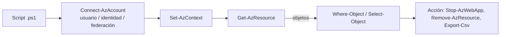

# PowerShell para Azure

Parte de: [[07-Azure/10 Infraestructura como código/_Índice Infraestructura como código|Infraestructura como código]]

> [!info] Cómo avanzar
> `progreso`: **pendiente** → **viendo** (estudiando) → **visto** (contestaste la autoevaluación sin abrir las respuestas) → **dominado** (hiciste el laboratorio o lo aplicaste de verdad).

## Contenido

### Qué es
**Azure PowerShell** es el conjunto de cmdlets para administrar Azure desde PowerShell. El módulo vigente es **Az** (`Install-Module Az`); el antiguo **AzureRM** está retirado y no debe usarse en nada nuevo. Az funciona en **PowerShell 7** en Windows, Linux y macOS, y viene preinstalado en Azure Cloud Shell y en los agentes hospedados de Azure Pipelines. Es la alternativa a [[Azure CLI]] para scripts y automatización; ambos hablan con el mismo Resource Manager.

### Cómo funciona
Los cmdlets siguen el patrón **Verbo-AzSustantivo**: `Get-AzWebApp`, `New-AzResourceGroup`, `Set-AzKeyVaultSecret`, `Remove-AzResourceGroup`. Az está dividido en submódulos (`Az.Accounts`, `Az.Resources`, `Az.Websites`, `Az.KeyVault`, `Az.Sql`…); puedes instalar solo los que necesitas para que los scripts carguen más rápido.

**Equivalencias con la CLI:**

| Azure CLI | Azure PowerShell |
|---|---|
| `az login` | `Connect-AzAccount` |
| `az account set --subscription <id>` | `Set-AzContext -Subscription <id>` |
| `az group create -n rg-lab -l eastus` | `New-AzResourceGroup -Name rg-lab -Location eastus` |
| `az group delete -n rg-lab` | `Remove-AzResourceGroup -Name rg-lab` |
| `az resource list -g rg-lab` | `Get-AzResource -ResourceGroupName rg-lab` |
| `az deployment group create -f main.bicep` | `New-AzResourceGroupDeployment -TemplateFile main.bicep` |

**La gran ventaja: objetos, no texto.** La CLI devuelve JSON que filtras con `--query` (JMESPath) o con `jq`. PowerShell devuelve **objetos .NET** con propiedades tipadas, que encadenas con el pipeline: `Where-Object`, `Select-Object`, `Sort-Object`, `Group-Object`, `ForEach-Object`, y exportas con `Export-Csv` o `ConvertTo-Json`. Para quien ya piensa en C#, es natural: `$app.State`, `$app.HostNames`, `$recurso.Tags['owner']`. Además tienes manejo de errores con `try/catch`, `-ErrorAction Stop`, parámetros tipados, `-WhatIf` en muchos cmdlets destructivos y módulos propios.



### Ejemplo
Script de limpieza para laboratorios: lista grupos de recursos con la etiqueta `proposito=lab` creados hace más de 3 días y los borra (con `-WhatIf` primero). Útil junto con [[Cómo borrar recursos al terminar una práctica]] y [[Azure - etiquetas (tags)]].

```powershell
#Requires -Modules Az.Accounts, Az.Resources
param(
    [Parameter(Mandatory)] [string] $SubscriptionId,
    [int] $DiasMaximos = 3,
    [switch] $Ejecutar
)

Connect-AzAccount -UseDeviceAuthentication | Out-Null
Set-AzContext -Subscription $SubscriptionId | Out-Null

$limite = (Get-Date).ToUniversalTime().AddDays(-$DiasMaximos)

$grupos = Get-AzResourceGroup -Tag @{ proposito = 'lab' } |
    Where-Object { $_.Tags['creado'] -and ([datetime]$_.Tags['creado']) -lt $limite }

$grupos | Select-Object ResourceGroupName, Location, @{ n = 'Creado'; e = { $_.Tags['creado'] } } |
    Format-Table

foreach ($g in $grupos) {
    if ($Ejecutar) {
        Remove-AzResourceGroup -Name $g.ResourceGroupName -Force -AsJob | Out-Null
        Write-Host "Borrando $($g.ResourceGroupName)..."
    } else {
        Remove-AzResourceGroup -Name $g.ResourceGroupName -WhatIf
    }
}

# Otro ejemplo de filtrado con objetos, sin JMESPath:
# Get-AzResource -ResourceGroupName rg-lab | Where-Object ResourceType -like '*sites*' | Select-Object Name, Location
```

En Azure Pipelines, la tarea `AzurePowerShell@5` usa una service connection (ver [[Azure Pipelines - service connections]]) y ya entrega el contexto autenticado; no llames a `Connect-AzAccount` dentro del script en ese caso.

### Cuándo usarlo y cuándo no
Usa PowerShell cuando tu automatización tiene **lógica** (condiciones, ciclos, reportes, transformación de datos), cuando trabajas en Windows o con administradores que ya lo conocen, o para runbooks de Azure Automation. La CLI es más cómoda para comandos sueltos y scripts bash cortos en Linux. Ninguno reemplaza a la IaC declarativa: para **crear y mantener** infraestructura usa [[Bicep]] o [[Terraform]], y deja PowerShell para operación (limpieza, reportes de costos, rotaciones, tareas puntuales). Ver [[Azure Portal vs CLI vs IaC]].

### Errores comunes
- **Instalar AzureRM** o mezclarlo con Az: está retirado y los cmdlets chocan.
- **Trabajar en la suscripción equivocada**: siempre `Set-AzContext` explícito al inicio y verifica con `Get-AzContext`.
- **Parsear la salida con texto** (`Out-String` y expresiones regulares) en lugar de usar las propiedades del objeto.
- **Comandos destructivos sin `-WhatIf`** la primera vez.
- **Guardar credenciales en el script**: usa tu sesión interactiva, Managed Identity (`Connect-AzAccount -Identity`) o la service connection del pipeline.

### Para profundizar
- [¿Qué es Azure PowerShell?](https://learn.microsoft.com/powershell/azure/what-is-azure-powershell)
- [Instalar el módulo Az](https://learn.microsoft.com/powershell/azure/install-azure-powershell)
- [Migrar de AzureRM a Az](https://learn.microsoft.com/powershell/azure/migrate-from-azurerm-to-az)

## Autoevaluación

Contesta primero en voz alta o en papel; luego despliega la respuesta.

> [!question]- ¿Qué módulo usas hoy para administrar Azure con PowerShell?
> El módulo **Az** (`Install-Module Az`). AzureRM está retirado. Funciona en PowerShell 7 en Windows, Linux y macOS.

> [!question]- Equivalentes de `az login`, `az account set` y `az group create`.
> `Connect-AzAccount`, `Set-AzContext -Subscription <id>`, `New-AzResourceGroup -Name rg-lab -Location eastus`.

> [!question]- ¿Qué ventaja tiene PowerShell frente a la CLI en scripts?
> Devuelve **objetos**, no texto: puedes filtrar y seleccionar propiedades sin JMESPath, p. ej. `Get-AzResource -ResourceGroupName rg-lab | Where-Object ResourceType -like '*sites*' | Select-Object Name`.

