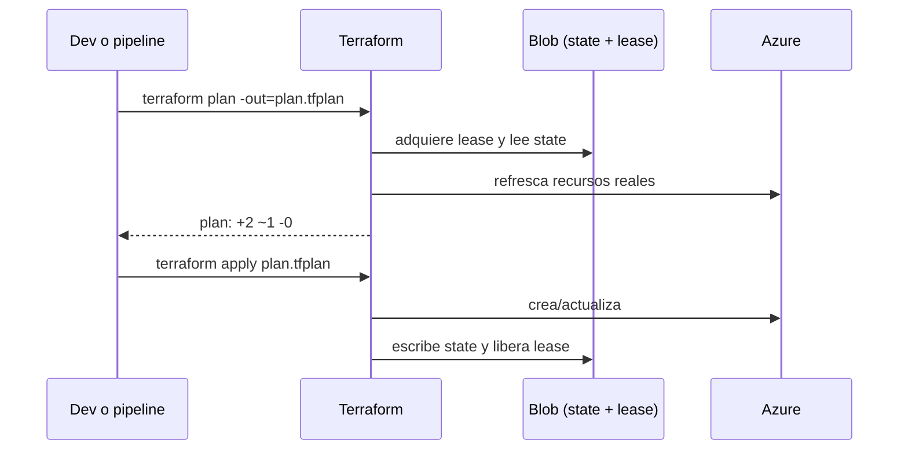

# Terraform

Parte de: [[07-Azure/10 Infraestructura como código/_Índice Infraestructura como código|Infraestructura como código]]

> [!info] Cómo avanzar
> `progreso`: **pendiente** → **viendo** (estudiando) → **visto** (contestaste la autoevaluación sin abrir las respuestas) → **dominado** (hiciste el laboratorio o lo aplicaste de verdad).

## Contenido

### Qué es
**Terraform**, de HashiCorp, es una herramienta de infraestructura como código **multi-proveedor**: con el mismo lenguaje (**HCL**) y el mismo flujo administras Azure, AWS, GCP, GitHub, Cloudflare, Datadog, Kubernetes y cientos de servicios más, mediante **providers**. Para Azure el provider principal es **`azurerm`** (y `azapi` para acceder directamente a cualquier API de Resource Manager). A diferencia de [[Bicep]], Terraform lleva su propio **state**.

### Cómo funciona
**El ciclo:**
1. `terraform init`: descarga providers y configura el **backend** donde vive el state.
2. `terraform plan`: compara tu código con el state y con lo real en Azure, y muestra qué crearía, cambiaría o destruiría.
3. `terraform apply`: ejecuta el plan (idealmente un plan guardado con `-out`).
4. `terraform destroy`: elimina todo lo que administra esa configuración; ideal para limpiar laboratorios.
Más `terraform fmt` y `terraform validate` para formato y validación antes de hacer commit.

**El state** es un archivo JSON con el mapeo entre cada recurso de tu código (`azurerm_linux_web_app.api`) y el recurso real (su id en Azure), más los atributos conocidos. Es delicado porque:
- Si se **pierde o se corrompe**, Terraform ya no sabe qué administra: intentará crear todo de nuevo o tendrás que importar recurso por recurso.
- Puede contener **secretos en texto plano** (contraseñas generadas, cadenas de conexión, llaves de cuentas).
- Si **dos personas** hacen `apply` a la vez con copias distintas, se pisan.

**Dónde guardarlo en un equipo que usa Azure:** en un **backend remoto `azurerm`**, que es un contenedor de **Blob Storage**. Ventajas: un solo state compartido, **bloqueo** mediante un *lease* del blob (si alguien está aplicando, el otro espera o falla), versionado y soft delete del blob para recuperar versiones, cifrado en reposo y control de acceso con RBAC (autenticando con Entra en lugar de la llave de la cuenta). Nunca lo subas al repositorio.



### Ejemplo
Configuración mínima para Itzamna.Dionisio con backend remoto. La versión mayor del provider `azurerm` vigente es la 5.x (la 5.0 salió en julio de 2026); revisa su guía de actualización si vienes de 4.x.

```hcl
# versions.tf
terraform {
  required_providers {
    azurerm = {
      source  = "hashicorp/azurerm"
      version = "~> 5.0"
    }
  }
  backend "azurerm" {
    resource_group_name  = "rg-tfstate"
    storage_account_name = "sttfstateitzamna"
    container_name       = "tfstate"
    key                  = "dionisio/prod.tfstate"
    use_azuread_auth     = true          # RBAC en vez de la llave de la cuenta
  }
}

provider "azurerm" {
  features {}
  subscription_id = var.subscription_id
}

# main.tf
variable "subscription_id" { type = string }
variable "ambiente"        { type = string }

resource "azurerm_resource_group" "rg" {
  name     = "rg-dionisio-${var.ambiente}"
  location = "mexicocentral"
  tags     = { sistema = "dionisio", ambiente = var.ambiente }
}

resource "azurerm_service_plan" "plan" {
  name                = "plan-dionisio-${var.ambiente}"
  resource_group_name = azurerm_resource_group.rg.name
  location            = azurerm_resource_group.rg.location
  os_type             = "Linux"
  sku_name            = "B1"
}

resource "azurerm_linux_web_app" "api" {
  name                = "app-dionisio-${var.ambiente}"
  resource_group_name = azurerm_resource_group.rg.name
  location            = azurerm_resource_group.rg.location
  service_plan_id     = azurerm_service_plan.plan.id
  https_only          = true
  identity { type = "SystemAssigned" }
  site_config {}
}

output "url" { value = "https://${azurerm_linux_web_app.api.default_hostname}" }
```

```bash
# Una sola vez: crear la cuenta del state (con versionado de blobs)
az group create -n rg-tfstate -l mexicocentral
az storage account create -n sttfstateitzamna -g rg-tfstate --sku Standard_LRS \
  --allow-blob-public-access false --min-tls-version TLS1_2
az storage container create -n tfstate --account-name sttfstateitzamna --auth-mode login
az storage account blob-service-properties update -n sttfstateitzamna -g rg-tfstate --enable-versioning true

terraform init
terraform plan -var ambiente=prod -var subscription_id=<id> -out plan.tfplan
terraform apply plan.tfplan
```

Tu identidad (o la de la service connection) necesita *Storage Blob Data Contributor* sobre el contenedor del state. Revisa en la documentación del provider los argumentos de `site_config` para fijar el runtime .NET, porque cambian entre versiones mayores.

### Cuándo usarlo y cuándo no
**¿Bicep o Terraform?**
- **Bicep**: solo Azure, **sin state** que proteger, soporte inmediato de servicios nuevos, `what-if` nativo, gratis y sin herramientas extra.
- **Terraform**: **multi-nube y multi-proveedor** (puedes crear el repo en GitHub, el DNS en Cloudflare y la app en Azure en un solo plan), ecosistema enorme de módulos y experiencia transferible entre nubes; a cambio administras el state y esperas a que el provider soporte lo nuevo (o usas `azapi`).
Si tu mundo es Azure y Azure DevOps, Bicep es el camino corto. Si tu empresa ya estandarizó Terraform o administras varias plataformas, Terraform.

### Errores comunes
- **State local en la laptop** o en el repositorio: se pierde, se duplica o expone secretos.
- **Cambios manuales en el portal** sobre recursos administrados por Terraform: el siguiente `plan` intenta revertirlos (*drift*).
- **`apply` sin revisar el plan**: un cambio de nombre puede significar destruir y recrear una base de datos. Usa `lifecycle { prevent_destroy = true }` en recursos críticos.
- **Un solo state gigante** para todo: planes lentos y radio de impacto enorme. Divide por sistema y ambiente (`dionisio/prod.tfstate`).
- **Versión del provider sin fijar**: un `init` nuevo baja una versión mayor con cambios incompatibles.

### Para profundizar
- [Terraform en Azure (Microsoft Learn)](https://learn.microsoft.com/azure/developer/terraform/overview)
- [Guardar el state de Terraform en Azure Storage](https://learn.microsoft.com/azure/developer/terraform/store-state-in-azure-storage)
- [Documentación del provider azurerm](https://registry.terraform.io/providers/hashicorp/azurerm/latest/docs)
- [Backend azurerm (documentación de Terraform)](https://developer.hashicorp.com/terraform/language/backend/azurerm)

## Autoevaluación

Contesta primero en voz alta o en papel; luego despliega la respuesta.

> [!question]- ¿Qué es el *state* de Terraform y por qué es delicado?
> Archivo con el mapeo entre tu código y los recursos reales. Si se pierde o se corrompe, Terraform no sabe qué administra. Puede contener **secretos** en texto plano.

> [!question]- ¿Dónde guardas el state en un equipo que usa Azure?
> En un **backend remoto** `azurerm` (un contenedor de Blob Storage), que además bloquea el archivo con un *lease* para que dos `apply` no corran a la vez.

> [!question]- Ciclo básico de comandos.
> `terraform init` (proveedores y backend) → `terraform plan` (qué cambiaría) → `terraform apply` → `terraform destroy` para limpiar.

> [!question]- ¿Bicep o Terraform?
> Bicep: solo Azure, sin state, soporte inmediato de servicios nuevos. Terraform: multi-nube y multi-proveedor (GitHub, Cloudflare…), gran ecosistema, a cambio de administrar el state.

