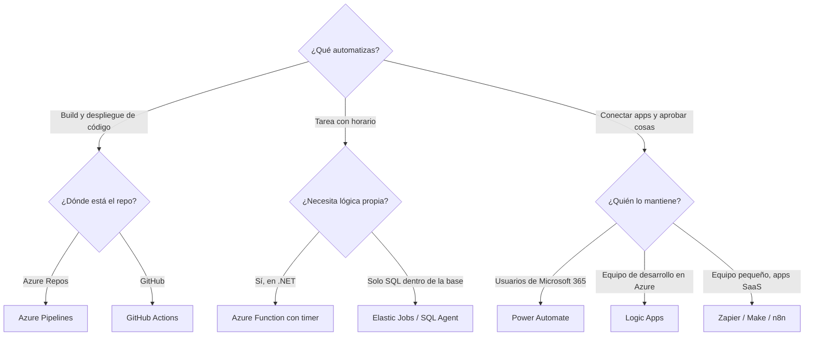

# Alternativas para automatizar (comparativa)

Parte de: [[08-Automatizacion-DevOps/01 Automatización y CICD/_Índice Automatización y CICD|Automatización y CICD]]

> [!info] Cómo avanzar
> `progreso`: **pendiente** → **viendo** (estudiando) → **visto** (contestaste la autoevaluación sin abrir las respuestas) → **dominado** (hiciste el laboratorio o lo aplicaste de verdad).

## Contenido

### Qué es
«Automatizar» cubre cosas muy distintas: compilar y desplegar código, correr una tarea cada noche, conectar dos aplicaciones SaaS, o reaccionar a un correo. Para cada tipo de problema hay una familia de herramientas, y elegir mal sale caro: un flujo de negocio metido en un pipeline de CI es difícil de mantener, y un despliegue armado en Power Automate es frágil. Esta nota es un mapa para decidir.

### Cómo funciona
Agrupa las opciones por **qué dispara** la automatización y **quién la mantiene**:

| Familia | Herramientas | Disparador típico | Quién la mantiene |
|---|---|---|---|
| CI/CD | [[Azure Pipelines]], [[GitHub Actions]], [[Jenkins (conceptos)]] | push, PR, tag | Desarrollo |
| Tareas programadas con código | [[Azure Functions programadas]], [[cron y Programador de tareas]], Elastic Jobs, SQL Agent | horario | Desarrollo / Operaciones |
| Scripts | [[Scripts con PowerShell]], [[Scripts con bash]], [[Scripts con Python]] | manual, pipeline, horario | Quien los escribe |
| Integración low-code en Azure | [[Logic Apps]] | evento, horario, HTTP | Desarrollo / integración |
| Automatización de oficina | [[Power Automate]] | correo, SharePoint, Teams | Usuarios de negocio |
| iPaaS SaaS | [[Zapier y Make]] | eventos de apps SaaS | Usuarios / marketing |
| Automatización autohospedable | [[n8n]] | webhook, horario | Desarrollo |
| Infraestructura | [[Bicep]], [[Terraform]], [[Pulumi]] | pipeline | Desarrollo / plataforma |

### Ejemplo
**CI/CD de una API.** Si el código vive en Azure Repos, Azure Pipelines es la opción natural: se integra con Boards (work items ligados a commits), environments con aprobaciones y service connections a Azure. Si el repo está en GitHub, GitHub Actions responde a eventos del repo y tiene un marketplace enorme. Ambas despliegan a Azure sin problema; lo que decide es dónde vive el código y la gobernanza del equipo.

**Tarea nocturna que borra registros viejos de Azure SQL.** Opciones, de más simple a más flexible:
1. Un procedimiento `dbo.usp_PurgarBitacora` ejecutado por **Elastic Jobs** (Azure SQL Database no tiene SQL Agent; Managed Instance sí).
2. Una **Azure Function con timer trigger** que llama al procedimiento con Dapper; te da logs en [[Application Insights]] y reintentos.
3. Un **pipeline programado** (`schedules:` en YAML) que corre `sqlcmd`. Sirve, pero mezcla CI con operación.
4. Una **Logic App** con el conector de SQL Server, si prefieres no escribir código.

Para el contexto del usuario (equipo .NET, Azure), la Function es la más mantenible: el código vive en el repo, se versiona y se despliega con el mismo pipeline.

### Cuándo usarlo y cuándo no
- **Logic Apps o Power Automate en vez de script/pipeline** cuando el flujo es de integración entre servicios (correo, SharePoint, Dynamics, aprobaciones humanas), cambia seguido y aprovecha conectores ya hechos. No los uses para lógica de negocio compleja ni para builds.
- **n8n vs Zapier/Make**: los tres son editores visuales de flujos con conectores. Zapier y Make son SaaS y cobran por ejecución de pasos; n8n se puede **autohospedar** (con licencia *Sustainable Use*), lo que te da control de datos y costo fijo de infraestructura, pero tú lo operas: respaldos, actualizaciones y seguridad.
- **Scripts** cuando la tarea es puntual y técnica; en cuanto se repite y otros dependen de ella, muévela a una Function o pipeline con monitoreo.

### Errores comunes
1. **Elegir por moda.** Evalúa disparador, mantenedor, costo por ejecución y observabilidad.
2. **Automatizaciones huérfanas.** Un Zap creado con la cuenta personal de alguien deja de funcionar cuando esa persona se va. Usa cuentas de servicio y documenta.
3. **Sin monitoreo.** Una tarea nocturna que falla en silencio durante semanas es peor que no tenerla. Alertas en fallos, siempre.
4. **Secretos pegados en el flujo.** Usa [[Managed Identity]] o [[Key Vault]].

### Para profundizar
- [Azure Logic Apps: ¿qué es?](https://learn.microsoft.com/azure/logic-apps/logic-apps-overview)
- [Comparar Logic Apps, Power Automate y Functions](https://learn.microsoft.com/azure/azure-functions/functions-compare-logic-apps-ms-flow-webjobs)
- [Elastic Jobs en Azure SQL](https://learn.microsoft.com/azure/azure-sql/database/elastic-jobs-overview)

## Autoevaluación

Contesta primero en voz alta o en papel; luego despliega la respuesta.

> [!question]- ¿Qué herramienta usarías para CI/CD de una API en Azure Repos y cuál si el repo está en GitHub?
> Azure Repos → **Azure Pipelines** (integración nativa con Boards, environments, service connections). GitHub → **GitHub Actions** (eventos del repo, marketplace). Ambas despliegan a Azure.

> [!question]- ¿Cuándo eliges Logic Apps/Power Automate en vez de un script o pipeline?
> Para **flujos de negocio** que conectan servicios SaaS (correo, Teams, SharePoint, CRM) con conectores listos y los puede mantener alguien no programador. Para build/deploy, pipeline; para lógica compleja, código.

> [!question]- n8n vs Zapier/Make: ¿qué cambia?
> n8n se puede **autohospedar** (con Docker) y controlas datos y costo; Zapier y Make son SaaS listos para usar, cobrando por tareas u operaciones (verificar en la página oficial).

> [!question]- Tarea nocturna que limpia registros viejos de tu base Azure SQL. ¿Opciones?
> Function con timer trigger, Elastic Jobs, Logic App programada o un pipeline programado (`schedules:`). En un servidor propio, cron o el Programador de tareas. Elige según dónde vive y quién lo mantiene.

