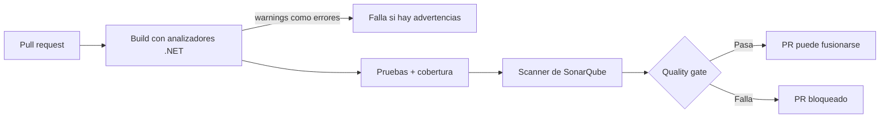

# Análisis estático (SonarQube y linters)

Parte de: [[08-Automatizacion-DevOps/01 Automatización y CICD/_Índice Automatización y CICD|Automatización y CICD]]

> [!info] Cómo avanzar
> `progreso`: **pendiente** → **viendo** (estudiando) → **visto** (contestaste la autoevaluación sin abrir las respuestas) → **dominado** (hiciste el laboratorio o lo aplicaste de verdad).

## Contenido

### Qué es
El **análisis estático** examina el código **sin ejecutarlo** para encontrar bugs probables, vulnerabilidades, código duplicado, complejidad excesiva y violaciones de estilo. Se hace con **linters** y **analizadores** que corren en el IDE y en el pipeline: los analizadores Roslyn de .NET, ESLint para JavaScript/TypeScript, y plataformas como **SonarQube** que agregan resultados, métricas e historial por proyecto.

### Cómo funciona
**En .NET** el SDK ya incluye los **analizadores de calidad de código** (reglas `CAxxxx`) y de estilo (`IDExxxx`). Se configuran con:
- `<AnalysisLevel>` en el `.csproj` o `Directory.Build.props` (por ejemplo `latest-recommended`) para el conjunto de reglas activas.
- Un archivo **`.editorconfig`** para ajustar la severidad de cada regla (`none`, `suggestion`, `warning`, `error`).
- `<EnforceCodeStyleInBuild>true</EnforceCodeStyleInBuild>` para que las reglas de estilo también se evalúen al compilar.
- **`<TreatWarningsAsErrors>true</TreatWarningsAsErrors>`** para que **cualquier advertencia rompa el build**. En CI se puede activar solo ahí con `dotnet build -warnaserror` o `/p:TreatWarningsAsErrors=true`.

**En el front** (Itzamna.Clio con React + Vite + TypeScript), ESLint con su configuración plana (`eslint.config.js`) y `tsc --noEmit` para errores de tipos.

**SonarQube** analiza el código en el pipeline (con el *scanner*) y publica en un servidor:
- **Issues** clasificados como bugs, vulnerabilidades, *code smells* y *security hotspots*.
- **Métricas**: cobertura (importada de tus reportes de pruebas), duplicación, complejidad.
- **Quality gate**: un conjunto de **condiciones** que el proyecto debe cumplir para considerarse aceptable, por ejemplo «cobertura de código nuevo ≥ 80 %, 0 bugs nuevos, 0 vulnerabilidades nuevas, duplicación de código nuevo < 3 %». Si no se cumple, el gate falla y el pipeline o el PR pueden bloquearse.
- El enfoque recomendado es **«código nuevo limpio»**: las condiciones se aplican al código **cambiado o nuevo**, no a todo el histórico.

Ediciones: **SonarQube Community Build** (gratis, autohospedado), ediciones comerciales de **SonarQube Server**, y **SonarQube Cloud**, cuyo plan gratuito cubre proyectos de código abierto y privados hasta 50 mil líneas de código según su página. La edición gratuita autohospedada no incluye análisis de ramas ni decoración de PR, que vienen en ediciones de pago. **SonarQube for IDE** (antes SonarLint) da retroalimentación en el editor.



### Ejemplo
`Directory.Build.props` en la raíz de [[Itzamna.Dionisio]]:

```xml
<Project>
  <PropertyGroup>
    <Nullable>enable</Nullable>
    <AnalysisLevel>latest-recommended</AnalysisLevel>
    <EnforceCodeStyleInBuild>true</EnforceCodeStyleInBuild>
    <TreatWarningsAsErrors>true</TreatWarningsAsErrors>
  </PropertyGroup>
</Project>
```

```ini
# .editorconfig
[*.cs]
dotnet_diagnostic.CA2007.severity = none        # ConfigureAwait: innecesario en ASP.NET Core
dotnet_diagnostic.CA1848.severity = suggestion  # LoggerMessage: recomendado, no bloqueante
dotnet_diagnostic.IDE0005.severity = warning    # usings innecesarios
```

Análisis con SonarQube desde un pipeline (CLI del scanner para .NET):

```bash
dotnet tool install --global dotnet-sonarscanner
dotnet sonarscanner begin /k:"itzamna-dionisio" \
  /d:sonar.host.url="$SONAR_URL" /d:sonar.token="$SONAR_TOKEN" \
  /d:sonar.cs.opencover.reportsPaths="**/coverage.opencover.xml"
dotnet build -c Release
dotnet test -c Release --collect:"XPlat Code Coverage" -- DataCollectionRunSettings.DataCollector.Configuration.Format=opencover
dotnet sonarscanner end /d:sonar.token="$SONAR_TOKEN"
```

En Azure DevOps también existe la extensión de SonarQube con tareas *Prepare*, *Analyze* y *Publish*, y se puede configurar el quality gate como requisito del PR.

### Cuándo usarlo y cuándo no
- Los **analizadores de .NET y ESLint**: siempre, son gratis y rápidos.
- **SonarQube** cuando hay varios proyectos o equipos y quieres métricas e historial centralizados; para un proyecto personal, los analizadores del SDK y SonarQube for IDE suelen bastar.
- Complementa, no sustituye, a la revisión de código ni a las [[Pruebas de seguridad en el pipeline]].

### Errores comunes
1. **Adoptar SonarQube en un proyecto viejo con un gate sobre todo el código**: aparecen miles de issues, el gate falla siempre y el equipo lo ignora o lo desactiva. Aplica el gate solo al **código nuevo** y limpia lo viejo gradualmente cuando toques cada archivo.
2. **Activar `TreatWarningsAsErrors` de golpe** en una solución con cientos de advertencias: hazlo por proyecto o arregla primero.
3. **Suprimir reglas sin justificación** con `#pragma warning disable`; documenta el motivo o ajusta en `.editorconfig`.
4. **Cobertura que no se importa** porque el formato o la ruta del reporte no coinciden: el gate falla por «0 % de cobertura».

### Para profundizar
- [Análisis de código en .NET](https://learn.microsoft.com/dotnet/fundamentals/code-analysis/overview)
- [Documentación de SonarQube Server](https://docs.sonarsource.com/sonarqube-server/)
- [Ediciones gratuitas de SonarQube](https://www.sonarsource.com/open-source-editions/)
- [ESLint: configuración](https://eslint.org/docs/latest/use/configure/)

## Autoevaluación

Contesta primero en voz alta o en papel; luego despliega la respuesta.

> [!question]- ¿Qué es el análisis estático?
> Revisar el código **sin ejecutarlo** para encontrar errores, malos olores, vulnerabilidades (SAST) y problemas de estilo: linters (ESLint, analizadores Roslyn), SonarQube/SonarCloud.

> [!question]- ¿Qué es un *quality gate*?
> Condiciones que el cambio debe cumplir para pasar (sin bugs nuevos críticos, cobertura mínima en código nuevo, duplicación baja). En el pipeline, si falla, el PR no se puede completar.

> [!question]- ¿Cómo haces que las advertencias de .NET bloqueen el build?
> `<TreatWarningsAsErrors>true</TreatWarningsAsErrors>` en el `.csproj` o `Directory.Build.props`, reglas en `.editorconfig` y `dotnet format --verify-no-changes` en el CI.

> [!question]- Error común al adoptar SonarQube en un proyecto viejo.
> Intentar arreglar miles de hallazgos de golpe. Enfócate en el **código nuevo** (*clean as you code*) y baja la deuda poco a poco. Ver [[SAST, DAST y SCA]].

## Práctica

- [[Lab 2 - GitHub Actions de build y pruebas]]

