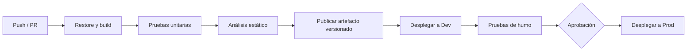

# CI y CD - conceptos

Parte de: [[08-Automatizacion-DevOps/01 Automatización y CICD/_Índice Automatización y CICD|Automatización y CICD]]

> [!info] Cómo avanzar
> `progreso`: **pendiente** → **viendo** (estudiando) → **visto** (contestaste la autoevaluación sin abrir las respuestas) → **dominado** (hiciste el laboratorio o lo aplicaste de verdad).

## Contenido

### Qué es
**Integración continua (CI)** es la práctica de integrar los cambios de todo el equipo a la rama principal muchas veces al día, y que **cada integración dispare automáticamente un build y un conjunto de pruebas** capaces de fallar. El objetivo es detectar conflictos y errores mientras todavía son pequeños y baratos de arreglar.

**Entrega continua (continuous delivery)** extiende la CI: cada cambio que pasa el pipeline queda en un estado **desplegable a producción**, y pasar a producción es una decisión de negocio (un clic o una aprobación). **Despliegue continuo (continuous deployment)** quita esa decisión: todo lo que pasa las verificaciones llega a producción solo, sin intervención humana. Las tres comparten la sigla CD, así que conviene aclarar de cuál hablas.

### Cómo funciona
Un pipeline típico tiene dos mitades. La de CI corre en cada push o pull request; la de CD toma el artefacto que produjo la CI y lo promueve por ambientes.



La regla de oro es **«construye una vez, despliega muchas»**: el binario (zip, imagen de contenedor, DACPAC) se genera **una sola vez** en la etapa de CI, se le pone una versión y se guarda como artefacto. Dev, QA y Prod reciben **ese mismo artefacto**; lo único que cambia entre ambientes es la configuración (variables, [[Key Vault]], app settings). Si recompilas por ambiente, lo que probaste en QA no es exactamente lo que llega a producción, y un rollback ya no es «volver a desplegar la versión anterior», sino «reconstruir algo que quizá ya no compila igual».

Prácticas que hacen que la CI sea real y no solo un build automático:
- Ramas de vida corta (horas o pocos días) o *trunk-based development*; ver [[Estrategias de ramas (GitFlow y trunk-based)]].
- Pruebas automatizadas que **bloquean** el merge si fallan (políticas de rama en Azure Repos o *branch protection* en GitHub).
- Build rápido: si tarda 40 minutos nadie espera el resultado y la retroalimentación se pierde.
- Arreglar un build roto es la prioridad del equipo; no se apilan cambios encima.

### Ejemplo
Para [[Itzamna.Dionisio]] en Azure DevOps, un pipeline YAML con etapa de CI y de CD:

```yaml
trigger:
  branches: { include: [ main ] }

stages:
- stage: CI
  jobs:
  - job: build
    pool: { vmImage: ubuntu-latest }
    steps:
    - task: UseDotNet@2
      inputs: { packageType: sdk, version: 10.0.x }
    - script: dotnet restore
    - script: dotnet build -c Release --no-restore
    - script: dotnet test -c Release --no-build --logger trx
    - script: dotnet publish src/Dionisio.Api -c Release -o $(Build.ArtifactStagingDirectory)/api --no-build
    - publish: $(Build.ArtifactStagingDirectory)/api
      artifact: api   # artefacto único que se promueve

- stage: Prod
  dependsOn: CI
  jobs:
  - deployment: deploy
    environment: dionisio-prod   # aquí se configuran aprobaciones
    strategy:
      runOnce:
        deploy:
          steps:
          - task: AzureWebApp@1
            inputs:
              azureSubscription: sc-dionisio-prod
              appName: app-dionisio-prod
              package: $(Pipeline.Workspace)/api
```

Con un *environment* que exige aprobación manual tienes **continuous delivery**; si quitas la aprobación y confías en pruebas automáticas y monitoreo, pasas a **continuous deployment**. Más detalle en [[Azure Pipelines]] y [[Azure Pipelines - environments y aprobaciones]].

### Cuándo usarlo y cuándo no
- CI conviene **siempre**, incluso en un proyecto personal: es barata y atrapa errores tontos.
- Continuous delivery es el estándar razonable para APIs de negocio.
- Continuous deployment exige buena cobertura de pruebas, [[Feature flags]], monitoreo y rollback rápido. Si falta alguno, quédate en delivery con aprobación.
- En sistemas regulados o con ventanas de cambio contractuales, la aprobación humana puede ser obligatoria.

### Errores comunes
1. **«Tenemos CI» porque el pipeline compila.** Sin pruebas que puedan fallar el build, solo confirmas que compila. Tampoco es CI si las ramas viven semanas sin integrarse.
2. **Recompilar por ambiente.** Rompe la trazabilidad. Publica un artefacto y promuévelo.
3. **Secretos en el YAML.** Usa variable groups ligados a Key Vault o service connections; ver [[Manejo de secretos]].
4. **Pruebas inestables (*flaky*) que se ignoran.** El equipo aprende a reintentar hasta que pase y deja de confiar en el pipeline. Ponlas en cuarentena y arréglalas.
5. **Pipeline lento sin caché.** Cachea paquetes NuGet/npm y paraleliza jobs.

### Para profundizar
- [Martin Fowler: Continuous Integration](https://martinfowler.com/articles/continuousIntegration.html)
- [Microsoft Learn: ¿Qué es la integración continua?](https://learn.microsoft.com/devops/develop/what-is-continuous-integration)
- [Documentación de Azure Pipelines](https://learn.microsoft.com/azure/devops/pipelines/)

## Autoevaluación

Contesta primero en voz alta o en papel; luego despliega la respuesta.

> [!question]- ¿Qué es integración continua (CI)?
> Integrar cambios a la rama principal **frecuentemente** (varias veces al día) y que cada integración dispare un build y pruebas automáticas. Detecta conflictos y errores cuando aún son pequeños.

> [!question]- Diferencia entre *continuous delivery* y *continuous deployment*.
> **Delivery**: cada cambio que pasa el pipeline queda **listo** para producción, pero alguien decide cuándo (aprobación). **Deployment**: si pasa, **se despliega solo** a producción, sin intervención.

> [!question]- ¿Qué significa «construye una vez, despliega muchas»?
> El CI produce un **artefacto versionado** que se promueve sin recompilar por dev → QA → prod. Así lo probado es lo desplegado y el rollback es redeplegar un artefacto anterior.

> [!question]- Error común: «tenemos CI» porque el pipeline compila.
> Sin pruebas automáticas que puedan fallar el build, el CI solo confirma que compila. Tampoco es CI si las ramas viven semanas sin integrarse.

## Práctica

- [[Lab 2 - GitHub Actions de build y pruebas]]

