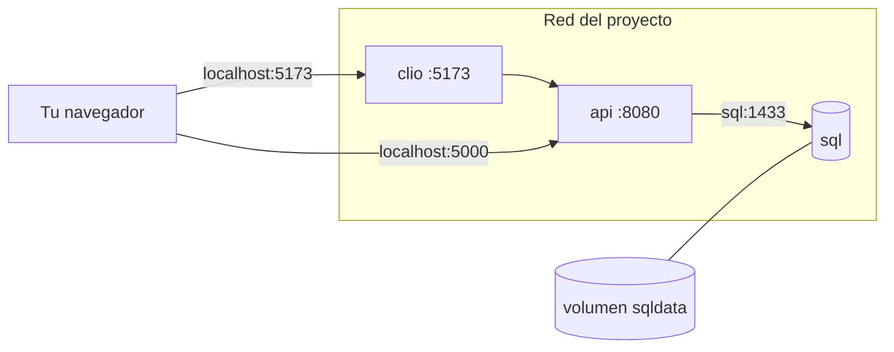

# Docker Compose

Parte de: [[08-Automatizacion-DevOps/01 Automatización y CICD/_Índice Automatización y CICD|Automatización y CICD]]

> [!info] Cómo avanzar
> `progreso`: **pendiente** → **viendo** (estudiando) → **visto** (contestaste la autoevaluación sin abrir las respuestas) → **dominado** (hiciste el laboratorio o lo aplicaste de verdad).

## Contenido

### Qué es
Docker Compose es la herramienta para **definir y levantar varios contenedores relacionados** con un solo archivo YAML (`compose.yaml`) y un solo comando. En lugar de recordar cinco `docker run` con sus redes, puertos y volúmenes, describes los servicios (API, SQL Server, Redis, el front) y ejecutas `docker compose up`. Es ideal para el ambiente local de desarrollo y para pruebas de integración.

### Cómo funciona
Compose crea por proyecto:
- Una **red** propia donde cada servicio es accesible por **su nombre** como hostname (DNS interno). El servicio `sql` se alcanza en `sql:1433`.
- Los **volúmenes con nombre** declarados, que persisten aunque borres los contenedores.
- Los contenedores de cada servicio, en el orden que indica `depends_on`.

Puntos que confunden:
- **`localhost` dentro de un contenedor es el propio contenedor.** Si tu API usa `Server=localhost,1433`, busca SQL Server dentro del contenedor de la API, donde no hay nada. Debe usar el nombre del servicio: `Server=sql,1433`. Ver [[Redes de contenedores (Docker y Kubernetes)]].
- **`depends_on` simple solo ordena el arranque**: espera a que el contenedor de SQL *inicie*, no a que SQL Server *acepte conexiones* (tarda varios segundos). Para esperar de verdad, define un `healthcheck` en el servicio de base y usa `depends_on` con `condition: service_healthy`. Aun así, la app debe tener reintentos al conectar ([[Reintentos con backoff]]).
- La clave `version:` al inicio del archivo es obsoleta en Compose v2; se ignora.



### Ejemplo
`compose.yaml` para [[Itzamna.Dionisio]] con SQL Server:

```yaml
services:
  sql:
    image: mcr.microsoft.com/mssql/server:2022-latest
    environment:
      ACCEPT_EULA: "Y"
      MSSQL_SA_PASSWORD: ${SA_PASSWORD}     # viene de un .env que NO se versiona
    ports:
      - "1433:1433"                         # para conectarte desde SSMS o Azure Data Studio
    volumes:
      - sqldata:/var/opt/mssql              # los datos sobreviven a 'down'
    healthcheck:
      test: ["CMD-SHELL", "/opt/mssql-tools18/bin/sqlcmd -S localhost -U sa -P \"$$MSSQL_SA_PASSWORD\" -C -Q 'SELECT 1' || exit 1"]
      interval: 10s
      timeout: 5s
      retries: 10
      start_period: 20s

  api:
    build: .
    environment:
      ASPNETCORE_ENVIRONMENT: Development
      ConnectionStrings__Dionisio: "Server=sql,1433;Database=Dionisio;User Id=sa;Password=${SA_PASSWORD};TrustServerCertificate=True"
    ports:
      - "5000:8080"
    depends_on:
      sql:
        condition: service_healthy          # espera a que SQL responda

volumes:
  sqldata:
```

Comandos del día a día:

```bash
docker compose up -d --build   # construye y levanta en segundo plano
docker compose logs -f api     # sigue los logs de un servicio
docker compose ps              # estado y salud de cada servicio
docker compose down            # borra contenedores y red; conserva volúmenes
docker compose down -v         # además BORRA los volúmenes con nombre: pierdes la base local
```

`down -v` es útil cuando quieres empezar con una base limpia (por ejemplo, para volver a correr tus scripts de migración desde cero), pero hazlo a propósito.

### Cuándo usarlo y cuándo no
- **Úsalo** para desarrollo local multi-servicio, demos y pruebas de integración en CI (también puedes usar [[Testcontainers]] desde las pruebas).
- **No es un orquestador de producción**: no reparte carga entre nodos ni se recupera de la caída de un servidor. En Azure usa [[Container Apps]] o [[AKS (conceptos)]].
- Para un solo contenedor, un `docker run` basta.

### Errores comunes
1. **`localhost` en la cadena de conexión.** Usa el nombre del servicio.
2. **Confiar en `depends_on` sin healthcheck.** La API arranca, falla al conectar y se cae.
3. **Contraseñas en el YAML versionado.** Usa un archivo `.env` en `.gitignore` o variables del shell.
4. **Borrar datos sin querer** con `down -v`.
5. **Choque de puertos** con un SQL Server instalado en Windows que ya usa 1433: mapea `"14333:1433"`.
6. **Confundir `ports` con la comunicación interna.** `ports:` solo hace falta para entrar **desde tu máquina**; entre servicios de la misma red se usan el nombre y el puerto interno, sin publicar nada.

### Tips para el día a día
- **Archivos de override**: `compose.override.yaml` se aplica automáticamente encima del principal; úsalo para montar el código fuente o cambiar variables solo en tu máquina.
- **Perfiles** (`profiles: [herramientas]`) para servicios opcionales como un visor de logs, que solo se levantan con `docker compose --profile herramientas up`.
- **Scripts de inicialización**: para crear la base y correr tus scripts `.sql` al arrancar, agrega un servicio de una sola ejecución que use la imagen con `sqlcmd` y `depends_on: sql: condition: service_healthy`, o deja que la API aplique las migraciones con DbUp al iniciar en desarrollo.
- **En CI**: `docker compose up -d --wait` espera a que los servicios con healthcheck estén sanos antes de seguir con las pruebas de integración.

### Para profundizar
- [Documentación de Docker Compose](https://docs.docker.com/compose/)
- [Referencia del archivo Compose](https://docs.docker.com/reference/compose-file/)
- [Controlar el orden de arranque en Compose](https://docs.docker.com/compose/how-tos/startup-order/)

## Autoevaluación

Contesta primero en voz alta o en papel; luego despliega la respuesta.

> [!question]- ¿Para qué sirve Docker Compose?
> Definir y levantar **varios contenedores** relacionados (API + SQL + Redis) con un archivo `compose.yaml`: `docker compose up -d`, `docker compose logs -f`, `docker compose down`.

> [!question]- Tu API intenta conectarse a `localhost:1433` y falla dentro de Compose. ¿Por qué?
> Dentro del contenedor, `localhost` es **el propio contenedor**. Los servicios se encuentran por **nombre de servicio** en la red de Compose: `Server=db,1433`.

> [!question]- ¿`depends_on` espera a que SQL Server esté listo?
> Solo espera a que **arranque** el contenedor. Para esperar a que esté sano, define un `healthcheck` en `db` y usa `depends_on: db: condition: service_healthy`. Aun así, agrega reintentos en la app.

> [!question]- ¿Qué hace `docker compose down -v`?
> Detiene y borra contenedores y redes **y los volúmenes** declarados: pierdes los datos de la base. Sin `-v`, los volúmenes se conservan.

## Práctica

- [[Lab 1 - Dockerfile y Docker Compose de una API con SQL Server]]

