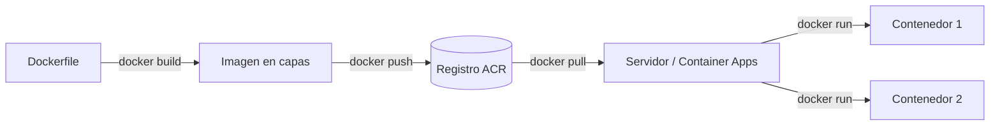

# Docker

Parte de: [[08-Automatizacion-DevOps/01 Automatización y CICD/_Índice Automatización y CICD|Automatización y CICD]]

> [!info] Cómo avanzar
> `progreso`: **pendiente** → **viendo** (estudiando) → **visto** (contestaste la autoevaluación sin abrir las respuestas) → **dominado** (hiciste el laboratorio o lo aplicaste de verdad).

## Contenido

### Qué es
Docker es una plataforma para **empaquetar una aplicación con todo lo que necesita** (runtime, librerías, archivos de configuración) en una **imagen**, y ejecutarla como **contenedor** aislado en cualquier máquina con un motor de contenedores. Resuelve el clásico «en mi máquina sí funciona»: si la imagen corre en tu laptop, corre igual en el pipeline, en Azure Container Apps o en Kubernetes.

### Cómo funciona
- **Imagen**: plantilla **inmutable** de solo lectura, formada por **capas** apiladas. Cada instrucción del `Dockerfile` (`FROM`, `COPY`, `RUN`) genera una capa. Se identifica por nombre y etiqueta (`dionisio-api:1.4.2`) y por un *digest* SHA256.
- **Contenedor**: una **instancia en ejecución** de una imagen, con una capa escribible encima, su propio sistema de archivos, red y procesos. De una imagen puedes levantar muchos contenedores. La analogía: la imagen es la clase, el contenedor es el objeto.
- **Registro**: donde se guardan y distribuyen imágenes (Docker Hub, [[Container Registry]] de Azure).
- **Caché de capas**: al reconstruir, Docker reutiliza las capas cuyas instrucciones y archivos de entrada no cambiaron. En cuanto una capa cambia, todas las de abajo se reconstruyen.



**Build multi-etapa.** Para compilar .NET necesitas el **SDK** (cientos de MB); para ejecutar basta el **runtime de ASP.NET Core**. Un Dockerfile multi-etapa compila en una etapa con la imagen `sdk` y copia solo el resultado publicado a una etapa final con la imagen `aspnet`. La imagen final es más chica, arranca más rápido y no contiene compiladores ni código fuente, lo que reduce la superficie de ataque.

**Orden de las capas.** Copiar primero solo el `.csproj` y ejecutar `dotnet restore` crea una capa que depende únicamente de las dependencias. Si después cambias un `.cs`, esa capa se reutiliza desde la caché y no se vuelven a descargar los paquetes NuGet. Si copias todo el código antes del restore, cualquier cambio invalida la caché y cada build tarda lo mismo que el primero.

### Ejemplo
Dockerfile para [[Itzamna.Dionisio]] con .NET 10:

```dockerfile
# Etapa 1: compilar con el SDK
FROM mcr.microsoft.com/dotnet/sdk:10.0 AS build
WORKDIR /src
# Solo el proyecto primero: esta capa se cachea mientras no cambien dependencias
COPY src/Dionisio.Api/Dionisio.Api.csproj src/Dionisio.Api/
RUN dotnet restore src/Dionisio.Api/Dionisio.Api.csproj
# Ahora sí, el resto del código
COPY . .
RUN dotnet publish src/Dionisio.Api -c Release -o /app --no-restore

# Etapa 2: solo el runtime
FROM mcr.microsoft.com/dotnet/aspnet:10.0 AS final
WORKDIR /app
COPY --from=build /app .
# Desde .NET 8 las imágenes escuchan en 8080 y traen un usuario sin privilegios
USER $APP_UID
EXPOSE 8080
ENTRYPOINT ["dotnet", "Dionisio.Api.dll"]
```

```bash
docker build -t dionisio-api:dev .
# -p publica: puerto 5000 del host -> 8080 del contenedor
docker run --rm -p 5000:8080 -e ASPNETCORE_ENVIRONMENT=Development dionisio-api:dev
```

Ojo: **`EXPOSE 8080` no publica nada**. Es documentación (metadato de la imagen) que indica en qué puerto escucha la app. Para que el host o la red lleguen al contenedor necesitas `-p` en `docker run` o `ports:` en [[Docker Compose]].

Agrega un `.dockerignore` con `bin/`, `obj/`, `.git/` y `*.user` para que el contexto de build sea pequeño y no se cuelen secretos locales.

### Cuándo usarlo y cuándo no
- **Úsalo** para ambientes de desarrollo reproducibles (SQL Server local en contenedor), para desplegar a Container Apps, AKS o App Service for Containers, y para builds aislados en CI.
- **No es obligatorio** para publicar una API a App Service: el despliegue de código (zip) es más simple si no necesitas dependencias nativas.
- Un contenedor **no es una VM**: comparte el kernel del host; para aislamiento fuerte entre clientes hostiles no basta.

### Errores comunes
1. **Datos de la base dentro del contenedor.** La capa escribible desaparece al borrar el contenedor, y con ella tus datos. Usa **volúmenes** (`-v sqldata:/var/opt/mssql`) o un servicio administrado como Azure SQL.
2. **Secretos en la imagen** (`COPY appsettings.Production.json` con contraseñas, o `ENV` con claves). Cualquiera con la imagen los lee capa por capa. Inyéctalos en tiempo de ejecución; ver [[Variables de entorno]] y [[Manejo de secretos]].
3. **Etiqueta `latest` en producción.** No sabes qué versión corre. Etiqueta con versión o SHA del commit.
4. **Correr como root.** Usa `USER $APP_UID` en imágenes .NET.
5. **Imágenes enormes** por no usar multi-etapa o por copiar `bin/obj`.

### Para profundizar
- [Documentación de Docker: conceptos](https://docs.docker.com/get-started/docker-overview/)
- [Contenerizar una app .NET (Microsoft Learn)](https://learn.microsoft.com/dotnet/core/docker/build-container)
- [Buenas prácticas para Dockerfile](https://docs.docker.com/build/building/best-practices/)

## Autoevaluación

Contesta primero en voz alta o en papel; luego despliega la respuesta.

> [!question]- Diferencia entre imagen y contenedor.
> La **imagen** es una plantilla inmutable en capas (SO base + runtime + tu app). El **contenedor** es una instancia en ejecución de esa imagen, con su capa escribible que se pierde al borrarlo.

> [!question]- ¿Por qué un build multi-etapa para .NET?
> Compilas con la imagen del **SDK** y copias solo el resultado a la imagen de **runtime** (`aspnet`): imagen final mucho más pequeña y sin herramientas de compilación. Ver [[Dockerfile para .NET]].

> [!question]- ¿`EXPOSE 8080` publica el puerto?
> No, solo lo documenta. Para acceder desde tu máquina usa `-p 5000:8080` (host:contenedor). Las imágenes de ASP.NET Core 8+ escuchan en **8080** por defecto.

> [!question]- ¿Por qué copiar primero el `.csproj` y hacer `restore` antes de copiar el resto?
> Por la **caché de capas**: si solo cambia código, Docker reutiliza la capa del restore y el build es mucho más rápido.

> [!question]- Error común: datos de la base dentro del contenedor.
> Al borrarlo se pierden. Usa un **volumen** (`-v sqldata:/var/opt/mssql`) para datos persistentes.

## Práctica

- [[Lab 1 - Dockerfile y Docker Compose de una API con SQL Server]]

