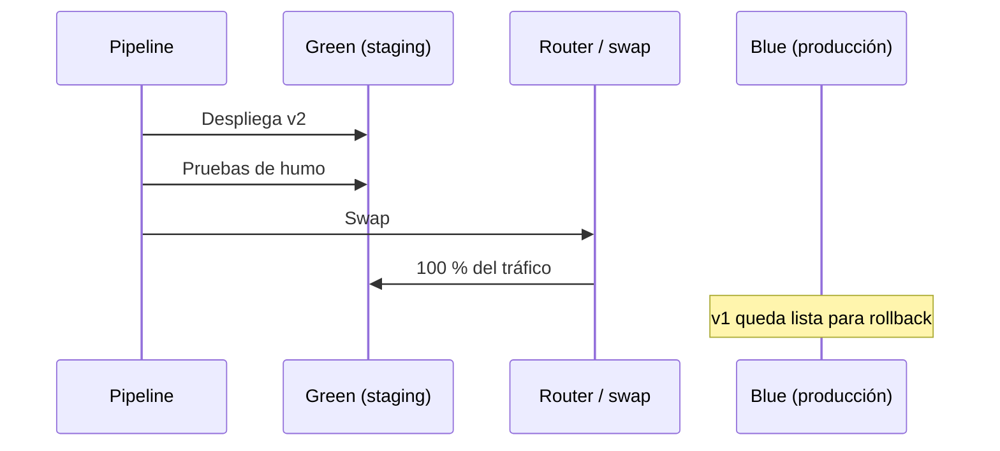

# Despliegue blue-green

Parte de: [[Estrategias de despliegue (blue-green y canary)]]

> [!info] Cómo avanzar
> `progreso`: **pendiente** → **viendo** (estudiando) → **visto** (contestaste la autoevaluación sin abrir las respuestas) → **dominado** (hiciste el laboratorio o lo aplicaste de verdad).

## Contenido

### Qué es
El despliegue **blue-green** mantiene **dos ambientes de producción idénticos**: «blue», que hoy recibe todo el tráfico, y «green», donde instalas la versión nueva. Cuando green está listo y verificado, **cambias el tráfico completo** de blue a green en un solo paso. Si algo sale mal, regresas el tráfico a blue, que sigue intacto con la versión anterior. Es parte de las [[Estrategias de despliegue (blue-green y canary)]].

### Cómo funciona
1. Blue (v1) atiende al 100 % de los usuarios.
2. Despliegas v2 en green. Green apunta a la **misma base de datos** (o a una compatible) y recibe la configuración de producción.
3. Calientas green y ejecutas **pruebas de humo** contra su URL directa: health checks, un login, una consulta crítica.
4. Cambias el enrutamiento: el router, balanceador o DNS manda todo el tráfico a green.
5. Observas métricas unos minutos. Si hay errores, vuelves a apuntar a blue (rollback en segundos).
6. Blue queda como respaldo hasta el siguiente despliegue, cuando los papeles se invierten.



**En App Service** se implementa con **deployment slots** ([[App Service - deployment slots]]): el slot `production` es blue y un slot `staging` es green. Despliegas al slot `staging` y haces **swap**. App Service calienta las instancias del slot destino antes de intercambiar los nombres de host, así que no hay caída. Algunas configuraciones se marcan como **slot setting** (se quedan pegadas al slot: por ejemplo, la cadena de conexión de staging si apunta a otra base) y otras viajan con el código. Los slots requieren plan **Standard o superior**.

### Ejemplo
Etapa de Azure Pipelines para [[Itzamna.Dionisio]]:

```yaml
- deployment: deploy_prod
  environment: dionisio-prod
  strategy:
    runOnce:
      deploy:
        steps:
        - task: AzureWebApp@1
          displayName: Desplegar a slot staging (green)
          inputs:
            azureSubscription: sc-dionisio-prod
            appName: app-dionisio-prod
            deployToSlotOrASE: true
            resourceGroupName: rg-dionisio-prod
            slotName: staging
            package: $(Pipeline.Workspace)/api
        - script: |
            # Prueba de humo contra el slot antes del swap
            code=$(curl -s -o /dev/null -w "%{http_code}" https://app-dionisio-prod-staging.azurewebsites.net/health/ready)
            test "$code" = "200"
          displayName: Prueba de humo
        - task: AzureAppServiceManage@0
          displayName: Swap staging -> production
          inputs:
            azureSubscription: sc-dionisio-prod
            Action: Swap Slots
            WebAppName: app-dionisio-prod
            ResourceGroupName: rg-dionisio-prod
            SourceSlot: staging
```

Rollback: otro swap (`staging` ↔ `production`) devuelve la v1, que quedó en el slot staging.

Fuera de App Service, blue-green se logra con dos revisiones en [[Container Apps]] y cambiando el peso de 0 a 100, o con dos *backends* detrás de [[Front Door]] o Application Gateway.

### Cuándo usarlo y cuándo no
- **Úsalo** cuando necesitas cero caída y rollback inmediato, y puedes probar la versión nueva en condiciones reales antes de exponerla.
- **No ayuda** si el cambio de base de datos no es compatible con la versión anterior: el rollback del código no deshace el esquema.

### Desventajas
- **Doble capacidad** durante el despliegue (en App Service el slot comparte el plan, así que consume CPU y memoria del mismo plan).
- **Todo o nada**: tras el swap, el 100 % de usuarios recibe v2 a la vez; si el bug aparece solo con carga real, afecta a todos hasta que reviertes. El [[Despliegue canary]] mitiga esto.
- **Estado compartido**: base de datos, colas y caché los usan ambas versiones; requieren compatibilidad.
- Tareas en segundo plano (timers, consumidores de colas) pueden correr en ambos slots si no las desactivas en staging.

### Para profundizar
- [Configurar deployment slots en App Service](https://learn.microsoft.com/azure/app-service/deploy-staging-slots)
- [Martin Fowler: BlueGreenDeployment](https://martinfowler.com/bliki/BlueGreenDeployment.html)

## Autoevaluación

Contesta primero en voz alta o en papel; luego despliega la respuesta.

> [!question]- ¿Cómo funciona blue-green?
> *Blue* sirve producción; despliegas a *green*, lo pruebas y cambias el tráfico. Blue queda intacto para volver en segundos.

> [!question]- ¿Cómo se implementa en App Service?
> Con un **deployment slot** `staging` y **swap**. Rollback = swap de regreso. Ver [[App Service - deployment slots]].

> [!question]- Desventaja de blue-green.
> Necesitas capacidad duplicada mientras conviven y todos los usuarios reciben el cambio a la vez: si hay un bug no detectado, afecta a todos.

