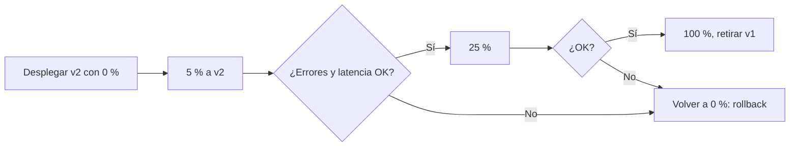

# Despliegue canary

Parte de: [[Estrategias de despliegue (blue-green y canary)]]

> [!info] Cómo avanzar
> `progreso`: **pendiente** → **viendo** (estudiando) → **visto** (contestaste la autoevaluación sin abrir las respuestas) → **dominado** (hiciste el laboratorio o lo aplicaste de verdad).

## Contenido

### Qué es
Un despliegue **canary** expone la versión nueva a una **fracción pequeña del tráfico real** (por ejemplo 5 %) mientras el resto sigue en la versión estable. Comparas métricas de ambas: si el canary se comporta igual o mejor, aumentas el porcentaje por pasos hasta el 100 %; si empeora, regresas su peso a 0 %. El nombre viene del canario que los mineros llevaban para detectar gas antes de que afectara a todos. Es parte de las [[Estrategias de despliegue (blue-green y canary)]].

### Cómo funciona
1. Despliegas v2 junto a v1, sin tráfico.
2. Mandas un porcentaje pequeño (1–5 %) a v2.
3. Durante un periodo de observación comparas **tasa de errores, latencia p95/p99 y métricas de negocio** (pedidos completados, logins exitosos) de v2 contra v1.
4. Si está dentro del umbral, subes a 25 %, 50 %, 100 %. Si no, **abortas**: peso 0 % a v2.
5. Al llegar al 100 %, retiras v1.



**Lo que necesitas sí o sí**:
- **Reparto de tráfico por peso** entre versiones.
- **Observabilidad por versión**: poder filtrar métricas por la versión que atendió cada request. En [[Application Insights]] se logra poniendo la versión en `cloud_RoleInstance` o en una propiedad personalizada, o con *telemetry initializers*. Sin esto, el canary es solo exponer usuarios al azar.
- **Criterios de éxito definidos antes** (por ejemplo: «tasa de 5xx del canary no mayor a 1.2 veces la estable y p95 < 400 ms»), idealmente ligados a tus [[SLI, SLO y SLA|SLO]].
- Compatibilidad de base de datos entre versiones, igual que en blue-green.

**Herramientas de Azure para repartir tráfico**:
- **App Service**: *traffic routing* por porcentaje hacia un slot («Testing in production»). Ver [[App Service - deployment slots]].
- **[[Container Apps]]**: modo de múltiples revisiones con pesos por revisión.
- **[[Front Door]]** y **Traffic Manager**: pesos entre *origins* o *endpoints* (útil entre regiones o plataformas).
- **Application Gateway** y controladores de *ingress* en [[AKS (conceptos)]] (o herramientas como Argo Rollouts/Flagger) para canary en Kubernetes.

### Ejemplo
Canary con slots de App Service usando Azure CLI en el pipeline:

```bash
# 1) v2 ya está desplegada en el slot 'staging'
# 2) Enviar 5 % del tráfico de producción al slot
az webapp traffic-routing set -g rg-dionisio-prod -n app-dionisio-prod \
  --distribution staging=5

# 3) Observar 30 minutos: comparar errores por versión en Application Insights
# 4a) Todo bien: swap completo y limpiar el reparto
az webapp deployment slot swap -g rg-dionisio-prod -n app-dionisio-prod --slot staging
az webapp traffic-routing clear -g rg-dionisio-prod -n app-dionisio-prod

# 4b) Mal: quitar el tráfico al canary
az webapp traffic-routing clear -g rg-dionisio-prod -n app-dionisio-prod
```

App Service fija al usuario a un slot con una cookie (`x-ms-routing-name`), así que un mismo usuario no salta entre versiones en cada request.

Consulta KQL para comparar versiones (suponiendo que guardas la versión en `application_Version`):

```kusto
requests
| where timestamp > ago(30m)
| summarize total = count(), fallas = countif(success == false),
            p95 = percentile(duration, 95) by application_Version
| extend tasaError = todouble(fallas) / total
```

### Cuándo usarlo y cuándo no
- **Úsalo** en servicios con tráfico suficiente para que el 5 % sea estadísticamente útil y en cambios de riesgo.
- **No sirve** con poco tráfico (5 % de 20 requests por hora no dice nada) ni si no puedes medir por versión.
- Para activar funciones por usuario, segmento o cliente, los [[Feature flags]] son más precisos que el canary por tráfico.

### Errores comunes
1. **Periodo de observación demasiado corto**: algunos errores aparecen solo con procesos nocturnos o picos.
2. **Comparar contra el histórico** en lugar de contra la versión estable al mismo tiempo.
3. **Olvidar limpiar el reparto** después del swap.

### Para profundizar
- [Enrutar tráfico en App Service (testing in production)](https://learn.microsoft.com/azure/app-service/deploy-staging-slots)
- [División de tráfico en Azure Container Apps](https://learn.microsoft.com/azure/container-apps/traffic-splitting)
- [Microsoft Learn: despliegues seguros](https://learn.microsoft.com/azure/well-architected/operational-excellence/safe-deployments)

## Autoevaluación

Contesta primero en voz alta o en papel; luego despliega la respuesta.

> [!question]- ¿Qué es un despliegue canary?
> Mandar un porcentaje pequeño del tráfico (1–10 %) a la versión nueva, comparar métricas (errores, latencia) y aumentar gradualmente o revertir.

> [!question]- ¿Qué herramientas de Azure permiten repartir tráfico?
> Revisiones de **Container Apps** con pesos, el porcentaje de tráfico por slot de App Service (*Testing in production*), Front Door con pesos por origen o service mesh en AKS.

> [!question]- ¿Qué necesitas sí o sí para hacer canary?
> **Observabilidad** por versión: si no puedes comparar las métricas del canary contra la versión estable, no sabes si avanzar.

