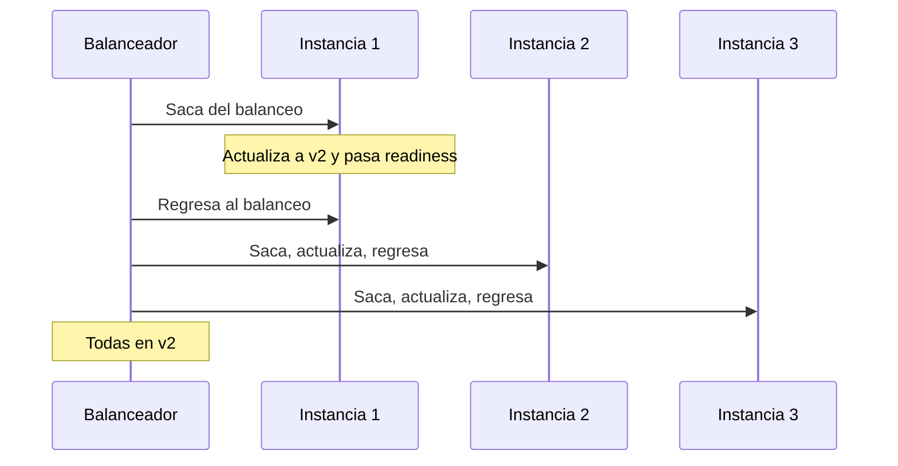

# Despliegue rolling

Parte de: [[Estrategias de despliegue (blue-green y canary)]]

> [!info] Cómo avanzar
> `progreso`: **pendiente** → **viendo** (estudiando) → **visto** (contestaste la autoevaluación sin abrir las respuestas) → **dominado** (hiciste el laboratorio o lo aplicaste de verdad).

## Contenido

### Qué es
En un despliegue **rolling** (gradual por instancias) reemplazas la versión **instancia por instancia** o en tandas: sacas una instancia del balanceador, la actualizas, verificas que esté sana, la regresas y pasas a la siguiente, hasta que todas tienen la versión nueva. No necesitas un ambiente duplicado, solo tener **varias instancias**. Es parte de las [[Estrategias de despliegue (blue-green y canary)]].

### Cómo funciona


Dos parámetros controlan el ritmo:
- **Máximo no disponible**: cuántas instancias pueden estar fuera a la vez (capacidad mínima garantizada).
- **Máximo excedente (*surge*)**: cuántas instancias **extra** puedes crear temporalmente por encima del número deseado.

La **readiness** es clave: el orquestador solo continúa con la siguiente tanda si las instancias nuevas reportan que están listas. Si nunca lo hacen, el despliegue se detiene y no tumba todo el servicio.

**Dónde es el comportamiento por defecto**: en **Kubernetes**, la estrategia por defecto de un `Deployment` es `RollingUpdate` (con `maxSurge` y `maxUnavailable` de 25 %). También es la forma típica de actualizar **Virtual Machine Scale Sets** con política de actualización gradual y de muchos balanceadores con grupos de servidores. Ver [[Kubernetes - conceptos básicos]].

### Ejemplo
Deployment de Kubernetes que actualiza de una en una sin perder capacidad:

```yaml
apiVersion: apps/v1
kind: Deployment
metadata: { name: dionisio-api }
spec:
  replicas: 4
  strategy:
    type: RollingUpdate
    rollingUpdate:
      maxSurge: 1          # crea 1 pod nuevo extra
      maxUnavailable: 0    # nunca baja de 4 pods listos
  minReadySeconds: 20      # el pod debe estar listo 20 s antes de seguir
  selector: { matchLabels: { app: dionisio-api } }
  template:
    metadata: { labels: { app: dionisio-api } }
    spec:
      containers:
      - name: api
        image: acrdionisio.azurecr.io/dionisio-api:1.4.3
        readinessProbe:
          httpGet: { path: /health/ready, port: 8080 }
```

```bash
kubectl set image deployment/dionisio-api api=acrdionisio.azurecr.io/dionisio-api:1.4.3
kubectl rollout status deployment/dionisio-api    # sigue el avance
kubectl rollout undo deployment/dionisio-api      # rollback: otro rolling hacia la versión previa
```

### Cuándo usarlo y cuándo no
- **Úsalo** para cambios rutinarios de bajo riesgo en servicios con varias instancias: es simple y barato.
- **Prefiere [[Despliegue blue-green]] o [[Despliegue canary]]** cuando necesitas rollback instantáneo o exposición controlada por porcentaje de tráfico.
- Con una sola instancia, «rolling» equivale a parar y arrancar: hay caída.

### Riesgos
- **Dos versiones conviviendo** durante todo el proceso: los usuarios pueden alternar entre v1 y v2 en requests seguidos. La API y la base de datos deben ser compatibles en ambos sentidos (contratos de API versionados y migraciones expand/contract).
- **Rollback lento**: deshacer implica otro rolling completo en sentido contrario, no un cambio instantáneo.
- **Capacidad reducida** si `maxUnavailable` > 0 y el despliegue coincide con un pico.
- **Fallos que no detecta la readiness**: si la sonda solo revisa que el proceso responde, una v2 con un bug lógico se propaga a todas las instancias. Combina con monitoreo y detención automática por métricas.

### Errores comunes
1. **Readiness que siempre responde 200**, aunque la app no pueda llegar a SQL: el rolling avanza con instancias rotas. La readiness debe revisar lo mínimo para atender requests.
2. **`maxUnavailable` alto con pocas réplicas**: con 2 réplicas y 50 %, durante el despliegue atiendes con la mitad de capacidad.
3. **No fijar `minReadySeconds`** ni un tiempo límite (`progressDeadlineSeconds`): una versión que se cae al minuto de arrancar parece sana al principio.
4. **Cambios incompatibles en la API** sin versionar: un cliente que recibe una respuesta de v2 y la siguiente de v1 se rompe. Ver [[Versionado de APIs]].
5. **Asumir que rolling sirve en App Service con una sola instancia**: ahí lo que da cero caída son los slots.

### Para profundizar
- [Kubernetes: estrategias de Deployment](https://kubernetes.io/docs/concepts/workloads/controllers/deployment/#strategy)
- [Actualizaciones graduales en Virtual Machine Scale Sets](https://learn.microsoft.com/azure/virtual-machine-scale-sets/virtual-machine-scale-sets-configure-rolling-upgrades)

## Autoevaluación

Contesta primero en voz alta o en papel; luego despliega la respuesta.

> [!question]- ¿Qué es un despliegue rolling?
> Reemplazar instancias de la versión vieja por la nueva por lotes (p. ej. de una en una), manteniendo el servicio arriba.

> [!question]- ¿Dónde es el comportamiento por defecto?
> En los **Deployments de Kubernetes** (`strategy: RollingUpdate`, con `maxSurge` y `maxUnavailable`).

> [!question]- ¿Qué riesgo tiene?
> Durante el despliegue conviven ambas versiones atendiendo usuarios; el rollback también es gradual.

