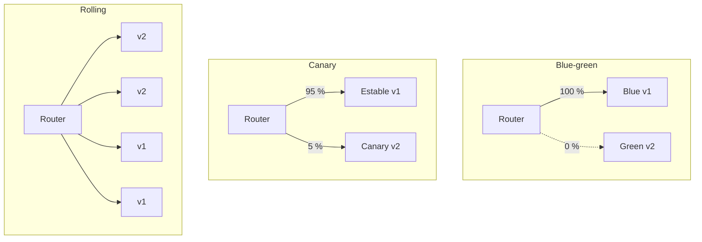

# Estrategias de despliegue (blue-green y canary)

Parte de: [[08-Automatizacion-DevOps/01 Automatización y CICD/_Índice Automatización y CICD|Automatización y CICD]]

> [!info] Cómo avanzar
> `progreso`: **pendiente** → **viendo** (estudiando) → **visto** (contestaste la autoevaluación sin abrir las respuestas) → **dominado** (hiciste el laboratorio o lo aplicaste de verdad).

## Contenido

### Qué es
Una **estrategia de despliegue** es la forma en que reemplazas la versión que está en producción por una nueva. La más ingenua es «parar, copiar archivos y arrancar», y tiene tres problemas: hay **tiempo de caída** mientras la app está detenida, **todos los usuarios** reciben la versión nueva a la vez (si tiene un bug, le pega a todos) y el **rollback** consiste en repetir el proceso con la versión anterior, si es que la guardaste. Las estrategias modernas buscan cero caída, exposición gradual y rollback en segundos.

### Cómo funciona
Las tres estrategias principales, en una frase cada una:
- **[[Despliegue blue-green]]**: tienes dos ambientes idénticos; despliegas la versión nueva en el que no recibe tráfico, la pruebas y **cambias todo el tráfico de golpe**; el rollback es volver a cambiar.
- **[[Despliegue canary]]**: mandas a la versión nueva un **porcentaje pequeño del tráfico** (1 %, 5 %, 25 %…), comparas métricas contra la versión estable y avanzas o abortas.
- **[[Despliegue rolling]]**: reemplazas las instancias **por tandas** (de una en una o un porcentaje a la vez) hasta que todas tienen la versión nueva.



| | Blue-green | Canary | Rolling |
|---|---|---|---|
| Caída | Ninguna | Ninguna | Ninguna (si hay capacidad) |
| Exposición al riesgo | Todos a la vez tras el cambio | Gradual y medida | Gradual por instancias |
| Rollback | Inmediato (switch) | Inmediato (0 % al canary) | Lento (otro rolling) |
| Costo | Doble infraestructura durante el cambio | Algo extra | Casi nada |
| Requiere | Router o *slots* | Reparto por peso + métricas | Varias instancias |

**Todas comparten un requisito**: durante un tiempo conviven **dos versiones** de la app (v1 y v2) contra la **misma base de datos**. Por eso los cambios de esquema deben ser **compatibles hacia atrás**: v1 debe seguir funcionando con el esquema que necesita v2. La técnica es **expand and contract** (ver [[Migraciones sin caídas (expand y contract)]]): primero agregas (columna nueva *nullable*, tabla nueva, procedimiento `v2` junto al viejo), despliegas el código que usa lo nuevo y, cuando ya nadie usa lo viejo, en un despliegue posterior lo eliminas. Nunca renombres ni borres una columna en el mismo despliegue que cambia el código.

### Ejemplo
Para [[Itzamna.Dionisio]] en App Service:
1. Migración *expand*: script `.sql` que agrega `Cliente.CorreoNormalizado NVARCHAR(256) NULL` y un `usp_Cliente_Obtener_v2`. El procedimiento viejo sigue igual.
2. Despliegue blue-green con el slot `staging` y *swap* (la v1 sigue funcionando porque la columna es opcional).
3. Opcional: antes del swap, enviar 10 % del tráfico al slot como canary.
4. Semanas después, migración *contract*: borrar el procedimiento viejo cuando ya no tiene llamadas (revisa con [[Application Insights]] o con `sys.dm_exec_procedure_stats`).

### Cuándo usarlo y cuándo no
- **Rolling** es suficiente para muchas cargas en Kubernetes o con varias instancias, si los cambios son de bajo riesgo.
- **Blue-green** cuando quieres probar en el ambiente real antes de recibir tráfico y un rollback instantáneo; muy natural en App Service con slots.
- **Canary** para cambios de alto riesgo o servicios con mucho tráfico, siempre que tengas observabilidad para comparar.
- Combínalas con [[Feature flags]]: desplegar código no tiene por qué significar activar la funcionalidad.

### Errores comunes
1. **Migraciones destructivas** junto con el código: la versión vieja truena durante el cambio y el rollback se vuelve imposible.
2. **Sesión en memoria**: al cambiar de instancia o versión, los usuarios pierden la sesión. Usa tokens o un almacén distribuido.
3. **No probar el rollback**: la estrategia promete volver en segundos, pero nadie lo ha ensayado.
4. **Elegir canary sin métricas**: si no puedes comparar errores y latencia por versión, solo estás exponiendo usuarios al azar.

### Para profundizar
- [Microsoft Learn: estrategias de despliegue seguras](https://learn.microsoft.com/azure/well-architected/operational-excellence/safe-deployments)
- [Deployment slots de App Service](https://learn.microsoft.com/azure/app-service/deploy-staging-slots)
- [Martin Fowler: BlueGreenDeployment](https://martinfowler.com/bliki/BlueGreenDeployment.html)

## Subtemas

- [[Despliegue blue-green]]
- [[Despliegue canary]]
- [[Despliegue rolling]]

## Autoevaluación

Contesta primero en voz alta o en papel; luego despliega la respuesta.

> [!question]- ¿Por qué no basta con «parar, copiar y arrancar»?
> Hay tiempo de caída y el rollback es lento. Las estrategias de despliegue reducen el **riesgo** y el **radio de impacto** de un cambio.

> [!question]- Compara blue-green, canary y rolling en una frase cada uno.
> **Blue-green**: dos ambientes completos, cambias todo el tráfico de golpe. **Canary**: una parte pequeña del tráfico va a la versión nueva y se amplía si va bien. **Rolling**: reemplazas instancias de poco en poco.

> [!question]- ¿Qué tienen que cumplir los cambios de base de datos para estas estrategias?
> Ser **compatibles hacia atrás** mientras conviven dos versiones (patrón *expand/contract*): primero agregas columnas, luego migras el código y al final quitas lo viejo.

## Progreso de los subtemas

```base
filters:
  and:
    - file.inFolder("08-Automatizacion-DevOps/01 Automatización y CICD/Estrategias de despliegue (blue-green y canary)")
    - file.name != "Estrategias de despliegue (blue-green y canary)"
views:
  - type: table
    name: Progreso
    order:
      - file.name
      - progreso
      - nivel
```
