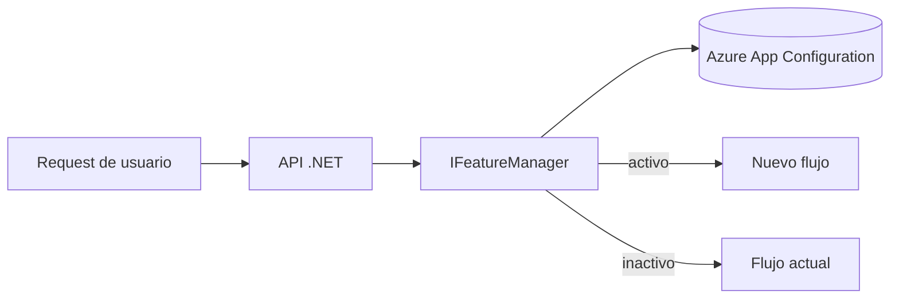

# Feature flags

Parte de: [[08-Automatizacion-DevOps/01 Automatización y CICD/_Índice Automatización y CICD|Automatización y CICD]]

> [!info] Cómo avanzar
> `progreso`: **pendiente** → **viendo** (estudiando) → **visto** (contestaste la autoevaluación sin abrir las respuestas) → **dominado** (hiciste el laboratorio o lo aplicaste de verdad).

## Contenido

### Qué es
Un **feature flag** (interruptor de funcionalidad) es una condición en el código que **activa o desactiva una funcionalidad en tiempo de ejecución** sin redeplegar. Separa dos cosas que solemos confundir: **desplegar** (poner código en producción) y **liberar** (que los usuarios lo vean). Con flags puedes desplegar código incompleto apagado, encenderlo para tu equipo, luego para el 10 % de los usuarios y apagarlo en segundos si falla.

### Cómo funciona
El código consulta a un **gestor de flags** («¿está activa `NuevoReporteExcel` para este usuario?»). El valor viene de configuración externa que se cambia sin desplegar: `appsettings`, variables de entorno o un servicio central como **Azure App Configuration**. El gestor puede evaluar **filtros**: porcentaje de usuarios, ventana de tiempo o lista de usuarios/grupos (*targeting*).

**Tipos de flags** (por propósito y vida útil):
- **Release (de liberación)**: esconden trabajo en progreso o permiten liberar gradualmente. Vida corta: se **borran** cuando la funcionalidad queda al 100 %.
- **Experimento**: pruebas A/B para medir qué variante funciona mejor. Vida de semanas.
- **Operación (kill switch)**: apagan una parte costosa o riesgosa ante un incidente (por ejemplo, desactivar la exportación pesada si la base está saturada). Pueden vivir mucho tiempo.
- **Permiso**: habilitan funciones por plan o cliente (premium, piloto). Son casi reglas de negocio de larga vida.



### Ejemplo
En .NET con la librería `Microsoft.FeatureManagement.AspNetCore` y Azure App Configuration para Wee.Reporteria o [[Itzamna.Dionisio]]:

```csharp
// Program.cs
builder.Configuration.AddAzureAppConfiguration(opciones =>
{
    opciones.Connect(new Uri(builder.Configuration["AppConfig:Endpoint"]!),
                     new DefaultAzureCredential())        // Managed Identity, sin secretos
            .UseFeatureFlags(ff => ff.SetRefreshInterval(TimeSpan.FromSeconds(30)));
});
builder.Services.AddAzureAppConfiguration();
builder.Services.AddFeatureManagement();   // incluye filtros de porcentaje, tiempo y targeting

var app = builder.Build();
app.UseAzureAppConfiguration();            // refresca los flags sin reiniciar
```

```csharp
[ApiController]
[Route("api/reportes")]
public sealed class ReportesController(IFeatureManager features, IReporteExcel reporte) : ControllerBase
{
    [HttpGet("ventas")]
    public async Task<IActionResult> Ventas(CancellationToken ct)
    {
        if (await features.IsEnabledAsync("NuevoReporteExcel"))
            return File(await reporte.GenerarV2Async(ct), "application/vnd.openxmlformats-officedocument.spreadsheetml.sheet");

        return File(await reporte.GenerarAsync(ct), "application/vnd.openxmlformats-officedocument.spreadsheetml.sheet");
    }

    // Endpoint completo detrás de un flag: si está apagado responde 404
    [HttpGet("beta")]
    [FeatureGate("ReportesBeta")]
    public IActionResult Beta() => Ok();
}
```

Sin App Configuration, el mismo código funciona con `appsettings.json`:

```json
{
  "FeatureManagement": {
    "NuevoReporteExcel": {
      "EnabledFor": [
        { "Name": "Microsoft.Percentage", "Parameters": { "Value": 10 } }
      ]
    },
    "ReportesBeta": false
  }
}
```

En el front (Itzamna.Clio) no evalúes flags sensibles en el navegador: pide a la API qué funciones están activas para el usuario.

### Cuándo usarlo y cuándo no
- **Úsalo** con *trunk-based development* para integrar código incompleto sin ramas largas, para liberaciones graduales y como kill switch.
- **No lo uses** como sustituto de permisos de seguridad: un flag apagado en el front no protege un endpoint; la autorización va en el servidor.
- Para cambios pequeños sin riesgo, un flag es complejidad innecesaria.

### Errores comunes
1. **No borrar flags viejos.** Cada flag duplica caminos de código y pruebas. Crea un work item para retirarlo al crear el flag y ponle fecha de caducidad.
2. **Probar solo con el flag encendido.** Ambos caminos deben pasar pruebas mientras el flag exista.
3. **Flags anidados o dependientes**: combinaciones imposibles de razonar.
4. **Evaluar el porcentaje sin usuario estable**: el mismo usuario ve la función aparecer y desaparecer. Usa *targeting* con un identificador de usuario.
5. **Configuración que no se refresca**: cambias el flag y nada pasa porque falta `UseAzureAppConfiguration()` o el intervalo de refresco.

### Para profundizar
- [Feature management en .NET (Microsoft Learn)](https://learn.microsoft.com/azure/azure-app-configuration/feature-management-dotnet-reference)
- [Inicio rápido: feature flags en ASP.NET Core](https://learn.microsoft.com/azure/azure-app-configuration/quickstart-feature-flag-aspnet-core)
- [Martin Fowler: Feature Toggles](https://martinfowler.com/articles/feature-toggles.html)

## Autoevaluación

Contesta primero en voz alta o en papel; luego despliega la respuesta.

> [!question]- ¿Qué es un feature flag?
> Un interruptor en configuración que activa o desactiva una funcionalidad **sin desplegar**. Separa *desplegar* el código de *liberar* la funcionalidad.

> [!question]- ¿Qué tipos de flags hay?
> **Release** (ocultar algo incompleto), **experimento** (A/B), **operación** (*kill switch* para apagar algo pesado) y **permiso** (solo ciertos usuarios o planes).

> [!question]- ¿Cómo se implementa en .NET con Azure?
> Con la librería `Microsoft.FeatureManagement` y **Azure App Configuration** como origen: `[FeatureGate("NuevoReporte")]` o `await featureManager.IsEnabledAsync("NuevoReporte")`, con filtros por porcentaje o por usuario.

> [!question]- Error común con flags.
> No borrarlos: se acumulan, multiplican las rutas de código sin probar y se vuelven deuda. Cada flag debe tener dueño y fecha de retiro.

