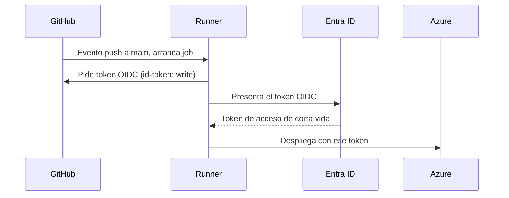

# GitHub Actions

Parte de: [[08-Automatizacion-DevOps/01 Automatización y CICD/_Índice Automatización y CICD|Automatización y CICD]]

> [!info] Cómo avanzar
> `progreso`: **pendiente** → **viendo** (estudiando) → **visto** (contestaste la autoevaluación sin abrir las respuestas) → **dominado** (hiciste el laboratorio o lo aplicaste de verdad).

## Contenido

### Qué es
GitHub Actions es el sistema de automatización integrado en GitHub. Ejecuta **workflows** definidos en YAML dentro de `.github/workflows/` cuando ocurre un evento del repositorio (push, pull request, release, un horario o un disparo manual). Sirve para CI/CD, pero también para tareas como etiquetar issues o publicar paquetes.

### Cómo funciona
La jerarquía es: **workflow → jobs → steps**.
- **`on:`** define los eventos que lo disparan (`push`, `pull_request`, `workflow_dispatch`, `schedule` con cron en UTC).
- **`jobs:`** cada job corre en un **runner** (máquina virtual hospedada por GitHub como `ubuntu-latest` o `windows-latest`, o un runner propio). Los jobs corren en paralelo salvo que declares `needs:`.
- **`steps:`** cada paso es un comando (`run:`) o una **action** reutilizable (`uses: owner/repo@versión`).
- **`permissions:`** limita lo que puede hacer el `GITHUB_TOKEN` automático del workflow.
- **`environment:`** asocia un job a un ambiente con reglas de protección (revisores requeridos, ramas permitidas) y secretos propios.
- **`strategy.matrix`** multiplica un job por combinaciones de variables (por ejemplo, Ubuntu y Windows, o .NET 8 y .NET 10).



**OIDC (federación de identidad).** En lugar de guardar el secreto de un *service principal*, registras en Entra ID una **credencial federada** que confía en tokens emitidos por GitHub para un repo, rama o environment concretos. En el workflow, `azure/login` intercambia el token OIDC del runner por un token de Azure válido unos minutos. No hay secreto que rotar ni que filtrar; solo necesitas `client-id`, `tenant-id` y `subscription-id`, que no son secretos.

### Ejemplo
CI con matriz y despliegue a App Service por OIDC:

```yaml
name: api
on:
  push: { branches: [ main ] }
  pull_request:

permissions:
  contents: read          # mínimo por defecto

jobs:
  build:
    runs-on: ${{ matrix.os }}
    strategy:
      matrix:
        os: [ ubuntu-latest, windows-latest ]
    steps:
      - uses: actions/checkout@v5
      - uses: actions/setup-dotnet@v5
        with: { dotnet-version: '10.0.x' }
      - run: dotnet test -c Release
      - run: dotnet publish src/Dionisio.Api -c Release -o out
        if: matrix.os == 'ubuntu-latest'
      - uses: actions/upload-artifact@v4
        if: matrix.os == 'ubuntu-latest'
        with: { name: api, path: out }

  deploy:
    needs: build
    if: github.ref == 'refs/heads/main'
    runs-on: ubuntu-latest
    environment: produccion
    permissions:
      id-token: write     # solo este job puede pedir token OIDC
      contents: read
    steps:
      - uses: actions/download-artifact@v4
        with: { name: api, path: out }
      - uses: azure/login@v2
        with:
          client-id: ${{ vars.AZURE_CLIENT_ID }}
          tenant-id: ${{ vars.AZURE_TENANT_ID }}
          subscription-id: ${{ vars.AZURE_SUBSCRIPTION_ID }}
      - uses: azure/webapps-deploy@v3
        with: { app-name: app-dionisio-prod, package: out }
```

Las versiones mayores de las actions cambian con el tiempo; revisa la más reciente en el Marketplace antes de copiar.

### Cuándo usarlo y cuándo no
- Úsalo si el código está en GitHub: eventos nativos, reutilización con *reusable workflows* y un marketplace grande.
- Si el código y los work items están en Azure DevOps, [[Azure Pipelines]] se integra mejor (Boards, environments, variable groups).
- Para cargas pesadas o redes privadas, runners propios; GitHub anunció en diciembre de 2025 un cobro por minuto para runners propios en repos privados y luego lo **pospuso** tras las críticas; revisa la página de facturación antes de decidir.

### Errores comunes
1. **Actions de terceros sin fijar.** `uses: alguien/accion@main` ejecuta lo que el autor publique mañana, con acceso a tus secretos. Fija a un **SHA de commit** (o al menos a una versión), revisa el código y prefiere publicadores verificados; Dependabot puede actualizar esos SHA.
2. **`permissions` amplios.** Si no los declaras, el token puede tener escritura según la configuración del repo. Declara `contents: read` arriba y amplía solo en el job que lo necesite.
3. **`pull_request_target` con checkout del código del PR.** Corre con secretos sobre código no confiable; evítalo salvo que entiendas el riesgo.
4. **Secretos impresos en logs** por `echo` o modo debug. GitHub enmascara secretos registrados, pero no los derivados.
5. **Cron en hora local.** `schedule` usa UTC.

### Para profundizar
- [Documentación de GitHub Actions](https://docs.github.com/actions)
- [Endurecimiento de seguridad para GitHub Actions](https://docs.github.com/actions/security-for-github-actions/security-guides/security-hardening-for-github-actions)
- [Conectar GitHub Actions con Azure mediante OIDC](https://learn.microsoft.com/azure/developer/github/connect-from-azure-openid-connect)

## Autoevaluación

Contesta primero en voz alta o en papel; luego despliega la respuesta.

> [!question]- ¿Cuál es la estructura de un workflow?
> Archivo en `.github/workflows/*.yml` con `on:` (eventos: `push`, `pull_request`, `schedule`, `workflow_dispatch`), `jobs:` y en cada job `runs-on:` y `steps:` que usan `uses:` (una action) o `run:` (comando).

> [!question]- ¿Cómo te autenticas a Azure desde Actions sin guardar un secreto de service principal?
> Con **OIDC** (federación): una identidad de Entra con credencial federada para el repo/rama, `permissions: id-token: write` y la action `azure/login` con `client-id`, `tenant-id` y `subscription-id`.

> [!question]- ¿Para qué sirve `permissions:` y por qué limitarlo?
> Define qué puede hacer el `GITHUB_TOKEN` del workflow. Con `contents: read` como base reduces el daño si una action de terceros está comprometida.

> [!question]- ¿Qué hace una `strategy.matrix`?
> Ejecuta el mismo job con varias combinaciones (versiones de .NET, sistemas operativos) en paralelo.

> [!question]- Error común con actions de terceros.
> Usarlas con una etiqueta movible (`@main`). Fija versión mayor de confianza o, para máxima seguridad, el **SHA** del commit.

## Práctica

- [[Lab 2 - GitHub Actions de build y pruebas]]

