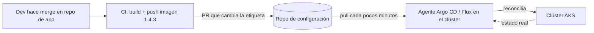

# GitOps

Parte de: [[08-Automatizacion-DevOps/01 Automatización y CICD/_Índice Automatización y CICD|Automatización y CICD]]

> [!info] Cómo avanzar
> `progreso`: **pendiente** → **viendo** (estudiando) → **visto** (contestaste la autoevaluación sin abrir las respuestas) → **dominado** (hiciste el laboratorio o lo aplicaste de verdad).

## Contenido

### Qué es
GitOps es un modelo de operación en el que **un repositorio Git es la única fuente de verdad del estado deseado** de tus sistemas (manifiestos de Kubernetes, charts de Helm, configuración), y un **agente dentro del entorno** compara continuamente ese estado con el real y lo corrige. Desplegar ya no es «ejecutar un comando contra producción», sino **hacer merge de un cambio en Git**. Las herramientas más conocidas son **Argo CD** y **Flux**; AKS ofrece una extensión de GitOps basada en Flux.

El proyecto OpenGitOps resume cuatro principios: el estado es **declarativo**, está **versionado e inmutable** (en Git), se **obtiene automáticamente** (pull) y se **reconcilia continuamente**.

### Cómo funciona
**Push vs pull.**
- **Push (CI/CD tradicional)**: el pipeline, que corre fuera del clúster, tiene credenciales del clúster y *empuja* los cambios (`kubectl apply`, `helm upgrade`). Si alguien cambia algo a mano después, nadie lo nota hasta el siguiente despliegue.
- **Pull (GitOps)**: un agente que vive **dentro** del clúster *jala* periódicamente el repo de configuración y aplica las diferencias. El pipeline de CI ya no necesita credenciales de producción: solo construye la imagen y actualiza la etiqueta en el repo de configuración. Si alguien edita algo a mano, el agente detecta la **deriva** y la revierte (o la reporta, según la política).



Es común separar **dos repos**: el de la aplicación (código) y el de configuración/entornos (manifiestos por ambiente). Así el historial de despliegues queda limpio y los permisos se separan.

### Ejemplo
Estructura de un repo de configuración con Kustomize:

```text
dionisio-config/
  base/
    deployment.yaml
    service.yaml
    kustomization.yaml
  overlays/
    dev/kustomization.yaml     # imagen: dionisio-api:1.4.3-rc1, 1 réplica
    prod/kustomization.yaml    # imagen: dionisio-api:1.4.2, 3 réplicas
```

```yaml
# overlays/prod/kustomization.yaml
resources: [ ../../base ]
images:
- name: acrdionisio.azurecr.io/dionisio-api
  newTag: "1.4.2"      # promover a prod = PR que cambia este valor
replicas:
- name: dionisio-api
  count: 3
```

Para promover la versión `1.4.3` a producción abres un PR que cambia `newTag`, alguien lo aprueba y al hacer merge el agente la aplica en minutos.

**Rollback en GitOps**: haces **`git revert`** del commit que subió la versión (o un PR que regresa la etiqueta anterior). El agente ve el cambio y reconcilia al estado previo. El rollback queda registrado en el historial como cualquier otro cambio, con autor y motivo. Evita hacer rollback con `kubectl` directo: el agente lo «corregirá» de vuelta a lo que diga Git.

### Cuándo usarlo y cuándo no
- **Úsalo** con Kubernetes y varios ambientes o clústeres: auditoría completa, menos credenciales expuestas, corrección automática de drift.
- **No aplica tan bien** a App Service o Functions: no hay un agente que reconcilie; ahí el modelo push con [[Azure Pipelines]] o [[GitHub Actions]] y [[Infraestructura como código - conceptos|IaC]] es lo práctico.
- La base de datos no se gestiona con GitOps; sus migraciones van por su propio flujo ([[Migraciones de base de datos (scripts versionados, DACPAC, DbUp y Flyway)]]).

### Errores comunes
1. **Secretos en texto plano en el repo de configuración.** Usa Sealed Secrets, SOPS o referencias a [[Key Vault]] con el CSI driver.
2. **Cambios manuales «de emergencia» con `kubectl`.** El agente los revierte y el equipo se confunde. Toda corrección pasa por Git, incluso en un incidente.
3. **Un repo con todo mezclado** (código y manifiestos de todos los ambientes) que dispara despliegues por cualquier commit.
4. **Ignorar las alertas de «OutOfSync»**: indican drift o un despliegue fallido.

### Para profundizar
- [Principios de OpenGitOps](https://opengitops.dev/)
- [Documentación de Argo CD](https://argo-cd.readthedocs.io/)
- [GitOps con Flux v2 en AKS](https://learn.microsoft.com/azure/azure-arc/kubernetes/conceptual-gitops-flux2)

## Autoevaluación

Contesta primero en voz alta o en papel; luego despliega la respuesta.

> [!question]- ¿Qué es GitOps?
> Usar Git como **fuente de verdad** del estado deseado (manifiestos de Kubernetes, Helm) y un agente dentro del clúster (Argo CD, Flux) que **jala** los cambios y reconcilia.

> [!question]- Push vs pull en despliegues.
> **Push**: el pipeline tiene credenciales del clúster y aplica. **Pull** (GitOps): el agente en el clúster lee Git; el CI no necesita credenciales de producción y el drift se corrige solo.

> [!question]- ¿Cómo haces rollback en GitOps?
> Con `git revert` del commit que cambió la configuración; el agente reconcilia a la versión anterior.

