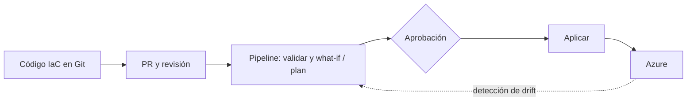

# Infraestructura como código - conceptos

Parte de: [[08-Automatizacion-DevOps/01 Automatización y CICD/_Índice Automatización y CICD|Automatización y CICD]]

> [!info] Cómo avanzar
> `progreso`: **pendiente** → **viendo** (estudiando) → **visto** (contestaste la autoevaluación sin abrir las respuestas) → **dominado** (hiciste el laboratorio o lo aplicaste de verdad).

## Contenido

### Qué es
**Infraestructura como código (IaC)** es describir servidores, redes, bases de datos y permisos en **archivos de texto versionados** en lugar de crearlos a mano en el portal. Esos archivos se revisan en pull requests, se prueban y se aplican desde un pipeline. El resultado: ambientes reproducibles (dev igual a prod), historial de quién cambió qué y la posibilidad de recrear todo si algo se pierde.

Herramientas comunes en Azure: [[Bicep]] (nativa de Azure), [[ARM templates]] (el JSON que Bicep genera), [[Terraform]] (multinube) y [[Pulumi]] (lenguajes de propósito general).

### Cómo funciona
**Declarativo vs imperativo.** En el estilo **declarativo** describes el **estado final** («quiero una Web App llamada X en el plan Y») y la herramienta calcula qué crear, cambiar o borrar. En el **imperativo** escribes los **pasos** («crea el grupo, luego crea el plan, luego la app»), como un script de `az cli`. Bicep, Terraform y Pulumi son declarativos (Pulumi usa un lenguaje imperativo para *construir* una descripción declarativa). Los scripts imperativos son útiles para tareas puntuales, pero difíciles de repetir sin efectos secundarios.

**Idempotencia.** Aplicar la misma definición una o diez veces produce el **mismo resultado**. Si la Web App ya existe con esa configuración, no pasa nada; si falta, se crea; si difiere, se corrige. Esto permite correr el despliegue en cada pipeline sin miedo. Un script `az webapp create` sin validaciones no es idempotente: la segunda vez falla o duplica.

**Drift (deriva).** Ocurre cuando la infraestructura real **ya no coincide** con el código, normalmente porque alguien cambió algo en el portal «solo para probar». Se detecta comparando: `terraform plan` muestra diferencias; en Bicep, `az deployment group what-if` dice qué cambiaría. Un pipeline programado que corre esa comparación cada noche y avisa si hay diferencias es una buena práctica.

**Infraestructura inmutable.** En vez de **modificar** un servidor existente (parchearlo, instalarle cosas), se **reemplaza** por uno nuevo construido desde la definición. Los contenedores lo hacen natural: cada versión es una imagen nueva. Evita los «servidores copo de nieve» únicos que nadie sabe reconstruir.



### Ejemplo
Bicep declarativo para el App Service de [[Itzamna.Dionisio]]:

```bicep
param location string = resourceGroup().location
param entorno string

resource plan 'Microsoft.Web/serverfarms@2023-12-01' = {
  name: 'asp-dionisio-${entorno}'
  location: location
  sku: { name: 'B1' }
  kind: 'linux'
  properties: { reserved: true }
}

resource app 'Microsoft.Web/sites@2023-12-01' = {
  name: 'app-dionisio-${entorno}'
  location: location
  identity: { type: 'SystemAssigned' }   // identidad para leer Key Vault
  properties: {
    serverFarmId: plan.id
    httpsOnly: true
    siteConfig: { linuxFxVersion: 'DOTNETCORE|10.0' }
  }
}
```

```bash
# Ver qué cambiaría antes de aplicar (detecta drift también)
az deployment group what-if -g rg-dionisio-dev -f main.bicep -p entorno=dev
# Aplicar (idempotente: correrlo dos veces no duplica nada)
az deployment group create -g rg-dionisio-dev -f main.bicep -p entorno=dev
```

### Cuándo usarlo y cuándo no
- Úsalo para todo lo que deba existir en más de un ambiente o sobrevivir a una persona.
- Para experimentos de una tarde, el portal está bien, pero borra el grupo de recursos al terminar.
- Bicep si solo usas Azure; Terraform si mezclas nubes o proveedores (GitHub, Cloudflare); Pulumi si el equipo prefiere C# y lógica compleja.

### Errores comunes
1. **Mezclar cambios manuales con IaC.** Genera drift y el siguiente despliegue «revierte» el cambio manual sin aviso.
2. **Secretos en los archivos.** Usa parámetros `@secure()` y referencias a [[Key Vault]].
3. **Aplicar sin `what-if`/`plan`.** Un cambio de nombre puede significar «borrar y crear» una base de datos.
4. **Un solo archivo gigante.** Divide en módulos por recurso o dominio.

### Para profundizar
- [Microsoft Learn: ¿Qué es la infraestructura como código?](https://learn.microsoft.com/devops/deliver/what-is-infrastructure-as-code)
- [Documentación de Bicep](https://learn.microsoft.com/azure/azure-resource-manager/bicep/overview)
- [Operación what-if de Bicep](https://learn.microsoft.com/azure/azure-resource-manager/bicep/deploy-what-if)

## Autoevaluación

Contesta primero en voz alta o en papel; luego despliega la respuesta.

> [!question]- ¿Declarativo o imperativo?
> **Declarativo**: describes el estado deseado y la herramienta calcula los cambios (Bicep, Terraform). **Imperativo**: escribes los pasos (scripts CLI). Lo declarativo es más fácil de repetir y revisar.

> [!question]- ¿Qué es la idempotencia y por qué importa?
> Aplicar la misma definición varias veces deja el mismo resultado, sin duplicar recursos. Permite re-ejecutar el pipeline con seguridad.

> [!question]- ¿Qué es el *drift* y cómo lo detectas?
> Diferencia entre lo que dice el código y lo que existe (alguien cambió algo en el portal). Se detecta con `terraform plan` o `what-if` periódicos; se corrige reaplicando o actualizando el código.

> [!question]- ¿Qué significa infraestructura inmutable?
> No modificar servidores en vivo: se crea una versión nueva (imagen, contenedor) y se reemplaza la anterior. Evita servidores «copo de nieve» imposibles de reproducir.

