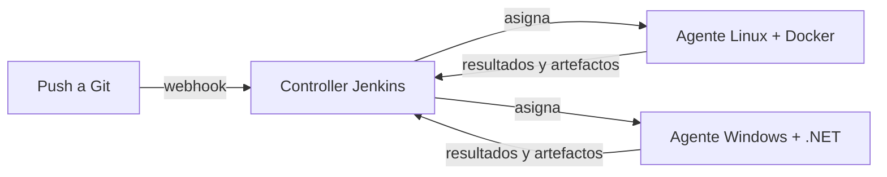

# Jenkins (conceptos)

Parte de: [[08-Automatizacion-DevOps/01 Automatización y CICD/_Índice Automatización y CICD|Automatización y CICD]]

> [!info] Cómo avanzar
> `progreso`: **pendiente** → **viendo** (estudiando) → **visto** (contestaste la autoevaluación sin abrir las respuestas) → **dominado** (hiciste el laboratorio o lo aplicaste de verdad).

## Contenido

### Qué es
Jenkins es un **servidor de automatización de código abierto** escrito en Java, uno de los más antiguos y extendidos para CI/CD. Tú lo instalas y operas (en una VM, en contenedores o en Kubernetes), y su comportamiento se amplía con **plugins**: hay plugins para casi todo, desde Git y Docker hasta notificaciones a Teams.

Hoy lo encontrarás sobre todo en empresas con infraestructura propia, en redes sin salida a internet o en organizaciones que lo adoptaron hace años y tienen cientos de jobs sobre él.

### Cómo funciona
Jenkins separa coordinación y ejecución:
- **Controller** (antes llamado *master*): guarda la configuración, la interfaz web, el historial de builds, las credenciales y **decide qué job corre dónde**. No debería ejecutar builds él mismo.
- **Agentes** (antes *slaves* o *nodes*): máquinas o contenedores que **ejecutan** los pasos. Se conectan al controller por SSH o por el protocolo de agente, y se etiquetan (`windows`, `docker`, `dotnet`) para que cada job pida el tipo que necesita. Pueden ser fijos o efímeros (un pod de Kubernetes por build).



Los pipelines modernos se escriben como código en un **`Jenkinsfile`** (sintaxis *declarativa* basada en Groovy) que vive en el repo. Jenkins lo lee y ejecuta sus `stages`. Con *Multibranch Pipeline*, crea un job por cada rama o PR automáticamente.

### Ejemplo
`Jenkinsfile` declarativo para una API .NET:

```groovy
pipeline {
    agent { label 'dotnet' }          // corre en un agente con esa etiqueta
    options { timeout(time: 30, unit: 'MINUTES') }
    stages {
        stage('Build') {
            steps { sh 'dotnet build -c Release' }
        }
        stage('Pruebas') {
            steps { sh 'dotnet test -c Release --logger trx' }
        }
        stage('Publicar') {
            when { branch 'main' }
            steps {
                sh 'dotnet publish src/Dionisio.Api -c Release -o out'
                archiveArtifacts artifacts: 'out/**'
            }
        }
    }
    post {
        failure { echo 'Avisar al equipo' }
    }
}
```

Compáralo con [[GitHub Actions]] o [[Azure Pipelines]]: la idea es la misma (etapas, pasos, artefactos); cambia quién opera la plataforma.

### Cuándo usarlo y cuándo no
**Úsalo** cuando:
- La red no permite servicios SaaS o los builds deben correr dentro del centro de datos.
- Ya existe una inversión grande en Jenkins y migrar no se justifica todavía.
- Necesitas una integración muy específica que solo existe como plugin.

**Evítalo** cuando tu código está en GitHub o Azure DevOps y no tienes restricción de red: los servicios gestionados te quitan todo el trabajo de operación.

**El costo oculto** frente a SaaS es la **operación**: alguien debe parchear el controller y los plugins (Jenkins publica avisos de seguridad con frecuencia), gestionar actualizaciones que rompen compatibilidad entre plugins, respaldar `JENKINS_HOME`, dimensionar agentes, asegurar credenciales y darle alta disponibilidad. Ese tiempo de ingeniería no aparece en una factura, pero existe.

### Errores comunes
1. **Ejecutar builds en el controller.** Compromete su estabilidad y seguridad; configura cero ejecutores en el controller.
2. **Instalar plugins sin control.** Cada plugin es superficie de ataque y fuente de incompatibilidades. Mantén una lista mínima y actualizada.
3. **Jobs configurados a mano en la UI** (*freestyle*). No se versionan ni se revisan. Usa `Jenkinsfile`.
4. **Sin respaldo de `JENKINS_HOME`.** Si se pierde el disco, pierdes configuración, credenciales e historial.
5. **Agentes permanentes «sucios».** Restos de builds anteriores producen resultados no reproducibles; prefiere agentes efímeros.

### Para profundizar
- [Documentación oficial de Jenkins](https://www.jenkins.io/doc/)
- [Sintaxis de Pipeline](https://www.jenkins.io/doc/book/pipeline/syntax/)
- [Avisos de seguridad de Jenkins](https://www.jenkins.io/security/advisories/)

## Autoevaluación

Contesta primero en voz alta o en papel; luego despliega la respuesta.

> [!question]- ¿Qué es Jenkins?
> Servidor de automatización open source y autohospedado. Los pipelines se definen en un `Jenkinsfile` (declarativo o scripted) y se extienden con miles de plugins.

> [!question]- ¿Qué es controller y qué son los agentes?
> El **controller** programa trabajos y guarda configuración; los **agentes** ejecutan los builds. Correr builds en el controller es mala práctica de seguridad y rendimiento.

> [!question]- ¿Qué costo oculto tiene Jenkins frente a servicios SaaS?
> Lo operas tú: servidor, respaldos, actualizaciones y sobre todo **plugins** que se desactualizan o tienen vulnerabilidades.

