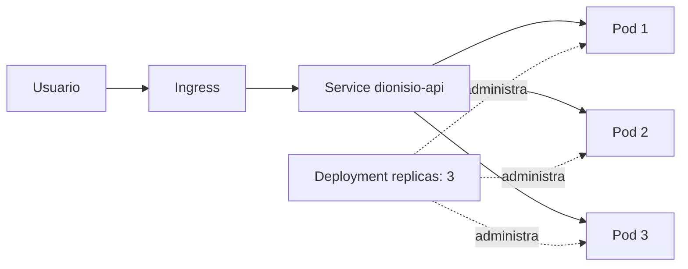

# Kubernetes - conceptos básicos

Parte de: [[08-Automatizacion-DevOps/01 Automatización y CICD/_Índice Automatización y CICD|Automatización y CICD]]

> [!info] Cómo avanzar
> `progreso`: **pendiente** → **viendo** (estudiando) → **visto** (contestaste la autoevaluación sin abrir las respuestas) → **dominado** (hiciste el laboratorio o lo aplicaste de verdad).

## Contenido

### Qué es
Kubernetes (K8s) es un **orquestador de contenedores** de código abierto: toma un grupo de máquinas (nodos) y las administra como una sola plataforma donde despliegas contenedores, decides cuántas réplicas quieres, cómo se exponen y cómo se actualizan. Si un contenedor muere, lo reinicia; si un nodo cae, mueve sus cargas a otro. En Azure el servicio administrado es [[AKS (conceptos)]], y [[Container Apps]] es una opción más simple construida sobre Kubernetes sin que lo administres.

### Cómo funciona
Kubernetes es **declarativo**: le entregas manifiestos YAML con el **estado deseado** («quiero 3 réplicas de `dionisio-api:1.4.2`») y sus **controladores** trabajan en un ciclo continuo de reconciliación para que el estado real coincida. No le dices «arranca un contenedor»; le dices cómo debe verse el sistema y él corrige las diferencias. Si borras un pod a mano, el controlador crea otro porque el deseado sigue siendo 3.

Objetos básicos:
- **Pod**: la unidad mínima de despliegue; uno o más contenedores que comparten red (misma IP) y almacenamiento. Es efímero: si muere, se crea otro con otra IP.
- **Deployment**: declara qué imagen, cuántas réplicas y cómo actualizar (por defecto *rolling update*; ver [[Despliegue rolling]]). Crea un **ReplicaSet** que mantiene el número de pods.
- **Service**: un nombre DNS y una IP estable que reparte tráfico entre los pods que coinciden con un selector de etiquetas. Resuelve el problema de que los pods cambien de IP.
- **Ingress / Gateway**: expone servicios HTTP hacia fuera con reglas de host y ruta.
- **ConfigMap** y **Secret**: configuración y datos sensibles inyectados como variables de entorno o archivos.
- **Namespace**: separación lógica (por equipo o ambiente).



**Sondas (probes).**
- **Liveness**: «¿el proceso está vivo o colgado?». Si falla, Kubernetes **reinicia** el contenedor.
- **Readiness**: «¿puede recibir tráfico ahora?». Si falla, el pod se **saca del Service** (no recibe requests) pero no se reinicia. Útil mientras calienta caché o si pierde la base de datos temporalmente.
- **Startup**: protege apps de arranque lento para que liveness no las mate antes de tiempo.

En ASP.NET Core se implementan con [[Health checks]], separando un endpoint de vida (sin dependencias) de uno de disponibilidad (que revisa SQL).

**Secrets.** Un `Secret` está codificado en **base64, que no es cifrado**: cualquiera con permiso de lectura lo decodifica. El cifrado en reposo en etcd es una configuración aparte (en AKS se puede usar KMS con Key Vault). Lo recomendable es guardar los secretos en [[Key Vault]] y montarlos con el *Secrets Store CSI Driver*, y limitar con RBAC quién puede leer Secrets.

### Ejemplo
```yaml
apiVersion: apps/v1
kind: Deployment
metadata: { name: dionisio-api }
spec:
  replicas: 3
  selector: { matchLabels: { app: dionisio-api } }
  template:
    metadata: { labels: { app: dionisio-api } }
    spec:
      containers:
      - name: api
        image: acrdionisio.azurecr.io/dionisio-api:1.4.2
        ports: [ { containerPort: 8080 } ]
        readinessProbe:
          httpGet: { path: /health/ready, port: 8080 }
          periodSeconds: 10
        livenessProbe:
          httpGet: { path: /health/live, port: 8080 }
          initialDelaySeconds: 15
        resources:
          requests: { cpu: 100m, memory: 256Mi }
          limits:   { memory: 512Mi }
---
apiVersion: v1
kind: Service
metadata: { name: dionisio-api }
spec:
  selector: { app: dionisio-api }
  ports: [ { port: 80, targetPort: 8080 } ]
```

```bash
kubectl apply -f dionisio.yaml        # declara el estado deseado
kubectl get pods -l app=dionisio-api  # ver réplicas
kubectl rollout status deployment/dionisio-api
kubectl rollout undo deployment/dionisio-api   # volver a la versión anterior
```

### Cuándo usarlo y cuándo no
- **Úsalo** cuando tienes muchos servicios, equipos de plataforma y necesidades de escalado, redes o despliegue avanzadas.
- **Evítalo** para una o dos APIs: App Service o Container Apps te dan escalado, HTTPS y despliegues sin administrar el clúster. Kubernetes tiene una curva de aprendizaje y costo operativo reales.

### Errores comunes
1. **Liveness que revisa la base de datos.** Si SQL cae, Kubernetes reinicia todos los pods en bucle sin arreglar nada. La dependencia va en readiness.
2. **Sin `requests`/`limits`.** El planificador no sabe dónde colocar pods y un pod puede acaparar el nodo.
3. **Creer que Secret = cifrado.**
4. **Usar `latest`** como etiqueta: los nodos pueden tener versiones distintas en caché.
5. **Cambios con `kubectl edit` en producción** que no están en Git; ver [[GitOps]].

### Para profundizar
- [Conceptos de Kubernetes (documentación oficial)](https://kubernetes.io/docs/concepts/)
- [Liveness, readiness y startup probes](https://kubernetes.io/docs/concepts/workloads/pods/probes/)
- [Buenas prácticas de AKS](https://learn.microsoft.com/azure/aks/best-practices)

## Autoevaluación

Contesta primero en voz alta o en papel; luego despliega la respuesta.

> [!question]- Define pod, deployment y service.
> **Pod**: unidad mínima, uno o más contenedores que comparten red. **Deployment**: mantiene N réplicas de un pod y hace actualizaciones *rolling*. **Service**: IP/DNS estable que balancea hacia los pods (ClusterIP, NodePort, LoadBalancer).

> [!question]- ¿Qué diferencia hay entre *liveness* y *readiness probe*?
> **Liveness**: si falla, Kubernetes **reinicia** el contenedor. **Readiness**: si falla, lo **saca del balanceo** sin reiniciarlo (p. ej. mientras calienta caché).

> [!question]- ¿Un `Secret` de Kubernetes está cifrado?
> Por defecto solo está en **base64** (no es cifrado). Protégelo con RBAC, cifrado en etcd o un almacén externo (Key Vault con el CSI driver).

> [!question]- ¿Qué significa que Kubernetes es declarativo?
> Aplicas el estado deseado (`kubectl apply -f`) y los controladores **reconcilian** continuamente: si un pod muere, crean otro.

