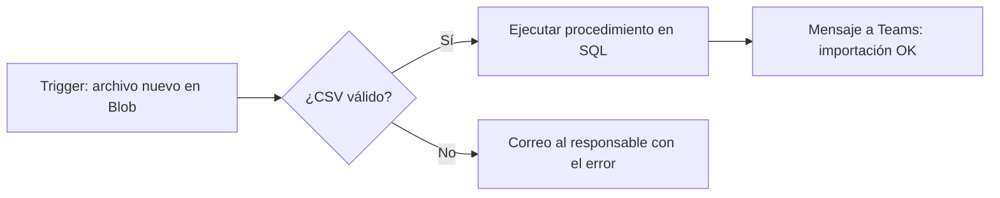

# Logic Apps

Parte de: [[08-Automatizacion-DevOps/01 Automatización y CICD/_Índice Automatización y CICD|Automatización y CICD]]

> [!info] Cómo avanzar
> `progreso`: **pendiente** → **viendo** (estudiando) → **visto** (contestaste la autoevaluación sin abrir las respuestas) → **dominado** (hiciste el laboratorio o lo aplicaste de verdad).

## Contenido

### Qué es
**Azure Logic Apps** es el servicio de Azure para construir **flujos de trabajo de integración** con un diseñador visual (o en JSON) y cientos de **conectores** ya hechos: SQL Server, Office 365, SharePoint, Service Bus, Blob Storage, SAP, HTTP, FTP y muchos más. Un flujo empieza con un **disparador** (*trigger*) y sigue con **acciones**. Sirve para orquestar procesos entre sistemas sin escribir el código de cada integración: «cuando llegue un archivo al Blob, valídalo, insértalo en SQL y avisa por Teams».

### Cómo funciona
- **Trigger**: un horario (*Recurrence*), una petición HTTP, un mensaje en una cola, un correo nuevo o un evento de Event Grid.
- **Acciones**: llamadas a conectores, condiciones, ciclos (`For each`), *scopes* para manejar errores (el patrón *try/catch* con `runAfter` en estado `Failed`), variables y expresiones (`@{triggerBody()?['id']}`).
- **Definición**: cada flujo es un documento JSON (*Workflow Definition Language*) que puedes versionar y desplegar con [[Bicep]] o desde un pipeline.

**Consumption vs Standard**:

| | Consumption | Standard |
|---|---|---|
| Infraestructura | Multiinquilino compartida | Inquilino único, sobre el runtime de Azure Functions |
| Flujos por recurso | Uno | Varios en la misma Logic App |
| Cobro | Por ejecución de acciones y conectores | Por plan de hospedaje (vCPU/memoria reservada) más algunos conectores |
| Tipos de flujo | Con estado | Con estado y **sin estado** (más rápidos, sin historial detallado) |
| Red privada | Limitada | Integración con VNet y *private endpoints* |
| Desarrollo local | Portal principalmente | Visual Studio Code, ejecución local, proyecto en Git |

Regla práctica: **Consumption** para flujos de poco volumen o esporádicos (pagas casi nada si no corren); **Standard** cuando hay volumen alto y constante, necesitas red privada o quieres desarrollar y desplegar como un proyecto.

**Dónde ves por qué falló**: en el **historial de ejecuciones** (*Run history*) de cada flujo. Abres la ejecución y el diseñador muestra cada paso en verde o rojo, con sus **entradas y salidas** exactas y el mensaje de error del conector. Para monitoreo centralizado, envía los diagnósticos a Log Analytics y crea alertas en [[Azure Monitor y alertas]] por ejecuciones fallidas.



### Ejemplo
Flujo para [[Itzamna.Dionisio]]: cada día a las 07:00 (hora de Ciudad de México), consultar los pedidos pendientes y mandar un resumen por correo.

1. Trigger **Recurrence**: frecuencia diaria, zona horaria «(UTC-06:00) Guadalajara, Ciudad de México, Monterrey», hora 7. A diferencia del timer de Functions, el trigger de recurrencia de Logic Apps acepta zona horaria.
2. Acción **SQL Server → Ejecutar procedimiento almacenado**: `dbo.usp_Pedidos_PendientesResumen`. La conexión puede autenticarse con la **identidad administrada** de la Logic App.
3. Acción **Crear tabla HTML** con el resultado.
4. Acción **Office 365 Outlook → Enviar correo** al equipo.
5. Un *scope* «Al fallar» que publica el error en un canal de Teams.

Fragmento de la definición JSON (lo que verías en la vista de código):

```json
{
  "triggers": {
    "Recurrence": {
      "type": "Recurrence",
      "recurrence": {
        "frequency": "Day",
        "interval": 1,
        "timeZone": "Central Standard Time (Mexico)",
        "schedule": { "hours": [ "7" ], "minutes": [ 0 ] }
      }
    }
  }
}
```

### Cuándo usarlo y cuándo no
- **Úsalo** para integraciones entre servicios con conectores existentes, procesos con pasos de espera o aprobación, y cuando el equipo quiere ver el flujo de forma visual.
- **No lo uses** para lógica de negocio compleja, cálculos pesados o algo que requiera pruebas unitarias finas: eso va en una API o en una [[Azure Functions|Function]], que la Logic App puede llamar.
- Si el flujo es de oficina y lo mantendrá un usuario de negocio con Microsoft 365, mira [[Power Automate]] (comparten motor y conectores).

### Errores comunes
1. **Ciclos sobre miles de elementos en Consumption** sin calcular el costo: cada acción dentro del `For each` se cobra.
2. **Credenciales personales en las conexiones**: si esa persona se va, el flujo se rompe. Usa identidades administradas o cuentas de servicio.
3. **No manejar errores**: sin un *scope* con `runAfter: Failed`, el flujo falla en silencio.
4. **Editar en el portal sin versionar**: exporta la definición a Git y despliega con IaC.

### Para profundizar
- [¿Qué es Azure Logic Apps?](https://learn.microsoft.com/azure/logic-apps/logic-apps-overview)
- [Logic Apps Consumption vs Standard](https://learn.microsoft.com/azure/logic-apps/single-tenant-overview-compare)
- [Monitorear ejecuciones de flujos](https://learn.microsoft.com/azure/logic-apps/monitor-logic-apps)

## Autoevaluación

Contesta primero en voz alta o en papel; luego despliega la respuesta.

> [!question]- ¿Qué es Logic Apps?
> Servicio de Azure para **flujos de trabajo** low-code con diseñador visual: un trigger (HTTP, horario, correo, mensaje) y acciones con cientos de **conectores** (Office 365, SQL, Service Bus, SAP…).

> [!question]- Consumption vs Standard.
> **Consumption**: multiinquilino, pago por ejecución de acciones, un flujo por recurso. **Standard**: corre sobre el runtime de Functions con plan dedicado, varios flujos, integración con VNet y desarrollo local (verificar en la página oficial).

> [!question]- ¿Dónde ves por qué falló un flujo?
> En el **historial de ejecuciones** (Run history): cada paso muestra entradas, salidas y error. Configura reintentos por acción y un `Scope` con *run after* para manejar fallas.

