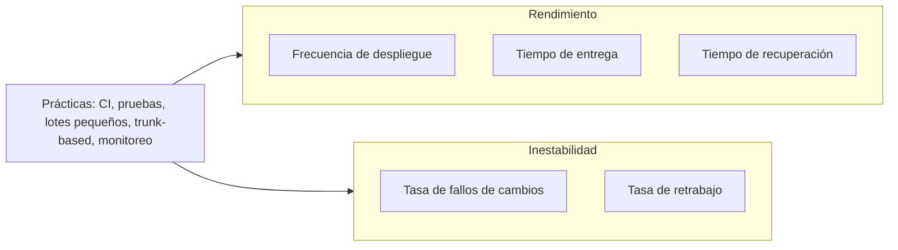

# Métricas DORA

Parte de: [[08-Automatizacion-DevOps/01 Automatización y CICD/_Índice Automatización y CICD|Automatización y CICD]]

> [!info] Cómo avanzar
> `progreso`: **pendiente** → **viendo** (estudiando) → **visto** (contestaste la autoevaluación sin abrir las respuestas) → **dominado** (hiciste el laboratorio o lo aplicaste de verdad).

## Contenido

### Qué es
Las **métricas DORA** vienen del programa de investigación *DevOps Research and Assessment* (hoy parte de Google Cloud), que durante más de una década ha estudiado qué distingue a los equipos que entregan software rápido **y** estable. Son indicadores del **desempeño de la entrega de software** de un servicio o equipo, no de personas.

Las **cuatro métricas clave** clásicas son:
1. **[[Frecuencia de despliegue (DORA)]]**: qué tan seguido llegan cambios a producción.
2. **[[Tiempo de entrega de cambios (DORA)]]**: cuánto tarda un commit en llegar a producción.
3. **[[Tasa de fallos de cambios (DORA)]]**: qué porcentaje de despliegues provoca una falla que requiere arreglo.
4. **[[Tiempo de recuperación de despliegues fallidos (DORA)]]**: cuánto tardas en restaurar el servicio tras un despliegue fallido (antes se llamaba MTTR o *time to restore*).

En los reportes recientes DORA agregó una quinta métrica, la **tasa de retrabajo** (*rework rate*): despliegues **no planeados** hechos para corregir un problema en producción, divididos entre el total de despliegues. También reorganizó los grupos: frecuencia, tiempo de entrega y tiempo de recuperación forman el grupo de **rendimiento (throughput)**, y tasa de fallos y retrabajo el de **inestabilidad**.

### Cómo funciona
**Velocidad y estabilidad juntas.** El hallazgo central de la investigación es que **no son un intercambio**: los equipos de mejor desempeño despliegan más seguido **y** fallan menos y se recuperan más rápido. Medir solo velocidad incentiva saltarse pruebas; medir solo estabilidad incentiva desplegar poco y en lotes enormes, que es justamente lo que vuelve riesgoso cada despliegue. Las métricas se equilibran entre sí: si subes la frecuencia y la tasa de fallos se dispara, no mejoraste.



**Qué necesitas registrar**: cada despliegue a producción (fecha, versión, commits incluidos), la fecha del primer commit de cada cambio, qué despliegues causaron un incidente, rollback o hotfix, y cuándo se restauró el servicio. En Azure DevOps, el historial de *environments* de [[Azure Pipelines]], los work items de incidentes en Boards y la [[Azure DevOps REST API]] te dan los datos.

### Ejemplo
Cálculos con datos de un mes de [[Itzamna.Dionisio]]:

- **Frecuencia**: 60 despliegues a producción en 30 días → 60 / 30 = **2 despliegues por día**.
- **Tasa de fallos**: de 20 despliegues, 3 requirieron rollback o hotfix → 3 / 20 = **15 %**.
- **Tiempo de entrega**: de commit a producción, en horas: 4, 30, 6, 48, 10, 2, 26. Ordenados: 2, 4, 6, **10**, 26, 30, 48 → la **mediana es 10 h** (el valor central de 7). El promedio sería ≈ 18 h, inflado por el cambio de 48 h.
- **Tiempo de recuperación**: tres incidentes por despliegue resueltos en 30, 90 y 45 min → (30 + 90 + 45) / 3 = **55 min** de media.

Script en Python para calcularlas desde un CSV exportado del pipeline:

```python
import csv
from statistics import median

with open("despliegues.csv", encoding="utf-8") as f:
    filas = list(csv.DictReader(f))   # columnas: fecha, horas_entrega, fallido, minutos_recuperacion

dias = 30
total = len(filas)
fallidos = [r for r in filas if r["fallido"] == "si"]

print(f"Frecuencia: {total / dias:.2f} por día")
print(f"Tiempo de entrega (mediana): {median(float(r['horas_entrega']) for r in filas):.1f} h")
print(f"Tasa de fallos: {len(fallidos) / total:.0%}")
if fallidos:
    rec = [float(r["minutos_recuperacion"]) for r in fallidos]
    print(f"Recuperación media: {sum(rec) / len(rec):.0f} min")
```

### Cuándo usarlo y cuándo no
- **Úsalas** para ver tendencias de un equipo o servicio a lo largo del tiempo y para decidir dónde invertir (si el tiempo de entrega es alto, ¿es por revisiones lentas, pruebas manuales o aprobaciones?).
- **No las uses** para comparar equipos con contextos distintos (una app móvil con revisión de tienda vs una API interna) ni para evaluar personas.
- Complementa con métricas de confiabilidad orientadas al usuario: [[SLI, SLO y SLA]].

### Errores comunes
1. **Convertirlas en metas o en evaluación individual.** Por la ley de Goodhart, cuando una medida se vuelve objetivo deja de medir bien: el equipo despliega cambios vacíos para subir la frecuencia o no registra fallos para bajar la tasa.
2. **Mirar una sola métrica** en lugar del conjunto.
3. **Definiciones inconsistentes**: ¿qué cuenta como «fallo»? ¿Desde el primer commit o desde el merge? Defínelo y no lo cambies.
4. **Medir a mano**: automatiza la recolección desde el pipeline o los números serán viejos y discutibles.
5. **Compararse con los umbrales «elite» de un reporte** sin considerar tu contexto; lo útil es tu propia mejora.

### Para profundizar
- [DORA: guía de las métricas de entrega de software](https://dora.dev/guides/dora-metrics-four-keys/)
- [Sitio oficial de DORA (reportes y capacidades)](https://dora.dev/)
- [CD Foundation: las 4 métricas clave se vuelven 5](https://cd.foundation/blog/2025/10/16/dora-5-metrics/)

## Subtemas

- [[Frecuencia de despliegue (DORA)]]
- [[Tiempo de entrega de cambios (DORA)]]
- [[Tasa de fallos de cambios (DORA)]]
- [[Tiempo de recuperación de despliegues fallidos (DORA)]]

## Ejercicios

Resuélvelos en papel o en la herramienta; la solución está plegada.

> [!question]- En 30 días hubo 60 despliegues a producción. ¿Frecuencia de despliegue?
> 60 / 30 = **2 despliegues por día**.

> [!question]- De 20 despliegues, 3 requirieron rollback o hotfix. ¿Tasa de fallos de cambios?
> 3 / 20 = **15 %**.

> [!question]- Tiempos de commit a producción (horas): 4, 30, 6, 48, 10, 2, 26. ¿Mediana del tiempo de entrega?
> Ordenados: 2, 4, 6, **10**, 26, 30, 48 → mediana **10 h**. (La mediana resiste mejor los valores extremos que el promedio, que daría ≈ 18 h.)

> [!question]- Tres incidentes por despliegue se resolvieron en 30, 90 y 45 min. ¿Tiempo medio de recuperación?
> (30 + 90 + 45) / 3 = **55 min**.

## Autoevaluación

Contesta primero en voz alta o en papel; luego despliega la respuesta.

> [!question]- ¿Cuáles son las cuatro métricas clave de DORA?
> **Frecuencia de despliegue** y **tiempo de entrega de cambios** (velocidad); **tasa de fallos de cambios** y **tiempo de recuperación** de despliegues fallidos (estabilidad). Los reportes recientes agregan otras, como la tasa de retrabajo (Pendiente de confirmar).

> [!question]- ¿Por qué medir velocidad y estabilidad juntas?
> Porque se equilibran: desplegar más rápido sin vigilar fallos degrada el servicio, y la investigación de DORA muestra que los equipos de alto desempeño mejoran **ambas** a la vez.

> [!question]- Error común al usar DORA.
> Usarlas para comparar o premiar personas: se manipulan. Son métricas del **sistema** de entrega para encontrar cuellos de botella.

## Progreso de los subtemas

```base
filters:
  and:
    - file.inFolder("08-Automatizacion-DevOps/01 Automatización y CICD/Métricas DORA")
    - file.name != "Métricas DORA"
views:
  - type: table
    name: Progreso
    order:
      - file.name
      - progreso
      - nivel
```
