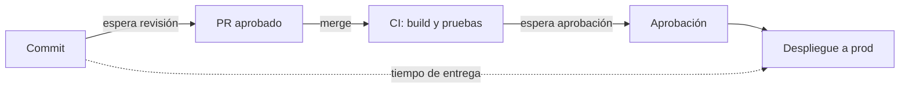

# Tiempo de entrega de cambios (DORA)

Parte de: [[Métricas DORA]]

> [!info] Cómo avanzar
> `progreso`: **pendiente** → **viendo** (estudiando) → **visto** (contestaste la autoevaluación sin abrir las respuestas) → **dominado** (hiciste el laboratorio o lo aplicaste de verdad).

## Contenido

### Qué es
El **tiempo de entrega de cambios** (*lead time for changes*) mide **cuánto tarda un cambio desde que se confirma en el control de versiones (commit) hasta que está corriendo en producción**. Es una de las [[Métricas DORA]] del grupo de rendimiento. No mide cuánto tarda en programarse una funcionalidad (eso sería el tiempo de ciclo completo desde la idea), sino la parte que controla el proceso de entrega: revisión, integración, pruebas, aprobaciones y despliegue.

### Cómo funciona
Para cada despliegue a producción, tomas los commits incluidos y calculas `fecha del despliegue − fecha del commit`. Luego resumes todos esos tiempos con la **mediana** (y a veces el percentil 90).



Normalmente la mayor parte del tiempo **no es trabajo**, es **espera**: el PR esperando revisor, el artefacto esperando a la ventana de despliegue del jueves, el cambio esperando a que QA lo pruebe a mano. Por eso descomponer el tiempo por etapas es lo más útil: te dice dónde está el cuello de botella.

**Por qué la mediana y no el promedio**: la distribución de tiempos de entrega está **sesgada**: la mayoría de los cambios tardan horas, pero unos pocos tardan días (un PR que se quedó olvidado, un cambio grande). El promedio se jala hacia esos valores extremos y no representa la experiencia típica. Con tiempos de 2, 4, 6, 10, 26, 30 y 48 horas, la mediana es 10 h y el promedio ≈ 18 h; si el cambio de 48 h hubiera tardado 200 h, el promedio subiría a ≈ 40 h y la mediana seguiría en 10 h. Si quieres vigilar los casos lentos, reporta además el percentil 90.

**Prácticas que lo reducen**:
- **Lotes pequeños**: PR chicos se revisan en minutos, no en días.
- **Revisiones rápidas**: acuerdos de equipo como «los PR se revisan el mismo día», *pair programming*.
- **Trunk-based development** con ramas de vida corta; ver [[Estrategias de ramas (GitFlow y trunk-based)]].
- **Pruebas automatizadas** confiables en lugar de regresión manual.
- **Pipeline rápido**: caché, paralelismo, pruebas por capas.
- **Aprobaciones solo donde aportan**: automatizar las verificaciones y dejar la aprobación humana para lo que realmente lo requiere.
- **Despliegue continuo** con [[Feature flags]] para que el código terminado no espere a que la funcionalidad completa esté lista.

### Ejemplo
Cálculo con Python a partir de pares (commit, despliegue) exportados de Git y del historial de [[Azure Pipelines]]:

```python
from datetime import datetime
from statistics import median, quantiles

cambios = [
    ("2026-11-02T09:00", "2026-11-02T13:00"),
    ("2026-11-02T10:00", "2026-11-03T16:00"),
    ("2026-11-03T08:00", "2026-11-03T14:00"),
    ("2026-11-03T09:00", "2026-11-05T09:00"),
]

horas = [
    (datetime.fromisoformat(d) - datetime.fromisoformat(c)).total_seconds() / 3600
    for c, d in cambios
]
print(f"Mediana: {median(horas):.1f} h")
print(f"P90: {quantiles(horas, n=10)[-1]:.1f} h")
```

Para obtener los commits de cada despliegue en Azure DevOps, el *run* del pipeline expone los cambios asociados (*changes*) por la [[Azure DevOps REST API]]; con `git log --format=%cI` obtienes la fecha de cada commit.

### Cuándo usarlo y cuándo no
- **Úsalo** para encontrar y quitar esperas en el proceso.
- **No lo confundas** con productividad de las personas: un tiempo alto casi siempre es un problema del sistema (aprobaciones, ambientes, pruebas manuales), no de quien programa.

### Errores comunes
1. **Reportar el promedio** y sacar conclusiones por unos cuantos valores atípicos.
2. **Medir desde el merge** en vez de desde el commit, ocultando la espera de revisión (si decides hacerlo, sé consistente y dilo).
3. **No descomponer por etapas**: el número total no dice qué arreglar.
4. **Acelerar recortando pruebas**: la [[Tasa de fallos de cambios (DORA)]] lo delatará.

### Para profundizar
- [DORA: métricas de entrega de software](https://dora.dev/guides/dora-metrics-four-keys/)
- [DORA: capacidad de trabajar en lotes pequeños](https://dora.dev/capabilities/working-in-small-batches/)

## Autoevaluación

Contesta primero en voz alta o en papel; luego despliega la respuesta.

> [!question]- ¿Qué mide?
> El tiempo desde que un cambio se **confirma** (commit) hasta que corre en producción.

> [!question]- ¿Qué prácticas lo reducen?
> Cambios pequeños, PRs revisados rápido, pipeline rápido y automático, despliegue sin pasos manuales.

> [!question]- ¿Por qué reportar la mediana y no el promedio?
> Un cambio que tardó semanas distorsiona el promedio; la mediana refleja el caso típico.

