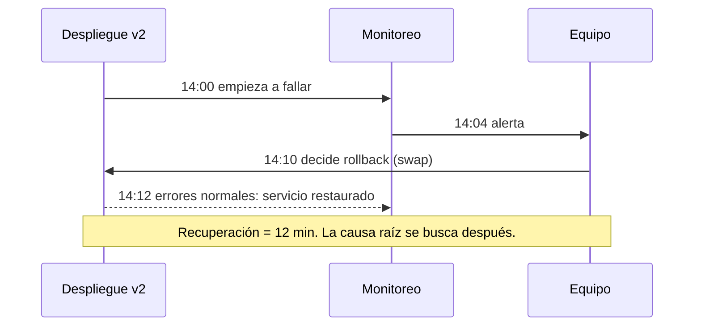

# Tiempo de recuperación de despliegues fallidos (DORA)

Parte de: [[Métricas DORA]]

> [!info] Cómo avanzar
> `progreso`: **pendiente** → **viendo** (estudiando) → **visto** (contestaste la autoevaluación sin abrir las respuestas) → **dominado** (hiciste el laboratorio o lo aplicaste de verdad).

## Contenido

### Qué es
El **tiempo de recuperación de despliegues fallidos** (*failed deployment recovery time*) mide **cuánto tarda el equipo en restaurar el servicio cuando un despliegue causa una falla** en producción. Es una de las [[Métricas DORA]]; antes se llamaba *time to restore service* o MTTR, y DORA lo acotó a fallas causadas por despliegues para separarlo de caídas por otras causas (una región de Azure caída, por ejemplo). En el modelo de cinco métricas forma parte del grupo de rendimiento.

### Cómo funciona
Para cada despliegue fallido:

```text
tiempo de recuperación = momento en que el servicio vuelve a funcionar para los usuarios
                       − momento en que el despliegue empezó a causar impacto
```

Luego resumes (mediana o media) todos los casos del periodo. Con tres incidentes resueltos en 30, 90 y 45 min, la media es 55 min.

**¿Se mide hasta encontrar la causa raíz?** **No.** Se mide hasta **restaurar el servicio** para los usuarios: el rollback terminó, el flag se apagó, la tasa de errores volvió a la normalidad. Entender la causa raíz y corregirla de fondo puede tardar días y pertenece al [[Postmortems sin culpables|postmortem]]. Mezclar ambos incentiva lo contrario de lo que quieres: quedarse investigando en producción en lugar de revertir primero.



**Qué lo reduce más**: la **capacidad de revertir rápido y con seguridad**, porque es la acción que más recorta el tiempo. En concreto:
- **Rollback de un paso** probado: swap de slots, peso 0 % al canary, `kubectl rollout undo`, `git revert` en [[GitOps]]; ver [[Rollback y gestión de releases]].
- **[[Feature flags]] como kill switch**: apagar la funcionalidad nueva sin redeplegar.
- **Detección temprana**: alertas por síntomas (tasa de errores, latencia, burn rate de [[Error budgets]]) que avisan en minutos, no cuando un cliente llama.
- **Despliegues pequeños**: es más obvio qué cambió y qué revertir.
- **[[Runbooks]]** y roles de incidente claros ([[Manejo de incidentes]]).
- **Migraciones compatibles hacia atrás** para que el rollback del código sea posible.

### Ejemplo
Consulta KQL en [[Application Insights]] para estimar cuándo empezó y terminó el impacto de un despliegue (tasa de fallos por minuto alrededor de la hora del despliegue):

```kusto
requests
| where timestamp between (datetime(2026-11-09 13:30) .. datetime(2026-11-09 15:00))
| summarize total = count(), fallas = countif(success == false) by bin(timestamp, 1m)
| extend tasa = todouble(fallas) / total
| where tasa > 0.02          // por encima del 2 % lo consideramos impacto
| summarize inicio = min(timestamp), fin = max(timestamp)
| extend minutosRecuperacion = datetime_diff('minute', fin, inicio)
```

Registra `inicio` y `fin` en el work item del incidente; así la métrica se calcula sola cada mes.

### Cuándo usarlo y cuándo no
- **Úsalo** para justificar inversión en rollback automatizado, monitoreo y feature flags.
- **No lo uses** para medir caídas de infraestructura ajenas al despliegue: esas van a tu disponibilidad general y a los [[SLI, SLO y SLA]].

### Errores comunes
1. **Medir hasta la causa raíz** o hasta el cierre del ticket.
2. **Empezar a contar en la alerta** en lugar de en el inicio del impacto: oculta el tiempo de detección, que suele ser grande.
3. **Rollbacks nunca ensayados** que en el momento crítico no funcionan.
4. **Debatir demasiado** antes de revertir; define criterios previos.

### Para profundizar
- [DORA: métricas de entrega de software](https://dora.dev/guides/dora-metrics-four-keys/)
- [Google SRE Book: Managing Incidents](https://sre.google/sre-book/managing-incidents/)

## Autoevaluación

Contesta primero en voz alta o en papel; luego despliega la respuesta.

> [!question]- ¿Qué mide?
> Cuánto se tarda en restablecer el servicio tras un despliegue fallido (antes llamado MTTR o *time to restore*).

> [!question]- ¿Qué lo reduce más?
> Rollback rápido y probado (swap de slot, artefacto anterior), alertas por síntomas y runbooks claros.

> [!question]- ¿Se mide hasta encontrar la causa raíz?
> No: hasta **restablecer** el servicio. La causa raíz se investiga después en el postmortem.

