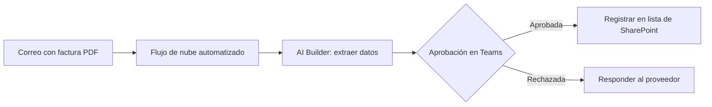

# Power Automate

Parte de: [[08-Automatizacion-DevOps/01 Automatización y CICD/_Índice Automatización y CICD|Automatización y CICD]]

> [!info] Cómo avanzar
> `progreso`: **pendiente** → **viendo** (estudiando) → **visto** (contestaste la autoevaluación sin abrir las respuestas) → **dominado** (hiciste el laboratorio o lo aplicaste de verdad).

## Contenido

### Qué es
**Power Automate** es el servicio de automatización de la **Power Platform** de Microsoft, pensado para que usuarios de negocio y desarrolladores automaticen tareas de oficina: aprobaciones, avisos, copiar datos entre Excel, SharePoint, Dataverse y Teams, o leer facturas de correos. Comparte el motor y buena parte de los conectores con [[Logic Apps]], pero vive en el ecosistema de Microsoft 365 y se licencia por usuario o por proceso.

### Cómo funciona
**Tipos de flujos**:
- **Flujos de nube automatizados**: se disparan por un evento («cuando llega un correo con adjunto», «cuando se crea un elemento en una lista de SharePoint»).
- **Flujos instantáneos**: se ejecutan a mano con un botón (desde la app móvil, Teams o una app de Power Apps).
- **Flujos programados**: corren con un horario.
- **Flujos de escritorio (RPA)**: con **Power Automate Desktop** automatizan aplicaciones de escritorio y sitios web imitando clics y teclado, útil para sistemas viejos sin API. Pueden ser **atendidos** (corren en la sesión del usuario) o **desatendidos** (en una máquina sin nadie).
- Además existen flujos de proceso de negocio dentro de aplicaciones de Dataverse.

**Conectores estándar vs premium**: los estándar (Outlook, SharePoint, Teams, OneDrive, Excel en la nube) se incluyen con muchas licencias de Microsoft 365; los **premium** (SQL Server, HTTP, Dataverse, Salesforce, conectores personalizados) requieren una licencia de Power Automate.

### Ejemplo
El área de compras recibe solicitudes por un formulario de Microsoft Forms. Un flujo automatizado:
1. Trigger: «Cuando se envía una respuesta nueva» en Forms.
2. Obtener los detalles de la respuesta.
3. **Iniciar y esperar una aprobación** asignada al jefe del solicitante (Office 365 Users → Obtener jefe).
4. Si se aprueba, crear el elemento en la lista de SharePoint «Compras aprobadas» y avisar por Teams; si no, enviar correo con el motivo.

Todo con conectores estándar, así que lo mantiene el área de compras sin intervención de desarrollo. Si mañana hace falta insertar en la base de [[Itzamna.Dionisio]], lo correcto es exponer un endpoint de la API protegido y llamarlo con un **conector personalizado** (premium), en lugar de dar acceso directo a SQL.

### Power Automate o Logic Apps
| Criterio | Power Automate | Logic Apps |
|---|---|---|
| Quién lo construye | Usuarios de negocio, *citizen developers* | Desarrolladores e integradores |
| Dónde vive | Entornos de Power Platform | Suscripción de Azure (grupo de recursos) |
| Licencia | Por usuario o por bot/proceso | Pago por uso o por plan de Azure |
| ALM | Soluciones de Power Platform | Git, Bicep, pipelines de Azure |
| Red y seguridad | Políticas DLP de Power Platform | VNet, private endpoints, RBAC de Azure |

Si el flujo es personal o departamental y gira alrededor de Microsoft 365, Power Automate. Si es una integración de sistemas que opera TI, con despliegue por pipeline y monitoreo en Azure, Logic Apps.

### Licencias y su riesgo típico
Según la lista de precios en USD publicada en 2026 (confírmala en la página oficial antes de presupuestar): los flujos de nube con conectores estándar vienen incluidos en Microsoft 365; **Premium** cuesta alrededor de **15 USD por usuario al mes** e incluye conectores premium y RPA atendido; **Process** ronda **150 USD por bot al mes** para RPA desatendido.

El riesgo típico: alguien construye un flujo con un **conector premium** (SQL, HTTP) usando su licencia de prueba o de Microsoft 365, el flujo se vuelve crítico y, al expirar la prueba o al compartirlo con otros, **deja de funcionar** o resulta que **cada usuario que lo dispara necesita licencia premium**. Revisa el tipo de conector antes de construir y define quién paga la licencia del flujo (licencia *per flow*/proceso para flujos de equipo).

### Errores comunes
1. **Flujos críticos ligados a una cuenta personal**: si la persona sale, el flujo muere. Usa cuentas de servicio y soluciones con co-propietarios.
2. **No configurar políticas DLP**: un usuario puede mandar datos de SharePoint a un servicio externo.
3. **Sin manejo de errores ni avisos**: configura *Run after* para notificar fallos.
4. **Ciclos sobre listas grandes** que topan con límites de solicitudes por día de la licencia.

### Para profundizar
- [Documentación de Power Automate](https://learn.microsoft.com/power-automate/)
- [Tipos de flujos en Power Automate](https://learn.microsoft.com/power-automate/flow-types)
- [Preguntas frecuentes de licencias de Power Automate](https://learn.microsoft.com/power-platform/admin/power-automate-licensing/faqs)

## Autoevaluación

Contesta primero en voz alta o en papel; luego despliega la respuesta.

> [!question]- ¿Qué tipos de flujos hay?
> **Cloud flows**: automatizados (por evento), instantáneos (botón) y programados. **Desktop flows**: RPA que controla apps de escritorio. Además flujos de procesos de negocio.

> [!question]- ¿Power Automate o Logic Apps?
> Power Automate: usuarios de negocio dentro de Microsoft 365, licenciado por usuario o flujo. Logic Apps: equipos de TI/desarrollo, en una suscripción de Azure, con ALM, IaC y redes. Usan el mismo motor de conectores.

> [!question]- Riesgo típico de licencias.
> Algunos conectores son **premium** (SQL, HTTP, conectores personalizados) y requieren licencia adicional (verificar en la página oficial).

