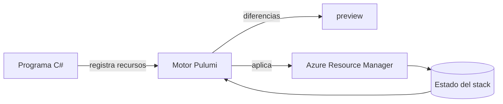

# Pulumi

Parte de: [[08-Automatizacion-DevOps/01 Automatización y CICD/_Índice Automatización y CICD|Automatización y CICD]]

> [!info] Cómo avanzar
> `progreso`: **pendiente** → **viendo** (estudiando) → **visto** (contestaste la autoevaluación sin abrir las respuestas) → **dominado** (hiciste el laboratorio o lo aplicaste de verdad).

## Contenido

### Qué es
Pulumi es una herramienta de [[Infraestructura como código - conceptos|infraestructura como código]] que te deja describir la infraestructura en **lenguajes de propósito general**: C#, TypeScript, Python, Go o Java, además de YAML. En lugar de aprender un DSL como HCL (Terraform) o Bicep, usas tu lenguaje con sus ciclos, funciones, clases, paquetes NuGet y pruebas unitarias. El motor de Pulumi es de código abierto; Pulumi Cloud es su servicio comercial opcional para guardar estado y colaborar.

### Cómo funciona
Tu programa **no crea recursos directamente**: al ejecutarse, registra objetos (por ejemplo `new WebApp(...)`) y Pulumi construye un **grafo de recursos deseados**. El motor lo compara con el **estado** guardado del despliegue anterior y calcula qué crear, actualizar o borrar, igual que Terraform. Por eso, aunque escribas código imperativo, el resultado es declarativo.

- **Proyecto**: carpeta con `Pulumi.yaml` y tu código.
- **Stack**: una **instancia** independiente del proyecto, normalmente un ambiente (`dev`, `prod`). Cada stack tiene su propia configuración (`Pulumi.dev.yaml`) y su propio estado.
- **Estado**: el registro de qué recursos existen y sus propiedades. Puede vivir en **Pulumi Cloud** (por defecto) o en un **backend propio**: una cuenta de Azure Blob Storage (`pulumi login azblob://contenedor`), S3 o el disco local. Con backend propio tú te encargas del bloqueo, respaldo y cifrado.
- **Secretos**: `pulumi config set --secret` los cifra en el archivo de configuración; puedes usar Azure Key Vault como proveedor de cifrado.
- **Proveedores**: para Azure, el paquete `Pulumi.AzureNative` cubre la API de Azure Resource Manager.



### Diferencias con Terraform y Bicep
| | Pulumi | Terraform | Bicep |
|---|---|---|---|
| Lenguaje | C#, TS, Python, Go, Java, YAML | HCL | Bicep (DSL) |
| Estado | Pulumi Cloud o backend propio | Archivo de estado (remoto recomendado) | No hay: Azure es el estado |
| Nubes | Multinube | Multinube | Solo Azure |
| Pruebas | Unitarias con xUnit, mocks | `terraform test` | Linter y what-if |

### Ejemplo
Stack en C# para [[Itzamna.Dionisio]]:

```csharp
using Pulumi;
using Pulumi.AzureNative.Resources;
using Pulumi.AzureNative.Web;
using Pulumi.AzureNative.Web.Inputs;

return await Deployment.RunAsync(() =>
{
    var config = new Config();
    var entorno = Pulumi.Deployment.Instance.StackName; // "dev" o "prod"

    var rg = new ResourceGroup($"rg-dionisio-{entorno}");

    var plan = new AppServicePlan("plan", new AppServicePlanArgs
    {
        ResourceGroupName = rg.Name,
        Kind = "linux",
        Reserved = true,
        Sku = new SkuDescriptionArgs { Name = entorno == "prod" ? "P0v3" : "B1" }
    });

    var app = new WebApp("app", new WebAppArgs
    {
        ResourceGroupName = rg.Name,
        ServerFarmId = plan.Id,
        HttpsOnly = true,
        SiteConfig = new SiteConfigArgs { LinuxFxVersion = "DOTNETCORE|10.0" }
    });

    return new Dictionary<string, object?> { ["url"] = app.DefaultHostName };
});
```

Comandos básicos:

```bash
pulumi new azure-csharp          # crea proyecto a partir de plantilla
pulumi stack init dev            # crea el stack dev
pulumi config set azure-native:location mexicocentral
pulumi config set --secret sqlPassword 'valor'   # se guarda cifrado
pulumi preview                   # muestra el plan sin aplicar
pulumi up                        # aplica los cambios
pulumi stack select prod         # cambia de stack
pulumi destroy                   # borra los recursos del stack
```

### Cuándo usarlo y cuándo no
- **Úsalo** si el equipo domina C# y la infraestructura tiene lógica real (generar N recursos a partir de datos, componentes reutilizables publicados como NuGet, pruebas unitarias).
- **Prefiere Bicep** si solo usas Azure y la infraestructura es sencilla: no hay estado que cuidar.
- **Prefiere Terraform** si el equipo ya lo usa o buscas la comunidad más grande de módulos.

### Errores comunes
1. **Lógica excesiva.** Que puedas usar ciclos no significa que debas construir un framework; el código de infraestructura debe leerse fácil.
2. **Perder o corromper el estado** en un backend propio sin respaldo ni bloqueo. Activa versionado en el contenedor de Blob.
3. **Confundir `Output<T>` con valores normales.** Los valores de recursos se resuelven después; usa `Apply` o interpolación de Pulumi, no `.ToString()`.
4. **Cambios manuales en el portal**, igual que con cualquier IaC: usa `pulumi refresh` para detectarlos.

### Para profundizar
- [Documentación de Pulumi](https://www.pulumi.com/docs/)
- [Pulumi con Azure (Azure Native)](https://www.pulumi.com/registry/packages/azure-native/)
- [Backends de estado en Pulumi](https://www.pulumi.com/docs/iac/concepts/state-and-backends/)

## Autoevaluación

Contesta primero en voz alta o en papel; luego despliega la respuesta.

> [!question]- ¿Qué distingue a Pulumi de Terraform y Bicep?
> Defines la infraestructura con **lenguajes de propósito general** (C#, TypeScript, Python, Go, Java) con clases, bucles y pruebas unitarias, en vez de un DSL.

> [!question]- ¿Qué son los *stacks* y dónde vive el estado?
> Un stack es una instancia del programa (dev, prod) con su configuración. El estado vive en Pulumi Cloud o en un backend propio (p. ej. Blob Storage).

> [!question]- Comandos básicos.
> `pulumi new` (crear proyecto), `pulumi preview` (qué cambiaría), `pulumi up` (aplicar), `pulumi destroy`.

