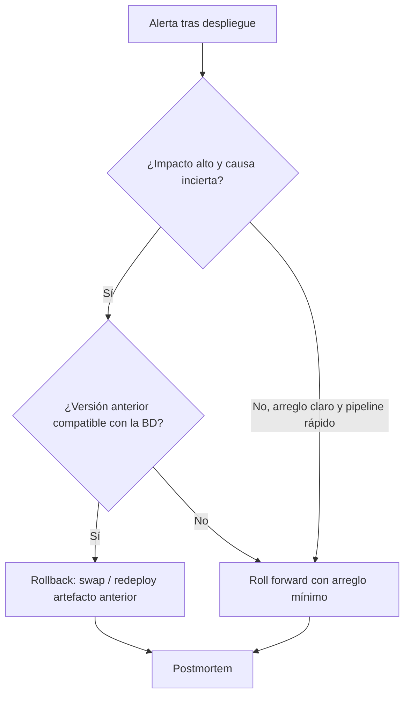

# Rollback y gestión de releases

Parte de: [[08-Automatizacion-DevOps/01 Automatización y CICD/_Índice Automatización y CICD|Automatización y CICD]]

> [!info] Cómo avanzar
> `progreso`: **pendiente** → **viendo** (estudiando) → **visto** (contestaste la autoevaluación sin abrir las respuestas) → **dominado** (hiciste el laboratorio o lo aplicaste de verdad).

## Contenido

### Qué es
**Gestionar releases** es controlar qué versión está en cada ambiente, cómo se promueve y cómo se deshace. **Rollback** es regresar a la versión anterior conocida como buena; **roll forward** es corregir hacia adelante desplegando una versión nueva con el arreglo. Tener ambos caminos listos convierte un mal despliegue en un susto de minutos en lugar de una noche entera.

### Cómo funciona
**¿Rollback o roll forward?**
- **Rollback** cuando el problema es grave, la causa no es obvia y la versión anterior es compatible con el estado actual (sobre todo la base de datos). Restaura el servicio primero; investigas después.
- **Roll forward** cuando el arreglo es pequeño y claro, el pipeline es rápido, o el rollback es imposible porque hubo un cambio de esquema o de datos que la versión anterior no entiende.

**Qué necesitas para que el rollback sea rápido**:
1. **Artefactos versionados e inmutables** guardados (zip del pipeline, imagen con etiqueta `1.4.2`, no `latest`). «Construye una vez, despliega muchas»; ver [[CI y CD - conceptos]].
2. **Un mecanismo de un paso**: swap de slots, peso 0 % al canary, `kubectl rollout undo`, `git revert` en [[GitOps]], o re-ejecutar la etapa de despliegue de un run anterior en [[Azure Pipelines]].
3. **Migraciones compatibles hacia atrás** (expand/contract): el código viejo debe funcionar con el esquema nuevo.
4. **Haberlo ensayado**: un rollback que nunca se probó es una hipótesis.
5. **Decisión rápida**: criterios claros («si la tasa de 5xx supera 2 % por 5 minutos tras desplegar, se revierte») y alguien con autoridad.

**Por qué la base de datos complica todo**: el código se reemplaza; los datos no. Si v2 renombró una columna, borró una tabla o transformó datos, volver a v1 no deshace eso: v1 truena contra el esquema nuevo. Y un script «de reversa» puede perder datos que se escribieron con v2. Por eso: cambios aditivos, scripts versionados ([[Migraciones de base de datos (scripts versionados, DACPAC, DbUp y Flyway)]]), respaldo o *point-in-time restore* antes de cambios riesgosos, y separar la migración destructiva en un release posterior.

**Saber qué hay en producción**:
- Versión semántica + SHA del commit en el artefacto ([[Git - tags y versionado semántico]]).
- Un endpoint `/version` o la versión en los [[Health checks]].
- Etiquetas en la telemetría (`application_Version` en [[Application Insights]]).
- El historial del *environment* en Azure DevOps (qué run se desplegó, cuándo y quién aprobó).



### Ejemplo
Exponer la versión en [[Itzamna.Dionisio]]:

```csharp
// Program.cs: la versión la inyecta el pipeline con /p:Version=1.4.2 /p:SourceRevisionId=$(Build.SourceVersion)
var ensamblado = typeof(Program).Assembly;
var version = ensamblado
    .GetCustomAttribute<AssemblyInformationalVersionAttribute>()?
    .InformationalVersion ?? "desconocida";

app.MapGet("/version", () => Results.Ok(new { version }))
   .AllowAnonymous();
```

```bash
# En el pipeline: versión y commit quedan dentro del binario
dotnet publish src/Dionisio.Api -c Release -o out \
  /p:Version=1.4.2 /p:SourceRevisionId=$BUILD_SOURCEVERSION
```

**Rollback publicando a IIS por FTP** ([[Publicar en IIS (FTP y FileZilla)]]): no hay swap, así que hay que prepararlo. Guarda cada versión publicada en una carpeta con su número (`releases/1.4.1`, `releases/1.4.2`) y conserva el zip del pipeline. Para revertir, coloca `app_offline.htm` en el sitio (detiene la app y libera los archivos), copia el contenido de la versión anterior, quita `app_offline.htm`. Mejor aún: apunta la ruta física del sitio de IIS a la carpeta de la versión y cambia esa ruta para revertir; es casi un blue-green manual.

### Cuándo usarlo y cuándo no
- Ten **siempre** un plan de rollback documentado en el [[Runbooks|runbook]] del servicio.
- Un rollback no sustituye arreglar la causa: después viene el [[Postmortems sin culpables|postmortem]].
- Los [[Feature flags]] permiten «rollback» de una funcionalidad sin redeplegar.

### Errores comunes
1. **No guardar artefactos anteriores** o depender de recompilar un commit viejo.
2. **Migraciones destructivas en el mismo release** que el código.
3. **Debatir 40 minutos** si revertir o no mientras los usuarios sufren: define el criterio antes.
4. **No saber qué versión está en producción** y revertir «a ciegas».

### Para profundizar
- [Azure Pipelines: environments e historial de despliegues](https://learn.microsoft.com/azure/devops/pipelines/process/environments)
- [Restauración a un punto en el tiempo de Azure SQL](https://learn.microsoft.com/azure/azure-sql/database/recovery-using-backups)
- [Google SRE Book: Release Engineering](https://sre.google/sre-book/release-engineering/)

## Autoevaluación

Contesta primero en voz alta o en papel; luego despliega la respuesta.

> [!question]- ¿Rollback o roll forward?
> **Rollback**: volver a la versión anterior conocida. **Roll forward**: corregir con una versión nueva. Si el arreglo no es trivial e inmediato, primero rollback para restablecer el servicio.

> [!question]- ¿Qué necesitas para que un rollback sea rápido?
> Artefactos **inmutables y versionados**, poder redeplegar uno anterior sin recompilar (o swap de slot), migraciones de base compatibles hacia atrás y un procedimiento probado (runbook).

> [!question]- ¿Por qué la base de datos complica el rollback?
> El código se revierte, los datos no. Si la migración borró o renombró una columna, la versión anterior falla. Por eso: cambios aditivos primero y borrados en un release posterior.

> [!question]- ¿Cómo identificas qué hay en producción?
> Versión semántica o número de build en el artefacto, **tag** de Git por release, notas de versión y el historial del environment en el pipeline. Exponer la versión en `/health` ayuda.

> [!question]- Si publicas a IIS por FTP, ¿cómo haces rollback?
> Guarda cada versión en una carpeta con su número (`releases/1.4.2`) y apunta el sitio a la carpeta activa, o conserva el zip anterior para volver a copiarlo. Mejor aún: automatiza con un pipeline (Web Deploy o un agente en el servidor).

