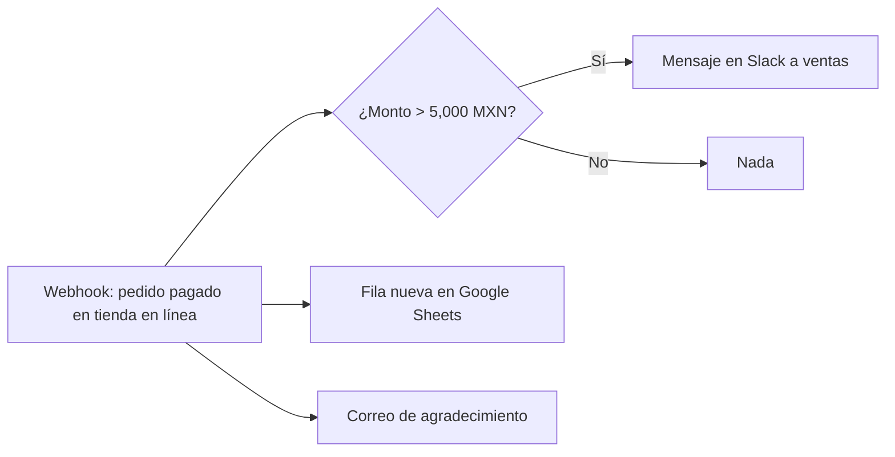

# Zapier y Make

Parte de: [[08-Automatizacion-DevOps/01 Automatización y CICD/_Índice Automatización y CICD|Automatización y CICD]]

> [!info] Cómo avanzar
> `progreso`: **pendiente** → **viendo** (estudiando) → **visto** (contestaste la autoevaluación sin abrir las respuestas) → **dominado** (hiciste el laboratorio o lo aplicaste de verdad).

## Contenido

### Qué es
**Zapier** y **Make** (antes Integromat) son plataformas **iPaaS SaaS** (*integration platform as a service*): conectan aplicaciones en la nube mediante flujos visuales sin código. Tienen miles de integraciones con apps populares (Gmail, Google Sheets, Slack, HubSpot, Shopify, Notion, Trello, Stripe) y los usan sobre todo equipos de marketing, ventas, operación y emprendedores para automatizar tareas repetitivas sin depender de desarrollo.

### Cómo funciona
**Lo que tienen en común**:
- Un flujo arranca con un **disparador** de una app («nuevo lead en el formulario», «nueva fila en Sheets», un webhook) y sigue con **acciones** en otras apps.
- Mapeas campos de un paso a otro con un editor visual.
- Corren en la infraestructura del proveedor: no instalas ni operas nada.
- Los disparadores son **instantáneos** (webhooks) o por **sondeo** (*polling*) cada cierto intervalo que depende del plan.

**Diferencias de estilo**:
- **Zapier** llama a sus flujos *Zaps*. Es lineal y muy fácil: paso tras paso, con ramas (*Paths*) y filtros. Tiene el catálogo de integraciones más grande.
- **Make** llama a sus flujos *escenarios* y los dibuja como un **lienzo de módulos** conectados, con *routers*, iteradores y agregadores. Es más visual y potente para transformar datos y manejar errores, con una curva de aprendizaje un poco mayor.

**Cómo suelen cobrar**: por **volumen de ejecución de pasos**.
- **Zapier** cobra por **tareas**: cada acción completada con éxito cuenta como una tarea (el disparador no cuenta). Los planes suben de precio según las tareas al mes y desbloquean pasos múltiples, ramas e intervalos de sondeo más cortos. (Cifras exactas del plan gratuito: Pendiente de confirmar.)
- **Make** cobra por **créditos** (antes «operaciones»): cada módulo que se ejecuta consume un crédito, incluidos disparadores, filtros y routers; algunas acciones de IA o de código consumen más. Según información de mayo de 2026, el plan gratuito da 1,000 créditos al mes, hasta 2 escenarios activos y un intervalo mínimo de 15 minutos entre ejecuciones programadas.

Consecuencia práctica: un flujo de 10 pasos que corre 1,000 veces al mes consume del orden de 10,000 unidades. Haz la cuenta antes de construir.

### Ejemplo
Un fotógrafo que vende sesiones usa un formulario de reservas:
1. Disparador: nueva respuesta en el formulario.
2. Crear evento en Google Calendar.
3. Agregar contacto a la lista de correo.
4. Enviar mensaje de confirmación por correo.
5. Si el paquete es «boda», crear tarjeta en Trello con la lista de preparación.

Son 4–5 tareas por reserva; con 30 reservas al mes cabe en planes básicos. Si esto lo hiciera desarrollo con código propio, tomaría días y habría que hospedarlo.

### Cuándo no los usarías
- **Datos sensibles o regulados** (datos personales de clientes, salud, finanzas) que no pueden salir a un tercero, o cuando necesitas controlar la región de residencia de datos.
- **Volumen alto**: miles de ejecuciones diarias se vuelven caras comparadas con una [[Azure Functions|Function]] o con [[n8n]] autohospedado.
- **Lógica de negocio central** del sistema: debe vivir en tu código, versionada y con pruebas, no en un Zap que alguien edita en el navegador.
- **Integración con sistemas internos** sin exposición a internet (tu SQL Server on-premises).
- Cuando el equipo ya vive en Microsoft 365 y Azure: [[Power Automate]] o [[Logic Apps]] encajan mejor en gobernanza y licencias.

### Errores comunes
1. **Cuentas personales** como dueñas de flujos críticos.
2. **No revisar el historial** de ejecuciones: los errores se acumulan y nadie se entera. Configura avisos por fallo.
3. **Subestimar el consumo**: filtros y routers en Make también cuestan.
4. **Sin documentar**: en seis meses nadie sabe qué Zap envía ese correo misterioso.

### Para profundizar
- [Centro de ayuda de Zapier](https://help.zapier.com/)
- [Documentación de Make](https://help.make.com/)
- Comparativa con otras opciones: [[Alternativas para automatizar (comparativa)]]

## Autoevaluación

Contesta primero en voz alta o en papel; luego despliega la respuesta.

> [!question]- ¿Qué tienen en común Zapier y Make?
> Son plataformas **SaaS no-code** para conectar apps: un trigger y una serie de acciones. Zapier llama a los flujos *Zaps*; Make, *escenarios* con un lienzo visual de módulos.

> [!question]- ¿Cómo suelen cobrar?
> Por volumen: **tareas** (Zapier) u **operaciones/créditos** (Make) al mes. Un flujo con muchos pasos o un bucle puede consumir la cuota rápido (verificar en la página oficial).

> [!question]- ¿Cuándo no los usarías?
> Con datos sensibles que no deben salir a un tercero, volúmenes altos (costo) o lógica crítica que necesita pruebas y versionado: mejor código o n8n autohospedado.

