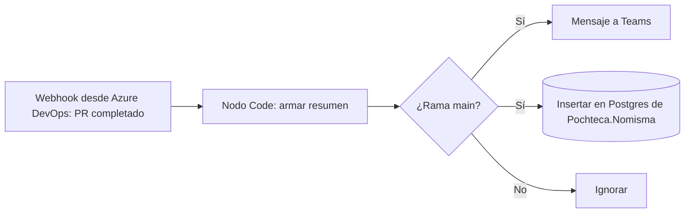

# n8n

Parte de: [[08-Automatizacion-DevOps/01 Automatización y CICD/_Índice Automatización y CICD|Automatización y CICD]]

> [!info] Cómo avanzar
> `progreso`: **pendiente** → **viendo** (estudiando) → **visto** (contestaste la autoevaluación sin abrir las respuestas) → **dominado** (hiciste el laboratorio o lo aplicaste de verdad).

## Contenido

### Qué es
**n8n** es una plataforma de **automatización de flujos de trabajo** con editor visual de nodos, parecida a [[Zapier y Make]], pero que puedes **autohospedar** en tu propio servidor o contenedor, además de usar su versión en la nube. Tiene cientos de integraciones, nodos para HTTP, bases de datos, código JavaScript o Python dentro del flujo y, en los últimos años, nodos para **agentes de IA** (modelos de lenguaje, memoria, herramientas). Es popular entre desarrolladores porque combina lo visual con la posibilidad de escribir código cuando hace falta.

### Cómo funciona
- Un **workflow** es un grafo de **nodos**. El primero es un disparador: *Webhook*, *Schedule Trigger*, un evento de una app o un disparo manual.
- Cada nodo recibe **ítems** (objetos JSON) del anterior y produce nuevos ítems. Puedes transformar datos con expresiones `{{ $json.campo }}` o con un nodo **Code**.
- Las **credenciales** (tokens, contraseñas de base de datos) se guardan cifradas en la base de datos de n8n con una llave de cifrado propia de la instancia.
- Al autohospedar, n8n guarda flujos, credenciales e historial en una base de datos (SQLite por defecto; PostgreSQL recomendado para producción). Para escalar, existe el **modo cola** con Redis y varios *workers*.

**Licencia**: n8n no es «open source» en sentido estricto, sino **fair-code** bajo la **Sustainable Use License**. Según su FAQ oficial, puedes usarlo gratis autohospedado para **uso interno de tu negocio**, proyectos personales, construir automatizaciones para clientes y cobrar por consultoría o mantenimiento. **No** puedes ofrecerlo como servicio donde terceros construyan sus propios flujos, hacer un fork para vender tu propia plataforma de automatización ni quitar su marca. Algunas funciones empresariales (SSO, ambientes, control de versiones con Git, etc.) requieren licencia Enterprise.



### Ejemplo
Levantar n8n en tu PC o en una VM con Docker Compose y PostgreSQL:

```yaml
services:
  postgres:
    image: postgres:16
    environment:
      POSTGRES_USER: n8n
      POSTGRES_PASSWORD: ${PG_PASSWORD}
      POSTGRES_DB: n8n
    volumes: [ pgdata:/var/lib/postgresql/data ]

  n8n:
    image: docker.n8n.io/n8nio/n8n
    ports: [ "5678:5678" ]
    environment:
      DB_TYPE: postgresdb
      DB_POSTGRESDB_HOST: postgres
      DB_POSTGRESDB_DATABASE: n8n
      DB_POSTGRESDB_USER: n8n
      DB_POSTGRESDB_PASSWORD: ${PG_PASSWORD}
      N8N_ENCRYPTION_KEY: ${N8N_ENCRYPTION_KEY}   # respáldala: sin ella no descifras credenciales
      GENERIC_TIMEZONE: America/Mexico_City
    volumes: [ n8ndata:/home/node/.n8n ]
    depends_on: [ postgres ]

volumes:
  pgdata:
  n8ndata:
```

Un flujo útil: *Schedule Trigger* diario → nodo HTTP que consulta la [[Azure DevOps REST API]] por work items atorados → nodo Code que filtra los que llevan más de 5 días en «Active» → mensaje a Teams.

### Al autohospedarlo, qué cuidar
- **Exposición a internet**: ponlo detrás de un proxy inverso con HTTPS; no publiques el puerto 5678 directo. Activa autenticación y, si es posible, restringe por IP o VPN.
- **Actualizaciones**: n8n publica versiones con frecuencia, incluidas correcciones de seguridad. Fija la versión de la imagen y actualiza con regularidad.
- **Respaldos**: de la base de datos **y** de la `N8N_ENCRYPTION_KEY`. Si pierdes la llave, las credenciales guardadas son inútiles.
- **Secretos**: las credenciales que guarda dan acceso a tus sistemas; limita quién puede editar flujos.
- **Nodos de código y comunitarios**: ejecutan código arbitrario; instala solo los que revises.
- **Recursos y monitoreo**: flujos pesados pueden saturar la instancia; vigila CPU, memoria y ejecuciones fallidas.

### Cuándo usarlo y cuándo no
- **Úsalo** cuando quieres automatizaciones visuales con control de tus datos, costo fijo de infraestructura y la opción de escribir código; o para prototipar flujos con agentes de IA.
- **Prefiere Zapier/Make** si no quieres operar nada y el volumen es bajo.
- **Prefiere [[Logic Apps]]** si todo está en Azure y necesitas gobernanza corporativa.

### Para profundizar
- [Documentación de n8n](https://docs.n8n.io/)
- [FAQ de la licencia de n8n](https://docs.n8n.io/n8n-community-license/community-license/license-faq)
- [Autohospedar n8n con Docker](https://docs.n8n.io/hosting/installation/docker/)

## Autoevaluación

Contesta primero en voz alta o en papel; luego despliega la respuesta.

> [!question]- ¿Qué es n8n?
> Herramienta de automatización de flujos con editor visual por **nodos**, que puedes **autohospedar** (Docker) o usar en su nube. Tiene nodos de código (JavaScript/Python), webhooks y nodos de IA.

> [!question]- ¿Qué licencia tiene?
> Licencia *fair-code* (Sustainable Use License): código disponible y autohospedable, con restricciones para ofrecerlo comercialmente como servicio (verificar en la página oficial).

> [!question]- Al autohospedarlo, ¿qué debes cuidar?
> Persistir datos y la llave de cifrado de credenciales (`N8N_ENCRYPTION_KEY`) en volumen, HTTPS delante, autenticación y actualizaciones.

