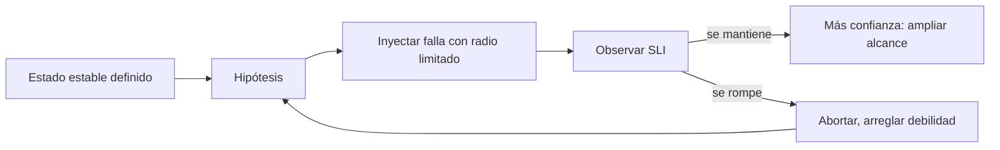

# Chaos engineering (conceptos)

Parte de: [[08-Automatizacion-DevOps/02 Operación en producción/_Índice Operación en producción|Operación en producción]]

> [!info] Cómo avanzar
> `progreso`: **pendiente** → **viendo** (estudiando) → **visto** (contestaste la autoevaluación sin abrir las respuestas) → **dominado** (hiciste el laboratorio o lo aplicaste de verdad).

## Contenido

### Qué es
**Chaos engineering** (ingeniería del caos) es la disciplina de **experimentar con fallas controladas** en un sistema para descubrir debilidades **antes** de que aparezcan solas en producción. En vez de esperar a que la base de datos se caiga un viernes, provocas a propósito que no responda durante dos minutos en un horario controlado y observas: ¿el [[Circuit breaker y reintentos|circuit breaker]] se abrió?, ¿la API degradó con elegancia?, ¿sonó la alerta?, ¿el runbook funcionó? Lo popularizó Netflix con *Chaos Monkey*, que apagaba instancias al azar.

No es «romper cosas por diversión»: es un **método experimental** con hipótesis, alcance limitado y forma de abortar.

### Cómo funciona
**Pasos de un experimento**:
1. **Definir el estado estable**: una métrica observable de comportamiento normal, idealmente un [[SLI (indicador de nivel de servicio)|SLI]] («tasa de éxito > 99.5 %, p95 < 400 ms»).
2. **Formular una hipótesis**: «si una instancia de App Service se reinicia, el estado estable se mantiene» o «si SQL tiene 500 ms de latencia extra, la API sigue respondiendo en menos de 1 s gracias a la caché».
3. **Elegir la falla** que simula eventos reales: apagar instancias, latencia o pérdida de red, CPU o memoria saturadas, dependencia caída, conmutación de zona o de base de datos.
4. **Limitar el radio de impacto** (*blast radius*): empezar en un ambiente de pruebas, con un porcentaje pequeño, por poco tiempo, con **condiciones de paro** automáticas y un botón para abortar.
5. **Ejecutar y observar** las métricas.
6. **Analizar**: si la hipótesis se cumplió, ganas confianza; si no, encontraste una debilidad. Crea acciones, arregla y repite.
7. **Automatizar y repetir**: lo que hoy funciona puede romperse con el siguiente cambio.

**Herramienta de Azure**: **Azure Chaos Studio**, un servicio administrado para crear y ejecutar experimentos de caos sobre recursos de Azure. Tiene una **biblioteca de fallas**: *service-direct* (aplicadas por la plataforma, por ejemplo apagar una VM o un nodo de AKS, conmutar Cosmos DB, bloquear acceso a Key Vault, reglas de NSG para cortar red) y *agent-based* (con un agente instalado en VMs para presión de CPU, memoria, matar procesos o añadir latencia de red). Los experimentos se definen con pasos, ramas paralelas y duración, usan una identidad administrada con permisos explícitos sobre cada objetivo y se pueden cancelar en cualquier momento. Revisa en la biblioteca de fallas qué servicios están soportados hoy.

Complementos: Azure Load Testing o k6 para generar carga mientras inyectas fallas ([[Pruebas de carga (k6 y NBomber)]]), y *game days* donde el equipo practica la respuesta.

### Ejemplo
Experimento para [[Itzamna.Dionisio]] en el ambiente de QA:
- **Estado estable**: tasa de éxito ≥ 99 % y p95 < 500 ms en `GET /api/pedidos`, con carga constante de k6.
- **Hipótesis**: «si [[Key Vault]] no es accesible durante 5 minutos, la API sigue funcionando porque cachea los secretos al arrancar».
- **Falla**: en Chaos Studio, la falla de denegación de acceso a Key Vault durante 5 min.
- **Paro**: si la tasa de éxito baja de 90 %, se cancela el experimento.
- **Resultado** (hipotético): a los 2 minutos la API empieza a fallar porque una librería consulta Key Vault en cada request. Acción: cachear la configuración y añadir alerta específica. Repetir el experimento después del arreglo.

Prueba sencilla sin herramientas, en desarrollo: detener el contenedor de SQL de [[Docker Compose]] (`docker compose stop sql`) mientras corres pruebas, y comprobar que la API responde con un `ProblemDetails` claro y se recupera sola al volver SQL.

### Cuándo usarlo y cuándo no
- **Úsalo** cuando ya tienes observabilidad, SLO, alertas y runbooks: el caos verifica que todo eso funcione. Sin observabilidad no puedes saber qué pasó.
- **No empieces en producción**; empieza en pruebas con fallas pequeñas y ve ampliando.
- Si ya sabes que algo va a fallar (no hay redundancia), no necesitas un experimento: arregla primero.

### Errores comunes
1. **Sin hipótesis ni métrica**: solo se rompe algo y se mira «a ver qué pasa».
2. **Radio de impacto sin límite** ni forma de abortar.
3. **No avisar** al equipo y confundir el experimento con un incidente real.
4. **No dar seguimiento** a las debilidades encontradas.

### Para profundizar
- [Principios de chaos engineering](https://principlesofchaos.org/)
- [Azure Chaos Studio: documentación](https://learn.microsoft.com/azure/chaos-studio/)
- [Biblioteca de fallas de Azure Chaos Studio](https://learn.microsoft.com/azure/chaos-studio/chaos-studio-fault-library)

## Autoevaluación

Contesta primero en voz alta o en papel; luego despliega la respuesta.

> [!question]- ¿Qué es chaos engineering?
> Inyectar fallas **controladas** (apagar una instancia, agregar latencia, cortar una dependencia) para comprobar que el sistema se comporta como esperas y descubrir debilidades antes que tus usuarios.

> [!question]- ¿Cuáles son los pasos de un experimento?
> Definir el **estado estable** (métricas normales), plantear una **hipótesis** («si cae una instancia, el error sigue < 0.1 %»), limitar el **radio de impacto**, inyectar la falla, observar y aprender; poder abortar en cualquier momento.

> [!question]- ¿Qué herramienta de Azure existe para esto?
> **Azure Chaos Studio**: experimentos con fallas a nivel de servicio (p. ej. apagar VMs, fallar un nodo de AKS) o con agente dentro de la VM.

