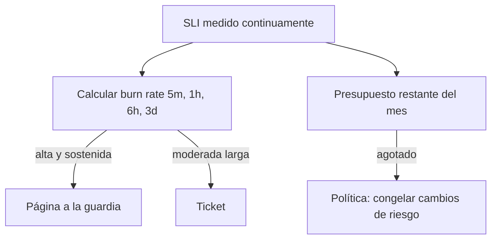

# Error budgets

Parte de: [[08-Automatizacion-DevOps/02 Operación en producción/_Índice Operación en producción|Operación en producción]]

> [!info] Cómo avanzar
> `progreso`: **pendiente** → **viendo** (estudiando) → **visto** (contestaste la autoevaluación sin abrir las respuestas) → **dominado** (hiciste el laboratorio o lo aplicaste de verdad).

## Contenido

### Qué es
El **presupuesto de error** (*error budget*) es **cuánto puede fallar un servicio sin violar su [[SLO (objetivo de nivel de servicio)|SLO]]**: `1 − SLO`. Con un SLO de 99.9 % en 30 días, el presupuesto es 0.1 %: **43.2 minutos** de caída total o, si el SLO es por requests, el 0.1 % de los requests. La idea clave de SRE es tratar ese margen como un **recurso que se gasta**: en despliegues, experimentos, migraciones o fallas inevitables. Mientras quede presupuesto, el equipo puede moverse rápido; cuando se agota, la prioridad pasa a la confiabilidad.

### Cómo funciona
**Cálculo por tiempo**: presupuesto = ventana × (1 − SLO). Con 30 días = 43,200 min:
- SLO 99.9 % → 43.2 min. Si llevas 25 min de caída, consumiste 25 / 43.2 ≈ **57.9 %** y te quedan ≈ 18.2 min.
- SLO 99.95 % → 21.6 min. Un despliegue que causó 12 min de caída total gastó 12 / 21.6 ≈ **55.6 %** del mes en un solo evento.

**Cálculo por requests**: permitidos = total × (1 − SLO). Con 2,000,000 requests y SLO 99.9 %, pueden fallar 2,000; si fallaron 1,500, consumiste **75 %** y quedan 500.

**Burn rate (tasa de consumo)**: qué tan rápido gastas el presupuesto respecto al ritmo «sostenible»:

```text
burn rate = tasa de error observada / (1 − SLO)
```

- Burn rate **1**: lo agotas justo al final de la ventana.
- Con SLO 99.9 % y tasa de error actual 0.5 %: 0.005 / 0.001 = **5**. Un presupuesto de 30 días se agota en 30 / 5 = **6 días**.
- Burn rate **14.4** sostenida 1 hora consume el 2 % del presupuesto de 30 días (14.4 × 1 h / 720 h).

**Por qué alertar por burn rate y no por cada error**: alertar por cada error o por «tasa de error > 1 %» genera ruido (un pico de 30 segundos despierta a alguien sin poner en riesgo nada) o llega tarde (una degradación lenta del 0.3 % nunca cruza el umbral pero consume el presupuesto). La burn rate alerta **en proporción al riesgo real para el SLO**. El esquema recomendado combina **varias ventanas**:
- **Burn rate alta en ventana corta** (por ejemplo ≥ 14.4 en 1 h, confirmada en 5 min): incidente serio, **página** a la guardia.
- **Burn rate moderada en ventana larga** (por ejemplo ≥ 1–3 en 6 h o 3 días): degradación lenta, **ticket**, se atiende en horario laboral.
Ver [[Guardias (on-call)]] y [[Azure Monitor y alertas]].



**Política de error budget**: lo que se hace cuando el presupuesto se agota (o va en camino) debe estar **acordado antes** entre producto e ingeniería, para que no sea una negociación en plena crisis. Típicamente:
- Congelar despliegues de funcionalidades nuevas; solo se despliegan arreglos de confiabilidad o seguridad.
- Priorizar las acciones pendientes de [[Postmortems sin culpables|postmortems]].
- Revisar el proceso de despliegue (más pruebas, canary obligatorio).
- Se levanta cuando el presupuesto se recupera en la ventana móvil.

### Ejemplo
Consulta KQL para el presupuesto restante y la burn rate de la última hora de [[Itzamna.Dionisio]] con SLO de 99.9 %:

```kusto
let slo = 0.999;
let ventana = requests | where timestamp > ago(30d) and name !has "health";
let mes = ventana | summarize total = count(), malos = countif(toint(resultCode) >= 500);
let hora = ventana | where timestamp > ago(1h)
    | summarize tasa = todouble(countif(toint(resultCode) >= 500)) / count();
mes | extend permitidos = total * (1 - slo)
    | extend consumidoPct = round(100.0 * malos / permitidos, 1)
    | extend burnRate1h = toscalar(hora) / (1 - slo)
```

Una regla de alerta de Azure Monitor sobre esta consulta, con umbral `burnRate1h > 14.4`, sería la alerta de página.

### Cuándo usarlo y cuándo no
- **Úsalo** donde ya tengas SLO medidos; sin SLI confiable, el presupuesto no significa nada.
- **No lo uses** como cuota para «gastar» a propósito con caídas; se gasta en riesgo calculado (cambios, experimentos), no en descuido.

### Errores comunes
1. **Política sin respaldo de producto**: se agota el presupuesto y se sigue desplegando igual.
2. **Alertas por umbrales fijos** en lugar de burn rate.
3. **Ventana de calendario** que «reinicia» el presupuesto el día 1 y premia ser descuidado a fin de mes; la ventana móvil lo evita.
4. **Contar mantenimiento planeado** de forma inconsistente.

### Para profundizar
- [Google SRE Book: Embracing Risk (error budgets)](https://sre.google/sre-book/embracing-risk/)
- [Google SRE Workbook: Alerting on SLOs](https://sre.google/workbook/alerting-on-slos/)
- [Google SRE Workbook: Error Budget Policy](https://sre.google/workbook/error-budget-policy/)

## Ejercicios

Resuélvelos en papel o en la herramienta; la solución está plegada.

> [!question]- SLO 99.9 % en 30 días. Llevas 25 min de caída este mes. ¿Qué porcentaje del presupuesto consumiste?
> Presupuesto = 43.2 min. 25 / 43.2 ≈ **57.9 %**. Te quedan ≈ 18.2 min.

> [!question]- SLO 99.9 % por requests. Llevas 2 000 000 requests y 1 500 fallidos. ¿Cuánto presupuesto queda?
> Permitidos: 2 000. Usados: 1 500 → **75 %** consumido, quedan 500 fallos.

> [!question]- SLO 99.9 % y la tasa de error actual es 0.5 %. ¿Burn rate? ¿En cuántos días agotas un presupuesto de 30 días?
> 0.005 / 0.001 = **5**. 30 / 5 = **6 días**.

> [!question]- Un despliegue causó 12 min de caída total. Con SLO 99.95 % en 30 días, ¿qué fracción del presupuesto gastó?
> Presupuesto = 21.6 min. 12 / 21.6 ≈ **55.6 %** en un solo incidente.

## Autoevaluación

Contesta primero en voz alta o en papel; luego despliega la respuesta.

> [!question]- ¿Qué es el presupuesto de error?
> Lo que el SLO permite fallar: 1 − SLO. Con 99.9 %, el 0.1 % de los requests (o 43.2 min en 30 días) es presupuesto que puedes «gastar» en despliegues, experimentos o fallas.

> [!question]- ¿Qué política aplicas cuando se agota el presupuesto?
> Congelar cambios de riesgo (solo arreglos de confiabilidad) hasta recuperarlo, priorizar las acciones de postmortem y revisar el proceso de despliegue. La política se acuerda **antes** con producto.

> [!question]- ¿Qué es la *burn rate*?
> Qué tan rápido se consume el presupuesto: `tasa de error observada / (1 − SLO)`. Burn rate 1 = lo agotas justo al final de la ventana; 10 = lo agotas en una décima parte del tiempo.

> [!question]- ¿Por qué alertar por burn rate y no por cada error?
> Alerta cuando **de verdad** pones en riesgo el SLO: una burn rate alta en una ventana corta indica un incidente; una moderada sostenida, degradación lenta. Reduce ruido.

## Práctica

- [[Lab 3 - Simulacro de incidente con SLO, error budget y postmortem]]

