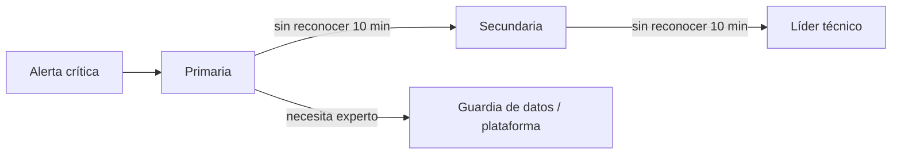

# Guardias (on-call)

Parte de: [[08-Automatizacion-DevOps/02 Operación en producción/_Índice Operación en producción|Operación en producción]]

> [!info] Cómo avanzar
> `progreso`: **pendiente** → **viendo** (estudiando) → **visto** (contestaste la autoevaluación sin abrir las respuestas) → **dominado** (hiciste el laboratorio o lo aplicaste de verdad).

## Contenido

### Qué es
Estar **de guardia** (*on-call*) significa ser la persona responsable de **responder a las alertas de producción** durante un periodo (normalmente una semana), incluso fuera de horario. Es la primera línea del [[Manejo de incidentes]]. Bien diseñada, la guardia protege a los usuarios y al equipo; mal diseñada, quema a las personas y las alertas se ignoran.

### Cómo funciona
**Rotación**: el equipo se turna con un calendario. Suele haber una persona **primaria** y una **secundaria** de respaldo. La herramienta de guardias (PagerDuty, incident.io, Grafana OnCall, o las notificaciones de los *action groups* de [[Azure Monitor y alertas]] por SMS, llamada o la app de Azure) sabe quién está de turno y a quién avisar.

**Política de escalamiento**: reglas que definen **qué pasa si nadie responde**: la alerta llega a la primaria; si no la reconoce (*acknowledge*) en, digamos, 10 minutos, pasa a la secundaria; si tampoco, al líder del equipo o al gerente. Garantiza que ninguna alerta crítica se quede sin atender porque alguien no escuchó el teléfono. También define cuándo escalar **por conocimiento** (la guardia necesita al experto de base de datos) y no solo por falta de respuesta.



**Qué hace sostenible una rotación**:
- **Suficientes personas** en la rotación (con 2 personas estás de guardia la mitad del tiempo; muchas referencias de SRE sugieren al menos 6–8 por rotación con un solo sitio) y turnos razonables.
- **Pocas alertas, todas accionables**: idealmente un puñado de páginas por turno. Si cada noche suena algo, el sistema es el problema.
- **Compensación** por guardias (pago, tiempo libre) y respeto por el descanso después de una noche mala.
- **Runbooks** enlazados a cada alerta ([[Runbooks]]) y permisos listos.
- **Traspaso** al cambiar de turno: qué pasó, qué quedó pendiente.
- **Tiempo para arreglar**: lo que despierta a alguien se convierte en trabajo prioritario para que no se repita.
- Quien escribe el código participa en la guardia: incentiva construir software operable.

**Fatiga de alertas**: el desgaste que ocurre cuando la guardia recibe **demasiadas alertas, muchas de ellas falsas, duplicadas o no accionables**. La gente empieza a silenciarlas o ignorarlas, y la alerta real se pierde entre el ruido. Se combate:
- Alertando por **síntomas que afectan a usuarios** (SLO y burn rate, ver [[Error budgets]]) y no por cada causa (CPU al 80 %).
- Eliminando o degradando a ticket toda alerta que no requiera acción inmediata.
- Agrupando alertas relacionadas y evitando duplicados.
- Revisando cada mes las alertas que sonaron: cuáles fueron útiles y cuáles no.

### Ejemplo
Configuración para el equipo de [[Itzamna.Dionisio]] (5 personas):
- Rotación semanal, lunes 10:00, con primaria y secundaria (la secundaria es quien fue primaria la semana anterior).
- **Página** (llamada) solo para: burn rate alta del SLO de disponibilidad y fallo del job nocturno de facturación. Todo lo demás, **ticket** o mensaje en Teams en horario laboral.
- Escalamiento: 10 min primaria → 10 min secundaria → líder.
- Revisión de 30 min cada lunes: alertas de la semana, ruido a eliminar, acciones.
- Tras una noche con página, la persona entra tarde al día siguiente.

```bash
# Action group de Azure Monitor que llama a la guardia (el número lo mantiene la herramienta de rotación)
az monitor action-group create -g rg-dionisio-prod -n ag-guardia-dionisio \
  --short-name guardia \
  --action webhook rotacion https://ejemplo-herramienta-guardias/integracion/abc123
```

### Cuándo usarlo y cuándo no
- **Necesitas guardia** si el servicio tiene usuarios fuera de horario o compromisos (SLA) que no pueden esperar al día siguiente.
- Para sistemas internos usados solo en horario laboral, puede bastar con soporte en horario y alertas por la mañana.

### Errores comunes
1. **Alertar por todo** «por si acaso».
2. **Una sola persona** que «siempre sabe» y queda de guardia permanente.
3. **Sin escalamiento**: la alerta suena en un teléfono en silencio y nadie más se entera.
4. **No dar tiempo a corregir** las causas de las páginas.

### Para profundizar
- [Google SRE Book: Being On-Call](https://sre.google/sre-book/being-on-call/)
- [Google SRE Workbook: On-Call](https://sre.google/workbook/on-call/)
- [Action groups de Azure Monitor](https://learn.microsoft.com/azure/azure-monitor/alerts/action-groups)

## Autoevaluación

Contesta primero en voz alta o en papel; luego despliega la respuesta.

> [!question]- ¿Qué hace sostenible una rotación de guardia?
> Suficientes personas en la rotación, alertas **accionables** (poco ruido), runbooks, escalamiento claro, traspaso de guardia documentado y compensación o descanso tras noches malas.

> [!question]- ¿Qué es la fatiga de alertas?
> Tantas alertas irrelevantes que la gente las ignora o silencia, y se pierde la importante. Cada alerta que no requirió acción es candidata a eliminarse o ajustarse.

> [!question]- ¿Qué es una política de escalamiento?
> Qué pasa si la persona de guardia no responde en X minutos: se avisa a la secundaria, luego al líder. Herramientas como PagerDuty u Opsgenie la automatizan.

