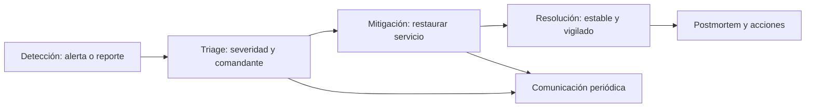

# Manejo de incidentes

Parte de: [[08-Automatizacion-DevOps/02 Operación en producción/_Índice Operación en producción|Operación en producción]]

> [!info] Cómo avanzar
> `progreso`: **pendiente** → **viendo** (estudiando) → **visto** (contestaste la autoevaluación sin abrir las respuestas) → **dominado** (hiciste el laboratorio o lo aplicaste de verdad).

## Contenido

### Qué es
Un **incidente** es un evento no planeado que degrada o interrumpe un servicio para sus usuarios (o amenaza con hacerlo): la API devuelve errores, los pagos no pasan, un reporte crítico no se generó. El **manejo de incidentes** es el proceso **organizado** para detectarlo, coordinar a la gente, restaurar el servicio, comunicar y aprender. Sin proceso, un incidente se vuelve un caos de diez personas en un chat probando cosas al mismo tiempo.

### Cómo funciona
**Prioridad número uno: mitigar el impacto y restaurar el servicio**, no encontrar la causa raíz. Primero se detiene el sangrado (rollback, apagar un [[Feature flags|flag]], conmutar a la otra región, escalar, bloquear un cliente abusivo); la investigación profunda viene después, en el [[Postmortems sin culpables|postmortem]]. Cada minuto investigando con el servicio caído es un minuto de usuarios afectados.

**Ciclo de vida**:

**Roles en un incidente serio** (una persona puede tener más de uno en equipos chicos, pero deben estar explícitos):
- **Comandante del incidente** (*incident commander*): coordina, decide, asigna tareas y mantiene la visión completa. **No** se pone a depurar; si lo hace, nadie coordina.
- **Líder de operaciones / responsables técnicos**: investigan y ejecutan las acciones de mitigación que el comandante aprueba.
- **Responsable de comunicaciones**: actualiza a interesados internos y a clientes (página de estado, correo, Teams) con una cadencia fija, para que los técnicos no reciban preguntas cada dos minutos.
- **Escriba** (*scribe*): registra la línea de tiempo: qué se observó, qué se decidió, quién hizo qué y cuándo. Será la base del postmortem.

**Niveles de severidad** (SEV1, SEV2…): clasifican el incidente por **impacto** para decidir **cuánta gente y qué urgencia**. Un ejemplo de escala:

| Nivel | Impacto | Respuesta |
|---|---|---|
| SEV1 | Servicio caído o pérdida de datos para muchos usuarios | Todos los roles, página inmediata, comunicación cada 30 min, postmortem obligatorio |
| SEV2 | Funcionalidad importante degradada o un cliente grande afectado | Guardia + comandante, horario extendido |
| SEV3 | Impacto menor con solución alternativa | Horario laboral, ticket |

Definirlos **antes** evita discutir en pleno incidente si «esto es grave» y alinea expectativas (quién se despierta, a quién se avisa). La severidad puede subir o bajar durante el incidente.

### Ejemplo
14:02, la alerta de burn rate de [[Error budgets]] de [[Itzamna.Dionisio]] se dispara: 8 % de 5xx. La guardia declara **SEV2** en el canal `#inc-2026-11-09-dionisio` y asume como comandante:
1. 14:05 Asigna a Ana (técnica) a revisar el último despliegue; a Luis comunicaciones; él mismo lleva la bitácora porque el equipo es chico.
2. 14:08 Ana ve que el despliegue de las 13:55 coincide con el inicio. El comandante decide **rollback** con swap de slots, sin esperar a entender el bug.
3. 14:11 Errores normales. Luis publica: «Servicio restablecido 14:11; seguimos vigilando».
4. 14:40 Se declara resuelto; se programa el postmortem para el día siguiente.

Plantilla mínima de actualización: **qué está pasando, impacto, qué estamos haciendo, próxima actualización a las HH:MM**.

### Cuándo usarlo y cuándo no
- Declara incidente **pronto**: es más barato bajar la severidad que llegar tarde. No hay que estar seguro de la causa para declarar.
- Para problemas sin impacto en usuarios (un job de dev falló), un ticket normal basta.
- Ten herramientas listas antes: canal por incidente, [[Runbooks]], acceso de emergencia, página de estado.

### Errores comunes
1. **Todos investigan a la vez y nadie comunica**: acciones contradictorias (dos personas reiniciando cosas distintas), interesados preguntando sin parar y nadie sabe el estado real. Se evita con un comandante explícito, roles asignados y un responsable de comunicaciones con cadencia fija.
2. **Buscar la causa raíz antes de mitigar**.
3. **El comandante depura** y deja de coordinar.
4. **No registrar la línea de tiempo**: el postmortem se reconstruye de memoria y con errores.
5. **Cambios sin anunciar** en el canal durante el incidente.

### Para profundizar
- [Google SRE Book: Managing Incidents](https://sre.google/sre-book/managing-incidents/)
- [Google SRE Workbook: Incident Response](https://sre.google/workbook/incident-response/)
- [PagerDuty Incident Response (documentación abierta)](https://response.pagerduty.com/)

## Autoevaluación

Contesta primero en voz alta o en papel; luego despliega la respuesta.

> [!question]- ¿Cuál es la prioridad número uno durante un incidente?
> **Mitigar**: restablecer el servicio (rollback, apagar un feature flag, escalar), aunque aún no sepas la causa raíz. La investigación profunda va después.

> [!question]- ¿Qué roles se asignan en un incidente serio?
> **Incident commander** (coordina y decide), responsable de **comunicación** (usuarios y directivos), **operaciones/técnicos** que investigan y aplican cambios, y alguien que lleve la **bitácora** de tiempos.

> [!question]- ¿Para qué sirven los niveles de severidad (SEV1, SEV2…)?
> Para decidir rápido a quién despertar, cada cuánto comunicar y qué urgencia tiene. Deben definirse por impacto en usuarios, no por intuición.

> [!question]- Error común: todos investigan a la vez y nadie comunica.
> Se duplican esfuerzos, se hacen cambios sin coordinar y los usuarios no saben nada. Un comandante y un canal único del incidente lo evitan.

## Práctica

- [[Lab 3 - Simulacro de incidente con SLO, error budget y postmortem]]

