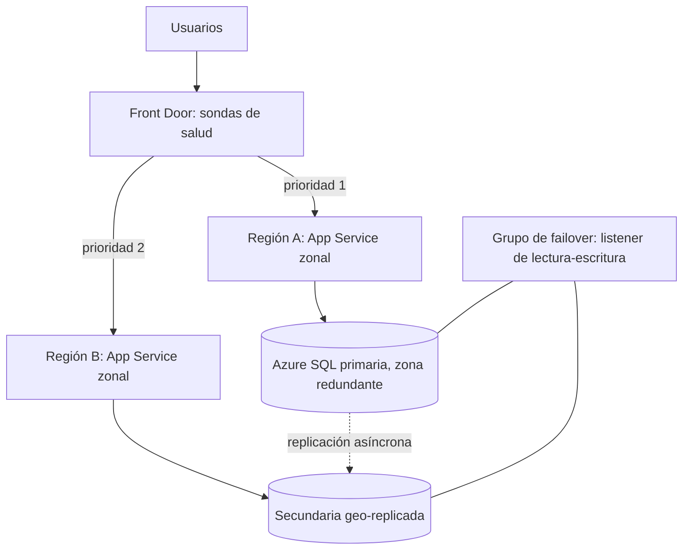

# Multi-región y alta disponibilidad

Parte de: [[08-Automatizacion-DevOps/02 Operación en producción/_Índice Operación en producción|Operación en producción]]

> [!info] Cómo avanzar
> `progreso`: **pendiente** → **viendo** (estudiando) → **visto** (contestaste la autoevaluación sin abrir las respuestas) → **dominado** (hiciste el laboratorio o lo aplicaste de verdad).

## Contenido

### Qué es
**Alta disponibilidad (HA)** es diseñar un sistema para que siga funcionando cuando fallan algunas de sus partes: una instancia, un centro de datos o incluso una región completa. Se logra con **redundancia** (más de una copia de cada componente) y **conmutación automática** (*failover*). **Multi-región** es el nivel más alto: desplegar el sistema en dos o más regiones de Azure para sobrevivir a la caída de una región entera.

### Cómo funciona
**Matemática de la redundancia.** Componentes **en serie** (todos deben funcionar) multiplican disponibilidades; componentes **en paralelo** (basta con uno) multiplican **indisponibilidades**:

```text
serie:    A_total = A1 × A2 × …
paralelo: A_total = 1 − (1 − A1) × (1 − A2) × …
```

- Dos regiones independientes de 99.9 % en activo-activo con conmutación perfecta: 1 − (0.001)² = **99.9999 %** teórico.
- Cada región con web (99.95 %) en serie con base (99.99 %): 0.9995 × 0.9999 ≈ **99.94 %** por región. Dos regiones en paralelo: 1 − (0.0006)² ≈ **99.99996 %**.

Son cifras teóricas: suponen fallas independientes y conmutación perfecta. En la vida real, un mismo bug desplegado en ambas regiones, un error de configuración global o el propio balanceador global (que queda en serie) bajan mucho ese número.

**Zonas de disponibilidad vs varias regiones**:
- Las **zonas de disponibilidad** son centros de datos físicamente separados **dentro de una región**, con energía, enfriamiento y red independientes y baja latencia entre ellos. Protegen contra la falla de un centro de datos. Activarlas es casi siempre sencillo (App Service con redundancia de zona, Azure SQL con zona redundante) y permite replicación **síncrona** sin pérdida de datos.
- **Varias regiones** protegen contra la caída de **una región completa** (o un desastre regional), pero están a cientos o miles de km: la replicación de datos suele ser **asíncrona** (puede haber pérdida de los últimos segundos) y la arquitectura se complica mucho.
Primero zonas; regiones solo si el negocio lo justifica.

**Activo-activo vs activo-pasivo**:
- **Activo-activo**: todas las regiones atienden tráfico a la vez. Aprovechas la capacidad y la conmutación es casi inmediata, pero los datos deben poder escribirse (o al menos leerse) en ambas, lo que exige resolver conflictos o particionar.
- **Activo-pasivo**: una región atiende; la otra está lista (en frío, tibia o caliente) y se activa ante falla. Más simple con datos (un solo escritor), pero la conmutación tarda más y pagas capacidad ociosa. Ver los niveles de costo en [[Recuperación ante desastres (RPO y RTO)]].

**Reparto de tráfico entre regiones en Azure**:
- **[[Front Door]]**: balanceador global de capa 7 (HTTP/HTTPS) con *health probes*, enrutamiento por latencia, prioridad o peso, WAF y caché en el borde. Es la opción habitual para APIs y sitios web.
- **Traffic Manager**: balanceo basado en **DNS** (cualquier protocolo), con métodos por prioridad, peso, rendimiento o geografía. La conmutación depende del TTL del DNS.



**La parte más difícil suele ser el estado (los datos)**. Duplicar App Services es fácil; tener la base de datos consistente, replicada y con un único punto de escritura claro es lo complicado: decidir qué región escribe, aceptar el RPO de la replicación asíncrona, evitar *split brain* (dos regiones creyéndose primarias), y también replicar secretos, colas, archivos de Blob y la configuración. En Azure SQL, los **grupos de failover** dan un nombre de conexión de lectura-escritura que apunta siempre a la primaria tras una conmutación.

### Ejemplo
Diseño activo-pasivo para [[Itzamna.Dionisio]]:
- App Service con redundancia de zona en *Mexico Central* (primaria) y en una región secundaria.
- Azure SQL con **grupo de failover**; la cadena de conexión usa el *listener* del grupo (`fog-dionisio.database.windows.net`), así no cambia al conmutar.
- Front Door con origen primario (prioridad 1) y secundario (prioridad 2), sonda `/health/ready`.
- [[Key Vault]] y [[Container Registry]] replicados o duplicados en ambas regiones.
- Simulacro trimestral: conmutar el grupo de failover y verificar con pruebas de humo.

### Cuándo usarlo y cuándo no
- **Zonas**: casi siempre en producción si la región las tiene; el costo extra es moderado.
- **Multi-región**: cuando el costo de una caída regional (horas) supera el costo de duplicar infraestructura y la complejidad operativa, o por requisitos regulatorios.
- Para muchos sistemas internos, una región con zonas más un buen plan de recuperación es suficiente.

### Errores comunes
1. **Duplicar el cómputo y olvidar los datos** o dependencias (Key Vault, Storage, identidad).
2. **No probar el failover**: el día real descubres que la región secundaria no tiene la configuración.
3. **Suponer independencia**: el mismo despliegue defectuoso en las dos regiones a la vez.
4. **Ignorar la latencia** entre regiones en llamadas síncronas.

### Para profundizar
- [Azure: zonas de disponibilidad y regiones](https://learn.microsoft.com/azure/reliability/availability-zones-overview)
- [Azure Well-Architected: diseño para confiabilidad multi-región](https://learn.microsoft.com/azure/well-architected/reliability/highly-available-multi-region-design)
- [Grupos de failover de Azure SQL Database](https://learn.microsoft.com/azure/azure-sql/database/failover-group-sql-db)

## Ejercicios

Resuélvelos en papel o en la herramienta; la solución está plegada.

> [!question]- Dos regiones independientes, cada una con 99.9 %, en activo-activo con conmutación perfecta. ¿Disponibilidad teórica?
> 1 − (1 − 0.999)² = 1 − 0.000001 = **99.9999 %**. En la práctica es menor: la conmutación y las dependencias compartidas (DNS, datos) no son perfectas.

> [!question]- Cada región tiene web (99.95 %) en serie con base (99.99 %). ¿Disponibilidad de una región y de dos en paralelo?
> Una región: 0.9995 × 0.9999 ≈ 0.99940. Dos en paralelo: 1 − (1 − 0.9994)² ≈ **99.99996 %** (teórico).

## Autoevaluación

Contesta primero en voz alta o en papel; luego despliega la respuesta.

> [!question]- Zonas de disponibilidad vs varias regiones.
> **Zonas**: centros de datos separados dentro de una región; protegen de la falla de uno con latencia baja. **Multi-región**: protege de la caída de una región completa, pero agrega latencia, costo y complejidad de datos.

> [!question]- Activo-activo vs activo-pasivo.
> **Activo-activo**: ambas regiones atienden tráfico (más capacidad, conmutación inmediata, pero datos más difíciles de sincronizar). **Activo-pasivo**: la secundaria espera; más simple y barato, con tiempo de conmutación.

> [!question]- ¿Qué componente reparte tráfico entre regiones en Azure?
> **Front Door** (HTTP, capa 7, global) o **Traffic Manager** (por DNS). Ambos usan sondeos de salud para sacar una región caída.

> [!question]- ¿Cuál suele ser la parte más difícil de multi-región?
> Los **datos**: replicación, consistencia, latencia de escritura y qué hacer con escrituras en curso al conmutar.

