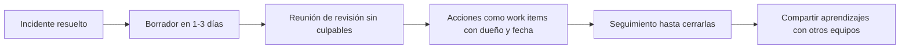

# Postmortems sin culpables

Parte de: [[08-Automatizacion-DevOps/02 Operación en producción/_Índice Operación en producción|Operación en producción]]

> [!info] Cómo avanzar
> `progreso`: **pendiente** → **viendo** (estudiando) → **visto** (contestaste la autoevaluación sin abrir las respuestas) → **dominado** (hiciste el laboratorio o lo aplicaste de verdad).

## Contenido

### Qué es
Un **postmortem** es el documento y la reunión que, después de un incidente, explican **qué pasó, por qué, qué impacto tuvo y qué se hará para que no se repita** (o para detectarlo y recuperarse más rápido). **Sin culpables** (*blameless*) significa que se analiza el **sistema** (procesos, herramientas, diseño, señales) y no a las personas: se parte de que todos actuaron de buena fe con la información que tenían en ese momento.

### Cómo funciona
**Por qué sin culpables**: si equivocarse se castiga, la gente oculta información, minimiza errores y no reporta casi-incidentes. Sin esa información no puedes arreglar el sistema. En un ambiente seguro, la persona que ejecutó el comando que tumbó producción es la que mejor puede explicar por qué parecía razonable, y eso revela la verdadera debilidad: ¿por qué el sistema permitió que un solo comando hiciera eso?

**Por qué «error humano» no es una causa raíz aceptable**: decir «el ingeniero se equivocó» es donde el análisis **empieza**, no donde termina. Las personas siempre van a cometer errores; la pregunta útil es **por qué el sistema hizo fácil cometerlo y difícil detectarlo**: ¿no había validación?, ¿el script de prod y el de dev se veían iguales?, ¿faltaba una prueba?, ¿la alerta no existía?, ¿el runbook estaba desactualizado?, ¿había presión por una fecha? Con «error humano» la única acción posible es «tener más cuidado», que no cambia nada. Técnicas como los **5 porqués** o identificar **factores contribuyentes** (normalmente hay varios, no una sola causa) ayudan a llegar más profundo.

**Secciones de un buen postmortem**:
1. **Resumen**: qué pasó en dos o tres frases.
2. **Impacto**: usuarios o clientes afectados, duración, requests fallidos, dinero, presupuesto de error consumido ([[Error budgets]]).
3. **Línea de tiempo** (en UTC o con zona explícita): detección, decisiones, mitigación, resolución. Sale de la bitácora del [[Manejo de incidentes|incidente]].
4. **Causas y factores contribuyentes**: técnicos y de proceso.
5. **Detección y respuesta**: ¿cómo nos enteramos?, ¿qué tan rápido?, ¿qué funcionó y qué no?
6. **Qué salió bien** (para mantenerlo) y **dónde tuvimos suerte**.
7. **Acciones**: concretas, con **responsable y fecha**, priorizadas, registradas como work items.
8. **Lecciones aprendidas**.



### Ejemplo
Fragmento del postmortem de un incidente de [[Itzamna.Dionisio]]:

```markdown
Resumen: el despliegue 1.8.0 incluyó una migración que renombró la columna
Pedido.Estatus; la versión anterior, aún activa en el slot durante el swap, falló.

Impacto: 9 min de 5xx en 40 % de requests (14:02–14:11 UTC-6); 31 % del error budget mensual.

Factores contribuyentes:
- La migración no era compatible hacia atrás (no seguía expand/contract).
- La revisión del PR no incluía revisar scripts .sql de migración.
- No hay prueba automatizada que corra la versión N-1 contra el esquema N.

Qué salió bien: la alerta de burn rate avisó en 2 min; el rollback por swap funcionó.

Acciones:
| Acción                                                     | Responsable | Fecha      |
| Regla en el PR: migraciones revisadas por un 2.º revisor    | Ana         | 2026-11-16 |
| Prueba en CI: API N-1 contra esquema N                      | Luis        | 2026-11-30 |
| Documentar expand/contract en el runbook de releases        | Ana         | 2026-11-20 |
```

Nota cómo no aparece «Juan se equivocó»: aparece qué faltaba en el sistema para que el error no llegara a producción. Ver [[Migraciones sin caídas (expand y contract)]].

### Cuándo usarlo y cuándo no
- **Obligatorio** para incidentes SEV1/SEV2, pérdida de datos, incumplimiento de SLA o cuando se consumió una parte grande del presupuesto de error.
- También vale la pena en **casi-incidentes**: algo que pudo ser grave y no lo fue por suerte.
- Para SEV3 repetitivos, agrúpalos en un análisis de tendencias en vez de uno por evento.

### Errores comunes con las acciones
1. **Acciones que nunca se cierran**: se escriben veinte, ninguna tiene responsable ni fecha, y el mismo incidente se repite en tres meses. Pocas acciones, priorizadas, como work items en el backlog real del equipo, con seguimiento.
2. **Acciones vagas** («mejorar el monitoreo», «tener más cuidado»): no son verificables.
3. **Solo acciones de prevención**: también importan las de **detección** (alertar antes) y **mitigación** (recuperar más rápido).
4. **Postmortem como trámite**: se escribe y nadie lo lee; compártelo y revísalo en grupo.

### Para profundizar
- [Google SRE Book: Postmortem Culture](https://sre.google/sre-book/postmortem-culture/)
- [Google SRE Workbook: Postmortem Culture](https://sre.google/workbook/postmortem-culture/)
- [Atlassian: plantillas y guía de postmortems sin culpables](https://www.atlassian.com/incident-management/postmortem/blameless)

## Autoevaluación

Contesta primero en voz alta o en papel; luego despliega la respuesta.

> [!question]- ¿Qué significa «sin culpables» (blameless)?
> Se asume que las personas actuaron de buena fe con la información que tenían; se buscan fallas del **sistema** (procesos, herramientas, alertas) que permitieron el error, no a quién castigar.

> [!question]- ¿Qué secciones tiene un buen postmortem?
> Resumen, **impacto** (usuarios, duración, presupuesto de error), **línea de tiempo**, detección, causas (raíz y factores contribuyentes), qué salió bien y mal, y **acciones** con dueño y fecha.

> [!question]- ¿Por qué «error humano» no es una causa raíz aceptable?
> Porque no lleva a una mejora: la pregunta es por qué el sistema permitió que un error humano tumbara producción (falta de validación, de revisión, de rollback).

> [!question]- Error común con las acciones del postmortem.
> Acciones vagas («tener más cuidado») o sin dueño ni fecha, que nunca se hacen. Deben ser concretas, verificables y seguidas como work items.

## Práctica

- [[Lab 3 - Simulacro de incidente con SLO, error budget y postmortem]]

