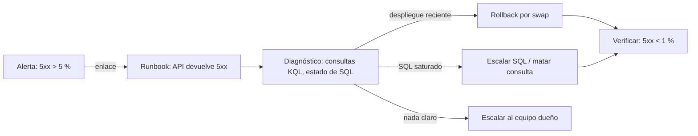

# Runbooks

Parte de: [[08-Automatizacion-DevOps/02 Operación en producción/_Índice Operación en producción|Operación en producción]]

> [!info] Cómo avanzar
> `progreso`: **pendiente** → **viendo** (estudiando) → **visto** (contestaste la autoevaluación sin abrir las respuestas) → **dominado** (hiciste el laboratorio o lo aplicaste de verdad).

## Contenido

### Qué es
Un **runbook** es un **procedimiento documentado, paso a paso**, para diagnosticar o resolver una situación operativa concreta: «la API devuelve 503», «la cola de correos se atasca», «conmutar la base a la región secundaria», «rotar el certificado». Su objetivo es que **cualquier persona de guardia**, incluso a las 3 a. m. y sin conocer a fondo el servicio, pueda actuar de forma correcta y rápida sin improvisar. Hay runbooks manuales (una página de documentación) y **automatizados** (un script o una runbook de Azure Automation que ejecuta los pasos).

### Cómo funciona
Un buen runbook tiene:
1. **Cuándo aplica**: qué alerta o síntoma lo dispara.
2. **Impacto y severidad** típica.
3. **Diagnóstico**: comandos o consultas para confirmar el problema, con el resultado esperado («si ves X, ve al paso 4»).
4. **Mitigación**: pasos concretos, con comandos copiables y enlaces directos a los tableros.
5. **Verificación**: cómo saber que ya se resolvió.
6. **Escalamiento**: a quién llamar si los pasos no funcionan.
7. **Metadatos**: responsable del runbook, fecha de última revisión y de último uso.

**Relación con las alertas**: **cada alerta que puede despertar a alguien debe enlazar a su runbook**. Si una alerta no tiene runbook, o no sabes qué hacer con ella (y entonces sobra) o el conocimiento vive solo en la cabeza de alguien. En [[Azure Monitor y alertas]] puedes incluir el enlace en la descripción de la regla o en la carga que manda el *action group* a Teams o a tu herramienta de guardias.



**Cómo evitar que se vuelva obsoleto**:
- **Vive junto al código** (carpeta `docs/runbooks/` en el repo) y se actualiza en el mismo PR que cambia el comportamiento; las revisiones de código lo incluyen.
- **Se usa y se ajusta**: después de cada incidente, el postmortem revisa si el runbook funcionó y genera acciones para corregirlo.
- **Simulacros** periódicos (*game days*): alguien nuevo sigue el runbook en un ambiente de pruebas; donde se atore, hay que mejorarlo.
- **Fecha de revisión** visible y un responsable; revisión trimestral.
- **Automatiza los pasos repetibles**: un script versionado y probado no se desactualiza en silencio como un texto (y si se rompe, la prueba lo dice).

### Ejemplo
`docs/runbooks/api-5xx.md` de [[Itzamna.Dionisio]]:

```markdown
Runbook: API Dionisio devuelve 5xx
Alerta: "dionisio-5xx-burnrate" (SEV2). Responsable: equipo Dionisio. Revisado: 2026-11-01.

1. Confirmar impacto (Application Insights > Logs):
   requests | where timestamp > ago(15m) | summarize fallas = countif(toint(resultCode) >= 500), total = count() by bin(timestamp, 1m)
2. ¿Hubo despliegue en los últimos 60 min? Azure DevOps > Environments > dionisio-prod.
   - Sí: hacer rollback (paso 3). No investigar primero.
   - No: ir al paso 4.
3. Rollback: az webapp deployment slot swap -g rg-dionisio-prod -n app-dionisio-prod --slot staging
4. Revisar dependencias: Application Insights > Application map. ¿SQL con DTU/CPU al 100 %?
   - Sí: ver consultas activas con sp_WhoIsActive o sys.dm_exec_requests; escalar a guardia de datos.
5. Verificar: 5xx < 1 % durante 10 min. Avisar en el canal del incidente.
Escalamiento: si en 30 min no hay mejora, llamar al líder técnico (ver rotación).
```

### Cuándo usarlo y cuándo no
- **Úsalos** para toda alerta que despierta a alguien y para procedimientos raros pero críticos (DR, rotación de secretos).
- Si un runbook se ejecuta igual cada semana, es candidato a **automatizarse por completo** (o a arreglar la causa para que deje de hacer falta).
- No sustituyen el criterio: en incidentes nuevos, el [[Manejo de incidentes]] guía la respuesta.

### Errores comunes
1. **Pasos vagos** («revisar la base de datos»): sin comandos ni resultados esperados.
2. **Enlaces rotos** a tableros o recursos renombrados.
3. **Asumir permisos** que la guardia no tiene a las 3 a. m.
4. **Documentos en una wiki aparte** que nadie actualiza.

### Para profundizar
- [Google SRE Book: Being On-Call (playbooks)](https://sre.google/sre-book/being-on-call/)
- [Runbooks en Azure Automation](https://learn.microsoft.com/azure/automation/automation-runbook-types)

## Autoevaluación

Contesta primero en voz alta o en papel; luego despliega la respuesta.

> [!question]- ¿Qué es un runbook?
> Procedimiento paso a paso para una tarea operativa o alerta concreta: cómo diagnosticar, qué comandos correr, cómo verificar y a quién escalar.

> [!question]- ¿Qué debe tener cada alerta respecto a los runbooks?
> Un **enlace** a su runbook. Si no sabes qué hacer cuando suena, la alerta no es accionable.

> [!question]- ¿Cómo evitas que un runbook quede obsoleto?
> Úsalo en simulacros y en incidentes reales, actualízalo como acción del postmortem y automatiza los pasos repetitivos (scripts, Azure Automation, pipelines).

## Práctica

- [[Lab 3 - Simulacro de incidente con SLO, error budget y postmortem]]

