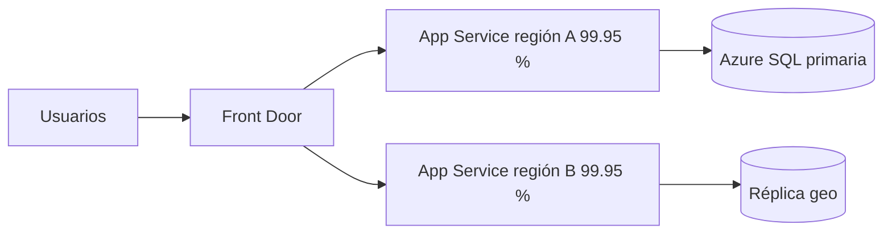

# SLA (acuerdo de nivel de servicio)

Parte de: [[SLI, SLO y SLA]]

> [!info] Cómo avanzar
> `progreso`: **pendiente** → **viendo** (estudiando) → **visto** (contestaste la autoevaluación sin abrir las respuestas) → **dominado** (hiciste el laboratorio o lo aplicaste de verdad).

## Contenido

### Qué es
Un **SLA** (*Service Level Agreement*) es un **acuerdo formal (normalmente contractual)** entre un proveedor y su cliente que fija un nivel de servicio mínimo y **qué pasa si no se cumple**. A diferencia del [[SLO (objetivo de nivel de servicio)|SLO]], que es un objetivo interno, el SLA tiene consecuencias legales o económicas. Forma parte de [[SLI, SLO y SLA]].

### Cómo funciona
Un SLA define: la métrica (normalmente disponibilidad mensual), cómo se calcula, qué se excluye (mantenimiento anunciado, fallas causadas por el cliente, fuerza mayor), el compromiso (99.95 %) y la **compensación**: casi siempre **créditos de servicio**, un porcentaje de la factura de ese mes que crece mientras peor fue el incumplimiento.

**Qué te da el SLA de un servicio de Azure**: Microsoft publica los SLA de cada servicio en el documento de *Service Level Agreements for Online Services*. Por ejemplo, App Service en planes de pago compromete **99.95 %** y Azure SQL Database **99.99 %** (más con configuraciones con redundancia de zona en ciertos niveles). Lo que te da es:
- Un **compromiso de disponibilidad** del servicio de la plataforma (no de tu código).
- **Créditos** si no se cumple, que **tú debes reclamar** con un ticket de soporte en el plazo indicado.
Lo que **no** te da: no compensa tus pérdidas de negocio (el crédito es una fracción de lo que pagas por ese recurso), no cubre fallas de tu aplicación, y solo aplica si cumples los requisitos de configuración (por ejemplo, ciertos SLA exigen varias instancias o zonas de disponibilidad).

**Por qué los niveles gratuitos suelen no tener SLA**: el proveedor no cobra, así que no tiene qué devolver en créditos, y esos niveles usan infraestructura compartida, con cuotas y sin garantías de recursos. Los niveles **Free** y **Shared** de App Service, por ejemplo, no tienen SLA. Sirven para aprender y para desarrollo, no para producción.

**Cómo subes la disponibilidad por encima del SLA de un servicio**: con **redundancia**. Si un componente individual da 99.95 %, dos copias **independientes en paralelo** con conmutación automática dan, en teoría, 1 − (0.0005)² ≈ 99.99997 %. En la práctica:
- **Varias instancias** y **zonas de disponibilidad** dentro de una región.
- **Varias regiones** con [[Front Door]] o Traffic Manager repartiendo tráfico y haciendo *failover*; ver [[Multi-región y alta disponibilidad]].
- **Degradación elegante**: caché, colas y [[Circuit breaker y reintentos]] para que una dependencia caída no tire todo.
- Reducir **dependencias en serie** (cada una multiplica y baja la disponibilidad total).

### Ejemplo
Ofreces la API de [[Itzamna.Dionisio]] a un cliente externo. Tu arquitectura en una región da como máximo ≈ 99.94 % (App Service 99.95 % × Azure SQL 99.99 %), y tu historial real es 99.92 %. Una propuesta razonable:
- **SLO interno**: 99.9 % mensual.
- **SLA al cliente**: 99.5 % mensual, medido por un monitor sintético externo, excluyendo ventanas de mantenimiento avisadas con 72 h.
- **Créditos**: 10 % de la cuota mensual si la disponibilidad queda entre 99.0 % y 99.5 %; 25 % si queda por debajo de 99.0 %.
Si el cliente exige 99.95 %, necesitarás invertir en una segunda región antes de firmar.

### Cuándo usarlo y cuándo no
- Firma SLA solo con relaciones contractuales y cuando puedas **medirlo** de forma que ambas partes confíen.
- Para equipos internos, un SLO acordado suele ser suficiente y más flexible.

### Errores comunes
1. **Prometer el SLA del proveedor** como si fuera el de tu sistema completo.
2. **No leer exclusiones y requisitos** del SLA de Azure (instancias mínimas, zonas).
3. **No reclamar créditos** a tiempo.
4. **Usar niveles gratuitos en producción**.

### Para profundizar
- [SLA de Microsoft para servicios en línea](https://www.microsoft.com/licensing/docs/view/Service-Level-Agreements-SLA-for-Online-Services)
- [Azure Well-Architected: objetivos de confiabilidad y SLA compuestos](https://learn.microsoft.com/azure/well-architected/reliability/metrics)

## Autoevaluación

Contesta primero en voz alta o en papel; luego despliega la respuesta.

> [!question]- ¿Qué te da el SLA de un servicio de Azure?
> Un porcentaje de disponibilidad mensual comprometido y **créditos de servicio** si no se cumple. No compensa tus pérdidas de negocio.

> [!question]- ¿Por qué los niveles gratuitos suelen no tener SLA?
> Porque no hay compromiso contractual: F1 de App Service o el plan Free de otros servicios no garantizan disponibilidad (verificar en la página oficial).

> [!question]- ¿Cómo subes la disponibilidad por encima del SLA de un solo servicio?
> Con **redundancia**: instancias en zonas de disponibilidad o en varias regiones con conmutación. En paralelo: 1 − (1 − a)².

