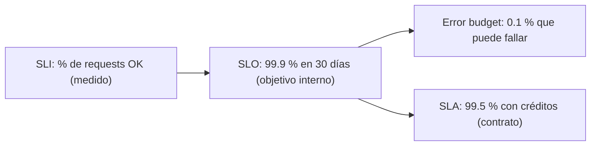

# SLI, SLO y SLA

Parte de: [[08-Automatizacion-DevOps/02 Operación en producción/_Índice Operación en producción|Operación en producción]]

> [!info] Cómo avanzar
> `progreso`: **pendiente** → **viendo** (estudiando) → **visto** (contestaste la autoevaluación sin abrir las respuestas) → **dominado** (hiciste el laboratorio o lo aplicaste de verdad).

## Contenido

### Qué es
Son tres conceptos de la ingeniería de confiabilidad (SRE) para hablar de **qué tan bien funciona un servicio** con números en lugar de impresiones:
- **[[SLI (indicador de nivel de servicio)|SLI]]**: la **medición**. Qué porcentaje de eventos fueron «buenos» para el usuario (requests exitosos, requests rápidos).
- **[[SLO (objetivo de nivel de servicio)|SLO]]**: el **objetivo interno** para ese indicador en una ventana de tiempo. «99.9 % de los requests exitosos en 30 días».
- **[[SLA (acuerdo de nivel de servicio)|SLA]]**: el **compromiso contractual** con un cliente, con consecuencias si no se cumple (créditos, penalizaciones).

La relación: mides un SLI, te fijas un SLO, y si le vendes el servicio a alguien, firmas un SLA **más laxo** que tu SLO.

### Cómo funciona


**Por qué el SLO debe ser más estricto que el SLA**: el SLO es tu **alarma temprana**. Si tu objetivo interno fuera igual al contrato, te enterarías de que vas mal justo cuando ya incumpliste y estás pagando penalizaciones. Con margen (SLO 99.9 %, SLA 99.5 %), cuando el SLO está en riesgo todavía tienes tiempo de frenar despliegues riesgosos y corregir antes de violar el contrato.

**Por qué no un SLO de 100 %**: es imposible (redes, hardware y dependencias fallan) y carísimo intentar acercarse; cada «nueve» extra multiplica el costo. Además, un objetivo de 100 % significa **cero cambios**: cualquier despliegue es un riesgo. Y los usuarios no notan la diferencia entre 99.99 % y 100 % porque su propio wifi o celular falla más que eso. El margen entre el SLO y el 100 % es el **[[Error budgets|presupuesto de error]]** que gastas en innovar.

**Tiempo de caída permitido** en una ventana de 30 días (43,200 minutos):

| SLO | Caída permitida |
|---|---|
| 99.9 % | 43.2 min |
| 99.95 % | 21.6 min |
| 99.99 % | 4.32 min |

Con un SLO **basado en requests** el cálculo es sobre eventos: si llegaron 2,000,000 requests y el SLO es 99.9 %, pueden fallar 2,000 (el 0.1 %).

**Disponibilidad compuesta**: si un request debe pasar por **varios componentes en serie** y todos deben funcionar, las disponibilidades **se multiplican**, así que el total siempre es **menor** que el más débil.
- Web (99.95 %) → API (99.95 %) → base (99.99 %): 0.9995 × 0.9995 × 0.9999 ≈ **99.89 %**.
- Tu API en App Service (SLA 99.95 %) con Azure SQL (99.99 %): 0.9995 × 0.9999 ≈ **99.94 %** como máximo teórico, y eso sin contar tus propios bugs ni despliegues.

Para superar el SLA de un componente necesitas **redundancia en paralelo**; ver [[Multi-región y alta disponibilidad]].

### Ejemplo
Para [[Itzamna.Dionisio]]:
- **SLI de disponibilidad**: proporción de requests a `/api/*` que no responden 5xx, medidos en el balanceador o en [[Application Insights]], excluyendo `/health`.
- **SLI de latencia**: proporción de requests de `GET /api/pedidos` que responden en menos de 400 ms.
- **SLO**: disponibilidad 99.9 % y latencia 99 % < 400 ms, ventana móvil de 28 días.
- **SLA** con el cliente interno: 99.5 % mensual, revisión trimestral.

```kusto
// SLI de disponibilidad de los últimos 28 días
requests
| where timestamp > ago(28d) and name !has "health"
| summarize total = count(), buenos = countif(toint(resultCode) < 500)
| extend sli = 100.0 * buenos / total
```

### Cuándo usarlo y cuándo no
- **Úsalos** en cualquier servicio del que dependan usuarios o equipos: convierten discusiones («está lento») en datos y priorizan el trabajo de confiabilidad.
- Empieza con uno o dos SLI por servicio; muchos SLO se ignoran.
- Un SLA solo existe si hay una relación contractual; para servicios internos, el SLO basta.

### Errores comunes
1. **SLO igual al SLA**: sin margen de reacción.
2. **SLO aspiracional** («cinco nueves») que el sistema nunca ha alcanzado: se incumple siempre y nadie le hace caso.
3. **SLI de infraestructura** (CPU, memoria) en lugar de experiencia del usuario.
4. **Olvidar la composición**: prometer 99.95 % sobre componentes que en serie dan 99.89 %.

### Para profundizar
- [Google SRE Book: Service Level Objectives](https://sre.google/sre-book/service-level-objectives/)
- [Google SRE Workbook: Implementing SLOs](https://sre.google/workbook/implementing-slos/)
- [Acuerdos de nivel de servicio de Microsoft (SLA para servicios en línea)](https://www.microsoft.com/licensing/docs/view/Service-Level-Agreements-SLA-for-Online-Services)

## Subtemas

- [[SLI (indicador de nivel de servicio)]]
- [[SLO (objetivo de nivel de servicio)]]
- [[SLA (acuerdo de nivel de servicio)]]

## Ejercicios

Resuélvelos en papel o en la herramienta; la solución está plegada.

> [!question]- SLO de disponibilidad 99.9 % en una ventana de 30 días. ¿Cuántos minutos de caída se permiten?
> 30 × 24 × 60 = 43 200 min; 43 200 × 0.001 = **43.2 min**.

> [!question]- ¿Y con 99.95 % y 99.99 % en 30 días?
> 99.95 % → **21.6 min**. 99.99 % → **4.32 min**.

> [!question]- SLO de 99.9 % basado en requests. En el mes llegaron 2 000 000 requests. ¿Cuántas pueden fallar?
> 2 000 000 × 0.001 = **2 000** requests.

> [!question]- Cadena web (99.95 %) → API (99.95 %) → base (99.99 %). ¿Disponibilidad compuesta?
> 0.9995 × 0.9995 × 0.9999 ≈ **0.9989 → 99.89 %**.

## Autoevaluación

Contesta primero en voz alta o en papel; luego despliega la respuesta.

> [!question]- Define SLI, SLO y SLA en una línea cada uno.
> **SLI**: lo que mides (p. ej. % de requests exitosos en < 500 ms). **SLO**: la meta interna para ese indicador (99.9 % en 30 días). **SLA**: el compromiso **contractual** con el cliente, con penalizaciones si se incumple.

> [!question]- ¿Por qué el SLO debe ser más estricto que el SLA?
> Para tener margen: si rompes el SLO te enteras y reaccionas **antes** de incumplir el contrato.

> [!question]- ¿Por qué no fijar un SLO de 100 %?
> Es imposible y carísimo, y congela los cambios. Además los usuarios no distinguen entre 99.99 % y 100 % cuando su propia red falla más que eso.

> [!question]- Tu API depende de App Service (SLA 99.95 %) y Azure SQL (99.99 %). ¿Disponibilidad compuesta máxima?
> Dependencias en serie se multiplican: 0.9995 × 0.9999 ≈ **99.94 %**. Tu SLO no puede ser mayor sin redundancia. (Los porcentajes de SLA son de ejemplo: verifica los vigentes en la página oficial.)

## Práctica

- [[Lab 3 - Simulacro de incidente con SLO, error budget y postmortem]]

## Progreso de los subtemas

```base
filters:
  and:
    - file.inFolder("08-Automatizacion-DevOps/02 Operación en producción/SLI, SLO y SLA")
    - file.name != "SLI, SLO y SLA"
views:
  - type: table
    name: Progreso
    order:
      - file.name
      - progreso
      - nivel
```
