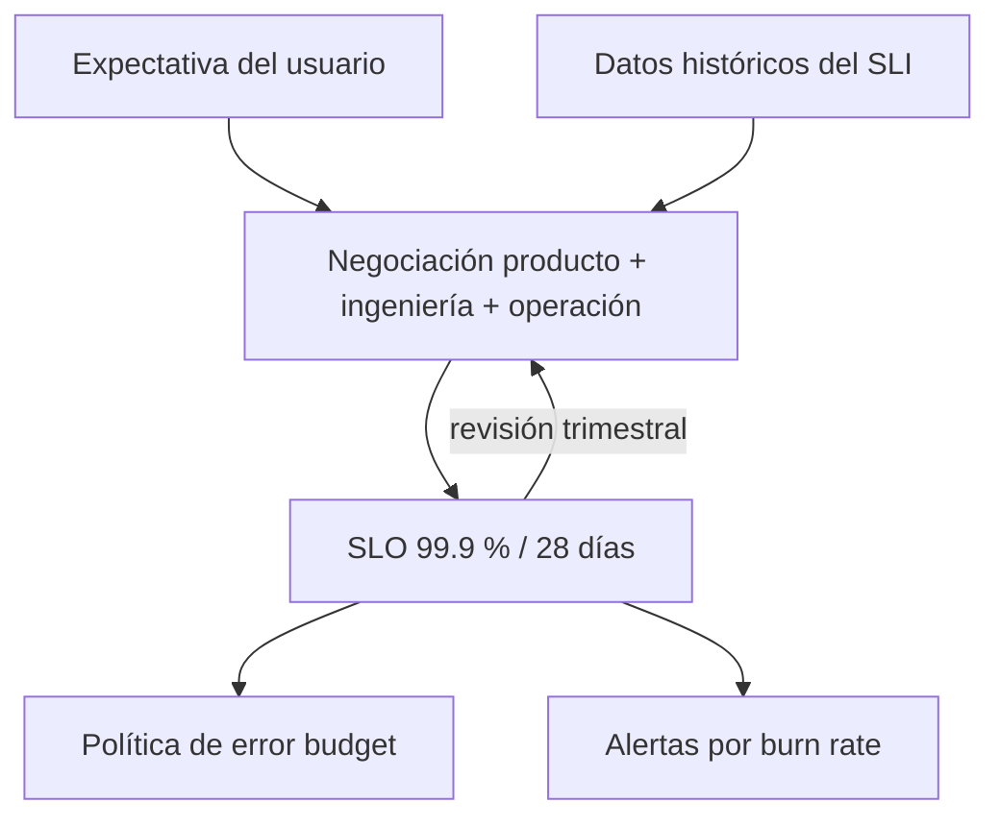

# SLO (objetivo de nivel de servicio)

Parte de: [[SLI, SLO y SLA]]

> [!info] Cómo avanzar
> `progreso`: **pendiente** → **viendo** (estudiando) → **visto** (contestaste la autoevaluación sin abrir las respuestas) → **dominado** (hiciste el laboratorio o lo aplicaste de verdad).

## Contenido

### Qué es
Un **SLO** (*Service Level Objective*) es el **valor objetivo** que te comprometes internamente a cumplir para un [[SLI (indicador de nivel de servicio)|SLI]] durante una **ventana de tiempo**. Por ejemplo: «el 99.9 % de los requests a la API de pedidos responde sin error 5xx, medido en una ventana móvil de 28 días». Es el centro de [[SLI, SLO y SLA]]: define cuánta confiabilidad es «suficiente» y, por diferencia, cuánto [[Error budgets|presupuesto de error]] tienes.

### Cómo funciona
**Elementos de un SLO completo**:
1. **El SLI** con su definición precisa (qué eventos son válidos y cuáles buenos, dónde se mide).
2. **El objetivo** numérico (99.9 %).
3. **La ventana**: móvil (últimos 28 o 30 días, la más usada porque no «se reinicia» el primer día del mes) o de calendario (mes natural, útil para reportes).
4. **El alcance**: qué servicio, endpoints o clientes cubre.
5. **Responsables y política**: quién lo vigila y qué se hace cuando el presupuesto se agota (la política de error budget).
6. Opcional: **justificación** (por qué ese número) y fecha de revisión.



**Quién lo acuerda**: no es una decisión solo de ingeniería. Debe acordarse entre **producto/negocio** (que sabe cuánto le importa al usuario y cuánto vale), **desarrollo** (que construye y despliega) y **operación/SRE** (que lo mantiene). Si producto no participa, cuando el presupuesto se agote y haya que frenar funcionalidades, no lo aceptará. El SLO es un acuerdo sobre prioridades: confiabilidad frente a velocidad de cambio.

**Cómo elegir el número**: parte de lo que el sistema **ya logra** (historia del SLI) y de lo que el usuario **necesita**, no de un número bonito. Un SLO un poco por debajo del desempeño histórico es alcanzable y deja presupuesto para cambios.

**Si lo cumples con mucho margen todo el año**, no necesariamente es bueno. Puede significar que:
- El objetivo es **demasiado bajo** y no refleja lo que los usuarios esperan (o que los usuarios se acostumbraron a una confiabilidad mayor y el SLO no protege nada).
- **Estás sobreinvirtiendo** en confiabilidad (infraestructura de más, procesos lentos) o **siendo demasiado conservador** con los cambios: tienes presupuesto de error sin gastar que podrías usar en desplegar más rápido, experimentar o hacer pruebas de caos.
Revisa el SLO: súbelo si los usuarios dependen de esa confiabilidad, o aprovecha el margen para acelerar la entrega.

### Ejemplo
Documento de SLO de [[Itzamna.Dionisio]] (guárdalo en el repo junto al código):

```yaml
servicio: itzamna-dionisio-api
responsables: [equipo-dionisio, producto-ventas]
ventana: 28d (móvil)
slos:
  - nombre: disponibilidad
    sli: requests /api/* sin 5xx / requests /api/* (excluye /health), medido en Front Door
    objetivo: 99.9
  - nombre: latencia-consulta-pedidos
    sli: GET /api/pedidos con duración < 400 ms / GET /api/pedidos sin 5xx
    objetivo: 99.0
politica_error_budget:
  - "Presupuesto < 25 %: solo despliegues con canary y aprobación de SRE"
  - "Presupuesto agotado: congelar funcionalidades; solo arreglos de confiabilidad"
revision: trimestral
```

En Azure puedes implementar los SLI con consultas KQL en Log Analytics y alertas de [[Azure Monitor y alertas]] por burn rate; también hay herramientas de terceros especializadas en SLO.

### Cuándo usarlo y cuándo no
- **Úsalo** en servicios de los que dependen usuarios o equipos.
- Empieza con un SLO por servicio y ajústalo con datos tras uno o dos ciclos.
- No pongas SLO a cada endpoint interno; agrupa por recorrido de usuario.

### Errores comunes
1. **SLO sin política**: se incumple y no pasa nada, así que no sirve.
2. **Fijarlo sin datos** o copiando el SLA del proveedor.
3. **Nunca revisarlo**.
4. **Demasiados SLO**: la atención se diluye.

### Para profundizar
- [Google SRE Workbook: Implementing SLOs](https://sre.google/workbook/implementing-slos/)
- [Google SRE Workbook: Error Budget Policy](https://sre.google/workbook/error-budget-policy/)

## Autoevaluación

Contesta primero en voz alta o en papel; luego despliega la respuesta.

> [!question]- ¿Qué elementos tiene un SLO completo?
> SLI + meta + **ventana** de tiempo: «99.5 % de las búsquedas responden en < 800 ms, medido en 28 días móviles».

> [!question]- ¿Quién debe acordar el SLO?
> Producto/negocio y el equipo técnico juntos: refleja cuánto le importa la confiabilidad al usuario y cuánto cuesta lograrla.

> [!question]- Cumpliste el SLO con mucho margen todo el año. ¿Es bueno?
> Puede indicar que el SLO es demasiado bajo o que podrías arriesgar más (desplegar más rápido, ahorrar costo). El presupuesto de error está para usarse.

## Práctica

- [[Lab 4 - Prueba de carga con k6]]

