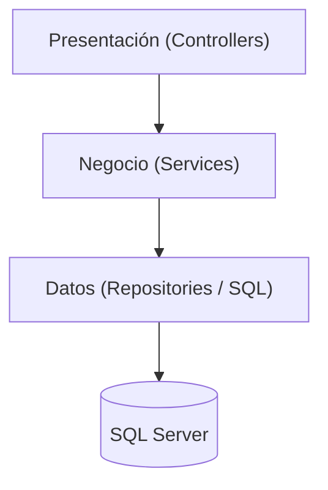

# Arquitectura en capas

Parte de: [[09-Arquitectura-Patrones/01 Estilos de arquitectura/_Índice Estilos de arquitectura|Estilos de arquitectura]]

> [!info] Cómo avanzar
> `progreso`: **pendiente** → **viendo** (estudiando) → **visto** (contestaste la autoevaluación sin abrir las respuestas) → **dominado** (hiciste el laboratorio o lo aplicaste de verdad).

## Contenido

### Qué es
La arquitectura en capas (*layered* o *n-layer*) divide una aplicación en niveles horizontales según su responsabilidad técnica: típicamente **presentación** (controllers, vistas), **lógica de negocio** (servicios) y **acceso a datos** (repositorios, SQL). Su regla principal es que **cada capa solo conoce a la capa inmediatamente inferior**: la presentación llama al negocio, el negocio llama a datos, y nunca al revés. Sirve para separar preocupaciones y es probablemente el estilo más enseñado, por eso aparece en casi todo proyecto "de plantilla".

### Cómo funciona
1. Una petición HTTP entra por la capa de presentación, que valida el formato y traduce a un DTO.
2. La capa de negocio aplica reglas y orquesta.
3. La capa de datos ejecuta la consulta y devuelve filas mapeadas.
4. La respuesta sube por el mismo camino.



Hay dos variantes: **capas cerradas** (cada petición debe pasar por todas, sin saltos) y **capas abiertas** (una capa puede declararse "de paso" y saltarse). Lo importante es que la dirección de dependencia apunta **hacia abajo, hacia la base de datos**: el negocio depende de la capa de datos.

Aquí está la diferencia con [[Clean Architecture]]: en Clean (y en [[Arquitectura hexagonal]]) la dependencia apunta **hacia el centro**, al dominio. El dominio define interfaces (puertos) y la infraestructura las implementa; el negocio no sabe que existe SQL Server. En capas clásicas, el servicio de negocio referencia directamente el proyecto de datos.

### Ejemplo
La forma típica en .NET, con tres proyectos y carpetas por tipo técnico:

```csharp
// Presentación
[ApiController, Route("api/pedidos")]
public sealed class PedidosController(PedidoService servicio) : ControllerBase
{
    [HttpGet("{id:int}")]
    public async Task<IActionResult> Obtener(int id) =>
        await servicio.ObtenerAsync(id) is { } p ? Ok(p) : NotFound();
}

// Negocio: si solo delega, es una capa "sumidero" (ver Errores comunes)
public sealed class PedidoService(PedidoRepository repo)
{
    public Task<PedidoDto?> ObtenerAsync(int id) => repo.ObtenerAsync(id);
}

// Datos
public sealed class PedidoRepository(IDbConnection db)
{
    public Task<PedidoDto?> ObtenerAsync(int id) =>
        db.QuerySingleOrDefaultAsync<PedidoDto>(
            "EXEC dbo.Pedido_Obtener @Id", new { Id = id });
}
```

Para leer un pedido tocaste tres archivos en tres carpetas, y el servicio no aporta nada. Con las reglas del usuario (vertical slice, una interfaz por consulta, SQL en archivos `.sql`), el mismo caso vive en `Features/Pedidos/ObtenerPedido.cs` con su query, su handler y su `ObtenerPedido.sql`, sin una capa intermedia que solo reenvía. Ver [[Vertical Slice Architecture]].

### Cuándo usarlo y cuándo no
- **Úsalo** en aplicaciones pequeñas o medianas donde el equipo ya lo conoce y los cambios son mayormente CRUD; también como estructura *dentro* de un módulo si de verdad hay lógica en cada capa.
- **No lo uses por costumbre.** Si cada capa solo pasa datos, estás pagando indirección sin beneficio. El usuario tiene esta regla explícita: nada de capas por inercia.
- **Alternativas:** [[Vertical Slice Architecture]] para organizar por caso de uso; [[Arquitectura hexagonal]] solo en los bordes (integraciones externas) cuando necesitas aislar un proveedor; [[Monolito modular]] para separar por área de negocio.

### Qué pasa si una capa se salta a otra
Si el controller usa el `DbContext` o la conexión directamente, se rompe la regla de dependencia: las reglas que vivían en el servicio (permisos, cálculos, validaciones) se omiten en ese camino, aparecen dos formas de hacer lo mismo y el comportamiento depende de por dónde entres. Además, el controller queda acoplado al esquema de base y es más difícil de probar. Si el salto es intencional (lecturas simples), hazlo explícito como decisión de diseño, por ejemplo con un slice de consulta, no como atajo escondido.

### Errores comunes
1. **Capas anémicas o "sumidero"** (*sinkhole*): servicios cuyos métodos solo llaman al repositorio con los mismos parámetros. Se detecta midiendo: si más del 80% de los métodos de la capa de negocio son una sola línea que delega, la capa sobra. Otro síntoma: cada cambio obliga a tocar los tres archivos en cadena.
2. **Lógica en el lugar equivocado:** reglas de negocio en el controller o en procedimientos almacenados sin que nadie lo sepa. Documenta dónde vive cada regla.
3. **DTO duplicados por capa** (`PedidoViewModel`, `PedidoDto`, `PedidoEntity`) idénticos entre sí. Mapear sin transformar es costo puro.
4. **Interfaces para todo** (`IPedidoService` con una sola implementación y sin pruebas que la sustituyan). Crea interfaces cuando haya una razón: un puerto hacia afuera o una prueba que lo necesite.
5. **Confundir capas lógicas con niveles físicos** (*tiers*): tres proyectos no significan tres servidores.

### Para profundizar
- [Estilo N-tier (Azure Architecture Center)](https://learn.microsoft.com/en-us/azure/architecture/guide/architecture-styles/n-tier)
- [Arquitecturas comunes de aplicaciones web (.NET, Microsoft Learn)](https://learn.microsoft.com/en-us/dotnet/architecture/modern-web-apps-azure/common-web-application-architectures)
- [Presentation Domain Data Layering (Martin Fowler)](https://martinfowler.com/bliki/PresentationDomainDataLayering.html)

## Autoevaluación

Contesta primero en voz alta o en papel; luego despliega la respuesta.

> [!question]- ¿Qué es la arquitectura en capas y cuál es su regla principal?
> Organiza el código por responsabilidad técnica (presentación → negocio → datos). Cada capa solo llama a la de abajo; en su versión clásica el negocio **depende** de la capa de datos.

> [!question]- ¿En qué se diferencia de [[Clean Architecture]]?
> En capas clásicas la dependencia apunta hacia la base de datos (negocio → datos). En Clean la dependencia se invierte: el negocio define interfaces y la infraestructura las implementa, así el dominio no conoce a la base.

> [!question]- ¿Qué pasa si una capa se salta a otra (el controller usa el `DbContext` directo)?
> Se rompe el aislamiento: la lógica queda repartida y duplicada, y cambiar la persistencia obliga a tocar la presentación. Es aceptable solo si se decide explícitamente (capas *abiertas*), no por accidente.

> [!question]- Error común: capas "anémicas" que solo pasan datos. ¿Cómo lo detectas?
> Servicios cuyo método solo llama al repositorio con los mismos parámetros (`GetById(id) => _repo.GetById(id)`). Si casi todo es así, sobran capas: considera [[Vertical Slice Architecture]] o eliminar el pasamanos.

