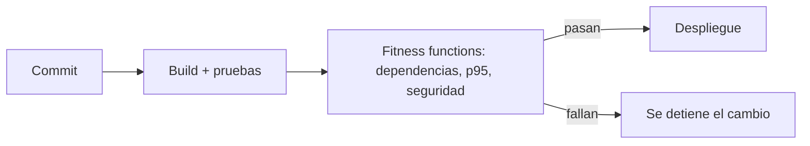

# Arquitectura evolutiva

Parte de: [[09-Arquitectura-Patrones/01 Estilos de arquitectura/_Índice Estilos de arquitectura|Estilos de arquitectura]]

> [!info] Cómo avanzar
> `progreso`: **pendiente** → **viendo** (estudiando) → **visto** (contestaste la autoevaluación sin abrir las respuestas) → **dominado** (hiciste el laboratorio o lo aplicaste de verdad).

## Contenido

### Qué es
La arquitectura evolutiva es el enfoque que diseña un sistema para **soportar cambios guiados e incrementales** en varias dimensiones (funcionalidad, rendimiento, seguridad, datos) en lugar de intentar acertar todo al inicio. La idea, popularizada por Neal Ford, Rebecca Parsons y Patrick Kua en *Building Evolutionary Architectures*, es que la arquitectura no se "termina": se protege con pruebas automáticas y se ajusta cuando aparece información nueva. Sirve para que el sistema pueda crecer sin que cada cambio grande sea una reescritura.

### Cómo funciona
Tiene tres ingredientes:

1. **Cambio incremental:** entregas pequeñas y frecuentes (pipeline de Azure DevOps, despliegues automatizados, feature flags) para que cada paso sea reversible.
2. **Cambio guiado por *fitness functions*:** una *fitness function* es una **verificación objetiva y automatizable de una característica arquitectónica**. Expresa "lo que no queremos perder" como algo que se puede ejecutar: una prueba, una métrica con umbral, un análisis estático. Si el cambio la rompe, el pipeline falla.
3. **Acoplamiento apropiado:** límites claros (módulos, slices, [[Bounded contexts]]) para que cambiar una parte no arrastre a las demás.



Tipos de fitness functions:
- **Atómicas** (una característica, p. ej. "Features no se referencian entre sí") vs **holísticas** (varias juntas, p. ej. prueba de carga que mide latencia y errores).
- **Disparadas** (corren en cada build) vs **continuas** (monitoreo en producción, como una alerta de Azure Monitor si el p95 supera 300 ms).

### Ejemplo
Las reglas del usuario dicen "vertical slice" y "hexagonal solo en bordes". Puedes convertir esas reglas en fitness functions con NetArchTest para que no dependan de la memoria del equipo:

```csharp
using NetArchTest.Rules;
using Xunit;

public sealed class ReglasDeArquitectura
{
    private static readonly System.Reflection.Assembly Api =
        typeof(Itzamna.Dionisio.Api.Program).Assembly;

    [Fact]
    public void Los_slices_de_Pedidos_no_dependen_de_Cobros()
    {
        var resultado = Types.InAssembly(Api)
            .That().ResideInNamespace("Itzamna.Dionisio.Api.Features.Pedidos")
            .ShouldNot().HaveDependencyOn("Itzamna.Dionisio.Api.Features.Cobros")
            .GetResult();

        Assert.True(resultado.IsSuccessful, "Un slice no debe llamar a otro slice");
    }

    [Fact]
    public void Solo_Infraestructura_conoce_el_SDK_de_Blob()
    {
        var resultado = Types.InAssembly(Api)
            .That().ResideInNamespace("Itzamna.Dionisio.Api.Features")
            .ShouldNot().HaveDependencyOn("Azure.Storage.Blobs")
            .GetResult();

        Assert.True(resultado.IsSuccessful);
    }
}
```

Otras fitness functions realistas: un paso del pipeline que falla si un paquete NuGet tiene vulnerabilidades conocidas (`dotnet list package --vulnerable`), una prueba que verifica que todas las respuestas de error son `ProblemDetails` con `codigo`, o un escaneo que detecta secretos en el repositorio.

### Cómo posponer decisiones sin parálisis
Posponer no es "no decidir"; es decidir **en el último momento responsable**: cuando ya tienes datos y antes de que la falta de decisión cueste. Para lograrlo sin quedarte congelado:
- Toma la opción **más barata de revertir** (monolito modular antes que microservicios; SQL Server que ya conoces antes que una base nueva).
- Aísla la decisión detrás de un límite: si dudas del proveedor de correo, ponlo detrás de un puerto (hexagonal solo en ese borde) y sigue avanzando.
- Escribe un ADR con la decisión provisional, el criterio que te haría cambiarla y la fecha de revisión (ver [[ADR - registro de decisiones de arquitectura]]).
- Define la fitness function que te avisará cuando el criterio se cumpla (por ejemplo, "si la cola tarda más de 5 minutos en vaciarse, revisamos el modelo de consumidores").

### Cuándo usarlo y cuándo no
- **Úsalo** en sistemas de vida larga con requisitos que cambian (casi todos los productos internos y SaaS).
- **Menos útil** en scripts o prototipos desechables, donde automatizar reglas cuesta más que el riesgo.
- No es excusa para no diseñar: sigues necesitando límites claros desde el inicio.

### Errores comunes
1. **Fitness functions que nadie ejecuta:** si no están en el pipeline, son documentación. Ponlas en el build.
2. **Medir lo fácil en vez de lo importante:** cobertura de código no es una característica arquitectónica; la latencia p95 o el acoplamiento sí.
3. **Reglas demasiado rígidas** que bloquean cambios legítimos; revísalas como cualquier código.
4. **Confundir evolutiva con improvisada:** cambiar sin ADR ni criterio produce deuda, no evolución. Ver [[Gestión de deuda técnica]].

### Para profundizar
- [Building Evolutionary Architectures, cap. 2: Fitness Functions (O'Reilly)](https://www.oreilly.com/library/view/building-evolutionary-architectures/9781492097532/ch02.html)
- [NetArchTest en GitHub](https://github.com/BenMorris/NetArchTest)
- [Monolith First (Martin Fowler)](https://martinfowler.com/bliki/MonolithFirst.html)

Relacionado: [[Atributos de calidad y trade-offs]], [[Monolito modular]].

## Autoevaluación

Contesta primero en voz alta o en papel; luego despliega la respuesta.

> [!question]- ¿Qué es la arquitectura evolutiva?
> Diseñar para el cambio incremental guiado: se definen las características importantes y se protegen con *fitness functions* mientras el sistema evoluciona en pasos pequeños.

> [!question]- ¿Qué es una *fitness function*? Da un ejemplo.
> Una verificación automática de una característica arquitectónica. Ej.: prueba que falla si `Domain` referencia `Infrastructure`; prueba de carga en CI que falla si p95 > 300 ms.

> [!question]- ¿Cómo pospones decisiones sin parálisis?
> Decidiendo en el *último momento responsable*: detrás de una interfaz, con la opción más simple y reversible, y registrando el porqué en un [[ADR - registro de decisiones de arquitectura|ADR]].

