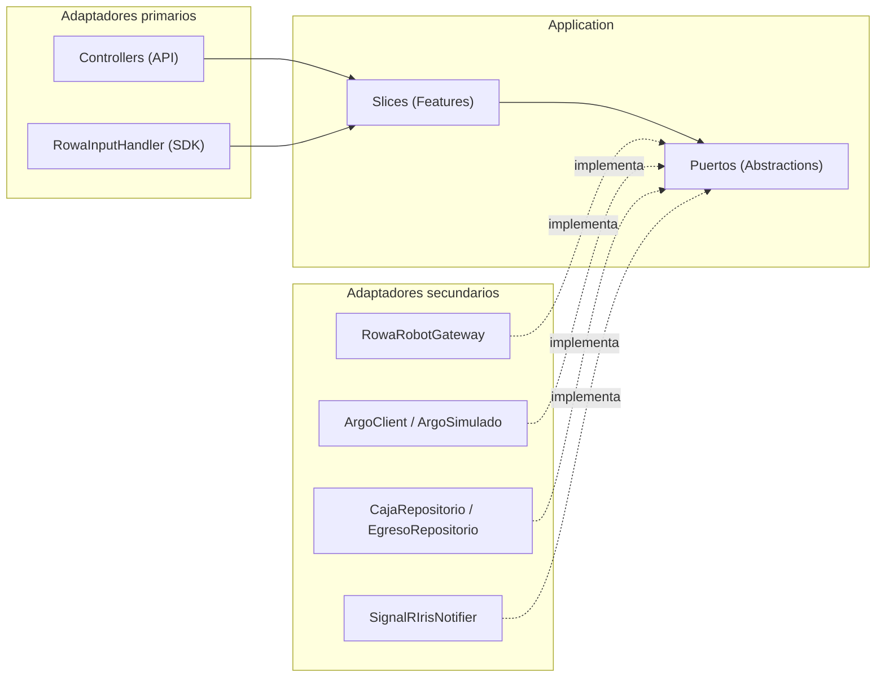

# Arquitectura hexagonal

> La aplicación habla con el mundo solo a través de puertos (interfaces) y cada tecnología externa se conecta con un adaptador intercambiable.

## Qué es y qué problema resuelve
Propuesta por Alistair Cockburn como *Ports and Adapters*. La aplicación queda en el centro y todo lo externo (UI, HTTP, base de datos, hardware) está "afuera". Resuelve que la lógica dependa de una tecnología concreta y permite probarla o cambiar una integración (robot real ↔ emulador, Argo real ↔ simulado) sin tocarla.

## Cómo funciona por dentro
- **Puerto**: interfaz definida *por la aplicación*, con el vocabulario de la aplicación.
- **Adaptador secundario (driven)**: implementa un puerto para que la aplicación use algo externo (base de datos, Argo, robot).
- **Adaptador primario (driving)**: algo externo que *invoca* a la aplicación (endpoint HTTP, Hub, callback de un SDK).



## Cuándo usarla y cuándo no
Úsala cuando hay integraciones externas que cambian, que se simulan o que hay que aislar (hardware, servicios en la nube). No hace falta en apps que solo envuelven una base de datos.

### Ventajas
- Simuladores y fakes "gratis": basta otro adaptador.
- La lógica no conoce protocolos (WWKS2, HTTP, SQL).
- Puertos pequeños por capacidad: cada consumidor depende solo de lo que usa.

### Desventajas
- Más interfaces y registros de DI.
- Puertos mal cortados (demasiado genéricos o calcados de la tecnología) no aíslan nada.
- Puede llevar a abstraer cosas que nunca cambiarán.

## Alternativas
| Alternativa | En qué se diferencia |
|---|---|
| [[Clean Architecture]] | Mismo principio (dependencias hacia adentro), formulado como capas concéntricas. |
| Llamar al SDK/HTTP directamente desde la lógica | Más simple, pero imposible de probar sin el robot o sin Argo. |
| [[Vertical Slice Architecture]] sin puertos | Cada slice usa la tecnología directa; se pierde la sustitución. |

## Cómo se usó en Ocelotl
En [[Ocelotl.Hermes]] los puertos viven en `Application/Abstractions` y los adaptadores en `Infrastructure` (y uno en `Api`):

| Puerto | Adaptador |
|---|---|
| `IRobotConexiones` · `IRobotStock` · `IRobotDispensado` | `RowaRobotGateway` (una instancia detrás de los tres) |
| `IArgoClient` | `ArgoClient` / `ArgoSimulado` |
| `ICajaRepositorio` · `IEgresoRepositorio` | `CajaRepositorio` / `EgresoRepositorio` (SQLite + [[Dapper]]) — ver [[Repository]] |
| `IIdentityProvider` · `ISesionActual` | `LocalIdentityProvider` · `SesionEnMemoria` |
| `IEventPublisher` · `IIrisNotifier` | `ChannelEventPublisher` · `SignalRIrisNotifier` (en Api) |
| `IReaccionEvento` | lo implementan los slices (`TrazarCajas`, `TrazarEgresos`) |

**Los tres puertos del robot.** Antes había una sola `IRobotGateway`; se partió por capacidad (`Ocelotl.Hermes/src/Ocelotl.Hermes.Application/Abstractions/IRobotGateway.cs`): `Conectar` depende de `IRobotConexiones`, `Dispensar` de `IRobotDispensado`. Una sola instancia los respalda porque comparten el pool de conexiones (`Ocelotl.Hermes/src/Ocelotl.Hermes.Infrastructure/DependencyInjection.cs`):

```csharp
services.AddSingleton<RowaRobotGateway>();
services.AddSingleton<IRobotConexiones>(sp => sp.GetRequiredService<RowaRobotGateway>());
services.AddSingleton<IRobotStock>(sp => sp.GetRequiredService<RowaRobotGateway>());
services.AddSingleton<IRobotDispensado>(sp => sp.GetRequiredService<RowaRobotGateway>());
```

**Primarios vs secundarios.** `RowaRobotGateway` es secundario (la app lo usa). `RowaInputHandler` es **primario**: el SDK de Rowa lo llama cuando el robot pide ingresar una caja y él invoca un slice (`Ocelotl.Hermes/src/Ocelotl.Hermes.Infrastructure/Robot/RowaInputHandler.cs`):

```csharp
await using var scope = scopes.CreateAsyncScope();
var handler = scope.ServiceProvider.GetRequiredService<ResolverPackEntrante.Handler>();
// ...
var resultado = await handler.Handle(new ResolverPackEntrante.Command(robotId, entrada), CancellationToken.None);
```

La decisión (permitir/rechazar) está en el slice; el adaptador solo traduce y garantiza `request.Finish()` en un `finally`. Los endpoints de la Api y el `RobotHub` también son adaptadores primarios.

En pruebas, `tests/Ocelotl.Hermes.Application.Tests/Fakes.cs` tiene `RobotsFalsos : IRobotConexiones, IRobotStock, IRobotDispensado`, `ArgoFalso`, `EgresosFalsos`, etc.

Funcionalidades: [[Conexión de robots]], [[Stock e inventario]], [[Dispensar]], [[Ingresos]], [[Sincronización con Argo]], [[Eventos en tiempo real]].

### Hexagonal vs por funcionalidad en Hermes
Hermes **no** es hexagonal "de libro" (con un núcleo de dominio rico rodeado de puertos). Se eligió **organización por funcionalidad** ([[Vertical Slice Architecture]]) **con puertos solo en los bordes**, porque:
- El **dominio son records sin reglas** (`Egreso`, `Caja`, eventos en `Domain/Eventos/EventosRobot.cs`): no hay un núcleo que proteger con un hexágono propio.
- El valor de Hermes es **orquestar integraciones**: robot BD Rowa ([[SDK BD Rowa y WWKS2]]), [[Argo]] (nube) e [[Ocelotl.Iris]] ([[SignalR]]). Ahí sí conviene aislar cada tecnología tras un puerto.
- Las reglas viven en los slices, nunca en los adaptadores (README de Hermes).

Matices observados en el código:
- `IArgoEventSink` (destino del outbox) está declarado en `Infrastructure/Argo/ArgoEventSink.cs`, no en `Application/Abstractions`, aunque el README lo lista como puerto. Tiene sentido porque solo lo usa el `OutboxDispatcher` (también de Infrastructure).
- `EventDispatcher` usa directamente las clases concretas `ChannelEventPublisher` y `OutboxRepositorio` (ambas de Infrastructure), sin puerto.

## Errores comunes y buenas prácticas
- **Puertos con tipos del proveedor** (p. ej. `IInputPack` del SDK en una interfaz de Application). En Hermes el adaptador traduce a `PackEntrante` antes de llamar al slice.
- **Un puerto gigante**: se partió `IRobotGateway` en tres por capacidad.
- **Lógica en el adaptador**: el antiguo `InputObserver` decidía y usaba `async void`; ahora decide el slice `ResolverPackEntrante`.
- Registrar la misma instancia detrás de varios puertos cuando comparten estado (pool de conexiones).

## Qué estudiar después
- [[Clean Architecture]] y [[Vertical Slice Architecture]]
- [[Repository]] y [[Patrón Outbox]] (adaptadores concretos)
- [[Inyección de dependencias]] (registrar una instancia bajo varias interfaces)
- Principio de segregación de interfaces (la "I" de SOLID)

## Documentación oficial
- https://alistair.cockburn.us/hexagonal-architecture/

## Autoevaluación

Contesta primero en voz alta o en papel; luego despliega la respuesta.

> [!question]- ¿Qué es un puerto y qué es un adaptador?
> Puerto: interfaz definida por la aplicación con su propio vocabulario. Adaptador: implementación concreta que conecta una tecnología con ese puerto (primario si invoca a la app; secundario si la app lo usa).

> [!question]- ¿Qué pasa si el puerto copia la API del proveedor (`IStripeClient` con sus mismos métodos)?
> No aísla nada: cambiar de proveedor obliga a cambiar el puerto y a sus consumidores. El puerto debe expresar la capacidad que la app necesita (`IPasarelaPago.CrearCargoAsync`).

> [!question]- ¿Cuándo no vale la pena?
> En una app que solo envuelve una base de datos sin integraciones que cambien o se simulen: las interfaces extra no pagan su costo.

