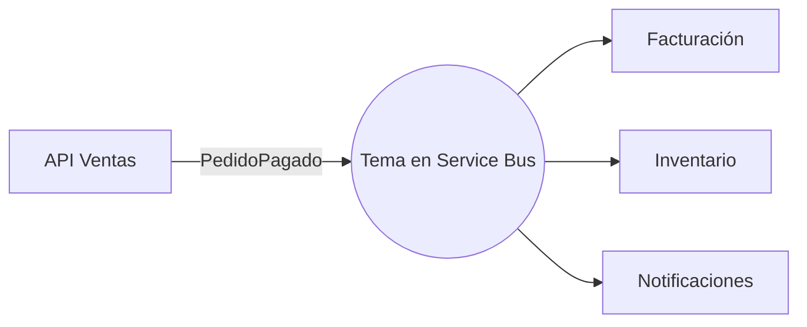

# Arquitectura orientada a eventos

Parte de: [[09-Arquitectura-Patrones/01 Estilos de arquitectura/_Índice Estilos de arquitectura|Estilos de arquitectura]]

> [!info] Cómo avanzar
> `progreso`: **pendiente** → **viendo** (estudiando) → **visto** (contestaste la autoevaluación sin abrir las respuestas) → **dominado** (hiciste el laboratorio o lo aplicaste de verdad).

## Contenido

### Qué es
Una arquitectura orientada a eventos (EDA, *event-driven architecture*) es un estilo en el que los componentes se comunican **publicando hechos que ya ocurrieron** ("PedidoPagado", "UsuarioRegistrado") en lugar de llamarse directamente. Quien publica no sabe quién escucha; los suscriptores reaccionan por su cuenta. Sirve para desacoplar sistemas en el tiempo y en el conocimiento: agregar un nuevo consumidor no obliga a modificar al productor.

### Cómo funciona
1. El **productor** cambia su estado y emite un evento a un **broker** (Azure Service Bus, Event Grid, Kafka, RabbitMQ).
2. El broker entrega el evento a uno o varios **consumidores** (pub/sub con temas y suscripciones).
3. Cada consumidor procesa a su ritmo, con reintentos y cola de mensajes muertos si falla.



Fowler distingue varios usos de "evento", y conviene no mezclarlos:
- **Evento de notificación:** mensaje mínimo ("el pedido 123 se pagó", con id y poco más). El consumidor que necesita detalles **llama de regreso** al productor. Es ligero y no expone datos, pero crea tráfico de vuelta y dependencia en tiempo de ejecución.
- **Event-carried state transfer:** el evento **lleva los datos** que el consumidor necesita (cliente, importe, líneas). El consumidor guarda su propia copia y no vuelve a preguntar. Gana autonomía y resiliencia a costa de duplicar datos y aceptar [[Consistencia eventual y teorema CAP|consistencia eventual]].
- **[[Event Sourcing]]:** los eventos son la fuente de verdad del estado, no solo un aviso.
- Dentro de un mismo proceso existen además los [[Eventos de dominio y reacciones|eventos de dominio]], que no necesariamente salen a un broker.

### El problema de la doble escritura
Si guardas en la base y luego publicas, y el proceso muere entre ambos pasos, **la base dice que el pedido está pagado pero nadie se enteró**: facturación nunca emite la factura. Al revés (publicar primero) es peor: avisas de algo que quizá no se guardó. La solución estándar es el [[Patrón Outbox]]: en la **misma transacción** guardas el cambio y una fila en la tabla `Outbox`; un proceso aparte lee esa tabla y publica, marcando lo enviado. Así la publicación es *at-least-once* y los consumidores deben ser idempotentes ([[Consumidores idempotentes]]).

### Ejemplo
Slice `PagarPedido` en una API con Dapper: la transacción cubre el cambio y el outbox.

```csharp
public sealed class PagarPedidoHandler(IDbConnection db, ISqlArchivos sql)
{
    public async Task Handle(PagarPedido.Command cmd, CancellationToken ct)
    {
        db.Open();
        using var tx = db.BeginTransaction();

        await db.ExecuteAsync(sql.Leer("Pedidos/PagarPedido.sql"),
            new { cmd.PedidoId, cmd.Importe }, tx);

        var evento = new PedidoPagado(cmd.PedidoId, cmd.Importe, DateTimeOffset.UtcNow);
        await db.ExecuteAsync(sql.Leer("Outbox/Insertar.sql"), new
        {
            Id = Guid.NewGuid(),
            Tipo = nameof(PedidoPagado),
            Contenido = JsonSerializer.Serialize(evento)
        }, tx);

        tx.Commit(); // ambos o ninguno
    }
}

public sealed record PedidoPagado(int PedidoId, decimal Importe, DateTimeOffset Ocurrio);
```

Un `BackgroundService` publica las filas pendientes del outbox en Service Bus. Este evento es *event-carried state transfer* ligero: lleva el importe para que facturación no tenga que llamar a la API.

### Cuándo usarlo y cuándo no
**Conviene** cuando varios sistemas reaccionan al mismo hecho, cuando quieres que un consumidor caído no tumbe al productor, o cuando hay picos que se absorben con una cola.

**No conviene** cuando:
- El usuario necesita la respuesta **inmediata y consistente** (validar saldo antes de autorizar un cargo).
- Es un CRUD sencillo con un solo consumidor: una llamada directa es más fácil de entender y depurar.
- El equipo no tiene trazabilidad distribuida (correlation id, logs centralizados); sin ella, seguir un flujo de eventos es adivinar.
- El flujo de negocio es una secuencia estricta que alguien debe ver completa: ahí una orquestación ([[Patrón Saga]]) es más clara que eventos sueltos.

### Errores comunes
1. **Doble escritura sin outbox:** pierdes eventos en cada caída. Usa outbox o la transacción del propio broker.
2. **Eventos que son comandos disfrazados** ("EnviarCorreo"): un evento describe un hecho pasado; si esperas que alguien específico haga algo, es un comando.
3. **Consumidores no idempotentes:** la entrega es al menos una vez; un duplicado no debe facturar dos veces.
4. **Contratos sin versión:** cambiar un campo rompe consumidores que no controlas. Agrega campos, no los renombres; versiona el tipo.
5. **Asumir orden global:** los brokers solo garantizan orden dentro de una partición o sesión.

### Para profundizar
- [What do you mean by "Event-Driven"? (Martin Fowler)](https://martinfowler.com/articles/201701-event-driven.html)
- [Estilo de arquitectura orientada a eventos (Azure Architecture Center)](https://learn.microsoft.com/en-us/azure/architecture/guide/architecture-styles/event-driven)
- [Colas, temas y suscripciones de Service Bus](https://learn.microsoft.com/en-us/azure/service-bus-messaging/service-bus-queues-topics-subscriptions)

## Autoevaluación

Contesta primero en voz alta o en papel; luego despliega la respuesta.

> [!question]- ¿Qué es una arquitectura orientada a eventos (EDA)?
> Los componentes se comunican publicando hechos ocurridos (eventos) en un broker; los interesados se suscriben y reaccionan sin que el productor los conozca.

> [!question]- Diferencia entre *evento de notificación* y *event-carried state transfer*.
> Notificación: lleva lo mínimo (`PedidoPagado {id}`) y el consumidor consulta si necesita más. State transfer: lleva los datos necesarios para que el consumidor no tenga que llamar al productor (menos acoplamiento en tiempo de ejecución, mensajes más grandes).

> [!question]- ¿Qué pasa si guardas en la base y luego publicas el evento, y el proceso muere entre ambos?
> El evento se pierde y los sistemas quedan inconsistentes. Se resuelve con el [[Patrón Outbox]]: guardar el evento en la misma transacción y publicarlo después.

> [!question]- ¿Cuándo NO conviene EDA?
> Cuando el llamador necesita la respuesta para continuar (consulta síncrona) o el flujo es simple y lineal: los eventos lo hacen más difícil de seguir y depurar.

