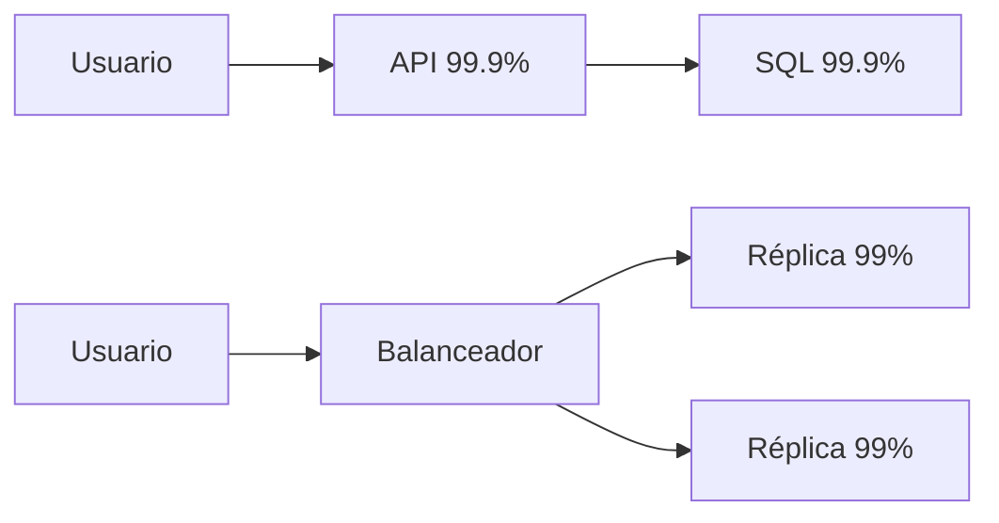

# Atributos de calidad y trade-offs

Parte de: [[09-Arquitectura-Patrones/01 Estilos de arquitectura/_Índice Estilos de arquitectura|Estilos de arquitectura]]

> [!info] Cómo avanzar
> `progreso`: **pendiente** → **viendo** (estudiando) → **visto** (contestaste la autoevaluación sin abrir las respuestas) → **dominado** (hiciste el laboratorio o lo aplicaste de verdad).

## Contenido

### Qué es
Los atributos de calidad (también llamados requisitos no funcionales o "-ilities") son las características que describen **qué tan bien** hace el sistema su trabajo, no qué hace: **disponibilidad, rendimiento (latencia y throughput), escalabilidad, seguridad, mantenibilidad, capacidad de prueba, observabilidad, costo, usabilidad, interoperabilidad**. La norma ISO/IEC 25010 los organiza en un modelo de calidad. Son los que realmente deciden la arquitectura: dos sistemas con las mismas funciones pueden necesitar arquitecturas opuestas por sus atributos.

### Cómo funciona
#### Volver verificable un atributo
"Debe ser rápido" no se puede probar. Se convierte en un **escenario de calidad** con seis partes (modelo del SEI):

| Parte | Ejemplo |
|---|---|
| Fuente | Usuario de la app móvil |
| Estímulo | Consulta el detalle de un pedido |
| Artefacto | API de pedidos |
| Entorno | Operación normal, 500 req/s |
| Respuesta | Devuelve el pedido |
| Medida | p95 menor a 200 ms y p99 menor a 500 ms |

Ese escenario sí se mide con una prueba de carga o una alerta. Fíjate que usa percentiles, no promedio: el promedio esconde a los usuarios lentos.

Escenario de **disponibilidad** para un API de pagos: *"Cuando la instancia primaria de la API de pagos falla (estímulo) durante horario pico (entorno), el balanceador redirige a otra instancia y el servicio sigue aceptando cobros (respuesta); ningún cobro confirmado se pierde y la interrupción visible dura menos de 30 segundos; la disponibilidad mensual es al menos 99.95% (medida)."*

#### Cálculos de disponibilidad
- **En serie** (la petición necesita A *y* B): se multiplican. Dos servicios de 99.9%: 0.999 × 0.999 = **0.998001 ≈ 99.8%**. Cada dependencia síncrona resta disponibilidad.
- **Presupuesto de caída:** 99.9% en 30 días = 0.001 × 43,200 min = **43.2 minutos al mes**. Con 99.8% el presupuesto sube a unos 86 minutos.
- **En paralelo** (basta que una réplica funcione, fallas independientes): 1 − (0.01 × 0.01) = **0.9999 = 99.99%**. La redundancia suma "nueves", pero solo si las fallas son realmente independientes (distinta zona, sin dependencia común).

#### Trade-offs
Mejorar un atributo casi siempre empeora otro. Ejemplos típicos:
- **Consistencia vs disponibilidad/latencia:** réplicas de lectura dan escala pero datos atrasados (ver [[Consistencia eventual y teorema CAP]]).
- **Seguridad vs usabilidad:** MFA en cada operación protege pero molesta.
- **Rendimiento vs mantenibilidad:** SQL a mano muy optimizado es rápido y difícil de cambiar.
- **Disponibilidad vs costo:** pasar de 99.9% a 99.99% suele exigir multi-zona o multi-región, y el costo crece mucho más que el beneficio.
- **Flexibilidad vs simplicidad:** puertos y adaptadores en todo el sistema dan intercambiabilidad que quizá nunca uses. Por eso el usuario aplica hexagonal **solo en los bordes**.

### Ejemplo
En Wee.Reporteria, los reportes en Excel pueden tardar. Escenario: *"Cuando un usuario pide el reporte mensual (hasta 200,000 filas), el sistema acepta la solicitud en menos de 1 s y entrega el archivo en menos de 2 minutos sin degradar el p95 de la API de ventas."* Ese escenario empuja la decisión: generar el reporte en un proceso en segundo plano con cola, no en la petición HTTP, y aislar sus conexiones ([[Bulkhead y throttling]]). La prioridad declarada es "no afectar ventas" sobre "reporte instantáneo".

### Cuándo usarlo y cuándo no
Siempre que tomes una decisión de arquitectura, nombra los 3–5 atributos que más importan **para ese sistema** y ordénalos. Un sistema interno de reportes prioriza costo y mantenibilidad; Xolotl.Hecate (identidad) prioriza seguridad y disponibilidad. No intentes maximizar todos.

### Errores comunes
1. **Querer todos los atributos al máximo:** "seguro, rápido, barato, 99.999% y fácil de cambiar". Si todo es prioridad, nada lo es; obliga a ordenar.
2. **Atributos sin medida:** "escalable" sin número no guía ninguna decisión.
3. **Usar promedios** en lugar de percentiles para latencia.
4. **Olvidar las dependencias en serie** al prometer un SLA: tu 99.95% no puede superar al de la base de datos de la que dependes.
5. **Decidir por moda** (microservicios "porque escalan") sin que la escalabilidad sea un atributo prioritario.

### Para profundizar
- [Azure Well-Architected Framework](https://learn.microsoft.com/en-us/azure/well-architected/)
- [ISO/IEC 25010 (modelo de calidad de producto)](https://www.iso.org/standard/78176.html)
- [Software Architecture in Practice, 4.ª ed. (SEI)](https://www.sei.cmu.edu/library/software-architecture-in-practice-fourth-edition/)

Relacionado: [[Requisitos funcionales y no funcionales]], [[Arquitectura evolutiva]].

## Ejercicios

Resuélvelos en papel o en la herramienta; la solución está plegada.

> [!question]- Dos servicios en serie con 99.9% de disponibilidad cada uno. ¿Disponibilidad combinada? ¿Cuánto tiempo caído al mes (30 días) permite 99.9%?
> Serie: 0.999 × 0.999 = **0.998 (99.8%)**. 99.9% permite 0.1% de 43,200 min = **43.2 min/mes** (≈ 8.76 h al año).

> [!question]- Pones dos réplicas independientes de un componente con 99% cada una, en paralelo (basta que una funcione). ¿Disponibilidad?
> 1 − (0.01 × 0.01) = **0.9999 (99.99%)**. La redundancia sube la disponibilidad si los fallos son independientes.

> [!question]- Escribe un escenario de calidad para disponibilidad de un API de pagos.
> Ejemplo: "Si cae una instancia del API en horario pico, el balanceador deja de enviarle tráfico en < 30 s y las peticiones en curso fallan con 503 reintentable; ningún pago se cobra dos veces." Tiene fuente, estímulo, respuesta y medida.

## Autoevaluación

Contesta primero en voz alta o en papel; luego despliega la respuesta.

> [!question]- ¿Qué son los atributos de calidad? Menciona cinco.
> Requisitos no funcionales que guían la arquitectura: disponibilidad, rendimiento/latencia, escalabilidad, seguridad, mantenibilidad, observabilidad, costo, testabilidad.

> [!question]- ¿Cómo se vuelve verificable "debe ser rápido"?
> Con un escenario medible: "con 500 usuarios concurrentes, el p95 de `GET /pedidos` es < 300 ms".

> [!question]- Da un trade-off típico entre dos atributos.
> Consistencia vs disponibilidad ([[Consistencia eventual y teorema CAP]]); seguridad vs usabilidad (MFA); rendimiento vs costo (más réplicas); caché = rendimiento a cambio de datos posiblemente viejos.

> [!question]- Error común al priorizar atributos.
> Querer todos al máximo. Hay que elegir los 2–3 que más importan al negocio y aceptar explícitamente lo que se sacrifica.

