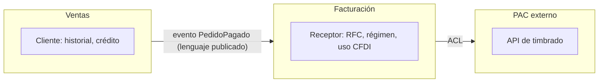

# Bounded contexts

Parte de: [[09-Arquitectura-Patrones/01 Estilos de arquitectura/_Índice Estilos de arquitectura|Estilos de arquitectura]]

> [!info] Cómo avanzar
> `progreso`: **pendiente** → **viendo** (estudiando) → **visto** (contestaste la autoevaluación sin abrir las respuestas) → **dominado** (hiciste el laboratorio o lo aplicaste de verdad).

## Contenido

### Qué es
Un *bounded context* (contexto delimitado) es un **límite explícito dentro del cual un modelo de dominio y su lenguaje tienen un significado único y consistente**. Es el concepto central del diseño estratégico de [[Domain-Driven Design - conceptos|DDD]]. La misma palabra puede significar cosas distintas en distintas partes del negocio: "Cliente" en Ventas es alguien con historial de compras y crédito; en Facturación es un RFC con régimen fiscal; en Soporte es alguien con tickets. En lugar de forzar un único modelo `Cliente` gigante, cada contexto tiene el suyo.

### Cómo funciona
1. **Identificas zonas del negocio** donde el lenguaje cambia (talleres con expertos, Event Storming).
2. **Trazas el límite:** dentro de él, un término tiene una definición; fuera, puede tener otra.
3. **Asignas dueño:** idealmente un equipo por contexto, con su código y sus datos.
4. **Defines cómo se relacionan** los contextos en un **mapa de contextos** (*context map*).



#### Patrones del mapa de contextos
- **Cliente/Proveedor (*customer/supplier*):** el contexto de abajo (cliente) depende del de arriba (proveedor), y el proveedor considera sus necesidades al planear.
- **Conformista:** el de abajo adopta el modelo del de arriba tal cual, porque no tiene poder para negociar (p. ej., una API de gobierno).
- **[[Anti-corruption layer]] (ACL):** el de abajo traduce el modelo ajeno al suyo para que no lo "contamine". Muy usado con sistemas legados o proveedores externos.
- **Open Host Service + Published Language:** el de arriba ofrece una API o un formato de eventos estable y documentado para muchos consumidores.
- **Shared Kernel:** dos contextos comparten una pequeña parte del modelo (y coordinan sus cambios). Útil pero acopla.
- **Partnership:** dos equipos se coordinan y evolucionan juntos.
- **Separate Ways:** no se integran; cada uno resuelve por su cuenta.

### Ejemplo
En un sistema de pedidos con facturación electrónica mexicana, separas `Ventas` y `Facturacion` como módulos. En código, cada uno tiene su propio tipo, aunque ambos digan "cliente":

```csharp
namespace Tienda.Ventas.Features.Pedidos;
public sealed record ClienteVenta(int ClienteId, string Nombre, decimal LimiteCredito);

namespace Tienda.Facturacion.Features.Emitir;
public sealed record Receptor(string Rfc, string RazonSocial, string RegimenFiscal,
                              string UsoCfdi, string CodigoPostal);
```

Ventas publica `PedidoPagado` con el `ClienteId`; Facturación lo recibe, busca el `Receptor` en **sus propias tablas** (esquema `fact` en SQL Server) y no consulta las tablas de Ventas. Si mañana cambia la forma de manejar crédito, Facturación no se entera.

### Bounded context y microservicio
**No son lo mismo.** Un bounded context es un límite de **modelo y lenguaje**; un microservicio es una **unidad de despliegue**. La relación sana es: un microservicio no debería abarcar varios contextos (mezclaría modelos), pero un contexto **puede vivir como módulo dentro de un [[Monolito modular]]** o, si es grande, repartirse en varios servicios. Empieza por los contextos como módulos; sepáralos en servicios solo si hay razones de despliegue, escala o equipos. Ver [[Microservicios]].

### Cuándo usarlo y cuándo no
- **Úsalo** cuando el sistema cubre varias áreas de negocio y empiezas a ver entidades enormes con campos que solo le importan a una parte, o reuniones donde dos áreas usan la misma palabra para cosas distintas.
- **No lo fuerces** en una aplicación pequeña de un solo propósito; un solo contexto basta.
- Relación con vertical slice: los slices viven **dentro** de un contexto (`Facturacion/Features/Emitir`), y un slice no cruza contextos.

### Errores comunes
1. **Un modelo único para toda la empresa:** el `Cliente` con 80 columnas que todos modifican. Divide por contexto.
2. **Contextos por tabla o por capa técnica** en lugar de por lenguaje de negocio.
3. **Límites solo en carpetas:** si Facturación hace `JOIN` contra las tablas de Ventas, el límite no existe. Separa esquemas y contrólalo con revisiones o pruebas de arquitectura.
4. **Shared kernel que crece sin control** hasta convertirse en una librería común que acopla todo.
5. **Confundir contexto con microservicio** y partir el sistema en servicios antes de entender el dominio.

### Para profundizar
- [Bounded Context (Martin Fowler)](https://martinfowler.com/bliki/BoundedContext.html)
- [Análisis de dominio para microservicios (Azure Architecture Center)](https://learn.microsoft.com/en-us/azure/architecture/microservices/model/domain-analysis)
- [DDD Reference (Eric Evans)](https://www.domainlanguage.com/ddd/reference/)

## Autoevaluación

Contesta primero en voz alta o en papel; luego despliega la respuesta.

> [!question]- ¿Qué es un bounded context?
> Una frontera explícita dentro de la cual un modelo y su lenguaje tienen un significado único. "Producto" en Catálogo (descripción, fotos) no es el mismo modelo que en Inventario (existencias, ubicación).

> [!question]- ¿Cómo se relacionan dos contextos? Menciona dos patrones del mapa de contextos.
> Cliente-proveedor, conformista, kernel compartido, [[Anti-corruption layer]], *published language*. Por ejemplo, ACL cuando el modelo externo es malo y no quieres que contamine el tuyo.

> [!question]- ¿Bounded context = microservicio?
> No necesariamente. Un contexto es una frontera de modelo; puede vivir como módulo de un [[Monolito modular]]. Un microservicio suele alinearse a uno, pero no al revés.

