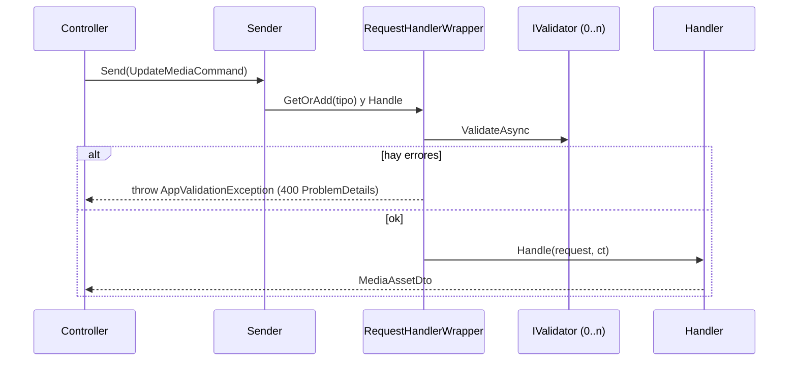

---
proyecto:
  - Itzamna.Dionisio
  - Pochteca.Nomisma
proyectos:
  - "[[Itzamna.Dionisio]]"
  - "[[Pochteca.Nomisma]]"
tipo: patron
nivel: intermedio
estado: completo
tags:
  - conocimiento
  - patron
  - backend
  - dotnet
  - cqrs
progreso: pendiente
area: Arquitectura y patrones
---
# CQRS y mediador

> Separar las operaciones que **cambian** estado (comandos) de las que **leen** (consultas) y despacharlas por un mediador que encuentra el handler; [[Itzamna.Dionisio]] tiene un mediador propio y mínimo con validación de [[FluentValidation]] integrada.

## Qué es y qué problema resuelve
- **CQRS** (Command Query Responsibility Segregation, Greg Young): cada caso de uso es un `Command` (escribe, p. ej. `PublishPortfolioCommand`) o una `Query` (lee, p. ej. `ListVersionsQuery`). En su forma ligera solo separa **tipos y handlers**; en su forma completa también separa modelos o bases de lectura y escritura.
- **Mediador** (patrón GoF): el emisor no conoce al receptor. El controller hace `Sender.Send(new XCommand(...))` y el mediador resuelve `IRequestHandler<XCommand, TResponse>`. Permite meter lógica transversal (validación, logging) en un solo punto.

Resuelve controllers gordos, servicios con decenas de métodos y validación repetida en cada endpoint.

## Cómo funciona por dentro
1. `IRequest<TResponse>`: marca un mensaje y su tipo de respuesta.
2. `IRequestHandler<TRequest, TResponse>`: un handler por mensaje.
3. `ISender.Send(request)`: busca (y cachea) un *wrapper* genérico para el tipo concreto, corre los validadores y llama al handler.
4. Registro por reflexión de todos los handlers del ensamblado.



## Cuándo usarla y cuándo no
### Ventajas
- Un caso de uso = un mensaje + un handler; fácil de encontrar y probar.
- Validación y logging centralizados.
- Controllers de una línea.
### Desventajas
- Indirección: "ir a la definición" desde el controller lleva al record, no al handler.
- Con MediatR, dependencia externa (MediatR pasó a licencia comercial; Dionisio lo evita con uno propio).
- Para CRUD trivial puede ser ceremonia de más.

## Alternativas
| Alternativa | En qué se diferencia |
|---|---|
| MediatR | Librería estándar de facto; pipeline behaviors, notificaciones. Licencia comercial en versiones recientes. |
| Handlers inyectados directo (sin mediador) | Lo que hace [[Ocelotl.Hermes]]: `[FromServices] Conectar.Handler h` (ver [[Vertical Slice Architecture]]). |
| Servicios de aplicación por agregado | `PortfolioService.Publish()`; menos archivos, clases más grandes. |
| Wolverine / Brighter | Mediadores con mensajería y colas integradas. |

## Cómo se usó en Itzamna
`Itzamna.Dionisio/src/Itzamna.Dionisio.Application/Messaging/Mediator.cs` define `IRequest<T>`, `IRequestHandler<,>`, `ISender`, `Unit` y el `Sender`. El comentario lo dice: "Mediador propio y mínimo (patrón CQRS): request → validación (FluentValidation) → handler. Evita la dependencia de licencia de MediatR manteniendo una interfaz equivalente."

El corazón del wrapper (mismo archivo):
```csharp
var validators = services.GetServices<IValidator<TRequest>>().ToList();
if (validators.Count > 0)
{
    var context = new ValidationContext<TRequest>(typed);
    var failures = new List<FluentValidation.Results.ValidationFailure>();
    foreach (var validator in validators)
    {
        var result = await validator.ValidateAsync(context, cancellationToken);
        failures.AddRange(result.Errors);
    }
    // ...agrupa por propiedad en camelCase y lanza AppValidationException
}
var handler = services.GetRequiredService<IRequestHandler<TRequest, TResponse>>();
return await handler.Handle(typed, cancellationToken);
```

Registro (`Application/DependencyInjection.cs`): `AddScoped<ISender, Sender>()`, `AddValidatorsFromAssembly(...)` y un recorrido por reflexión que registra como *scoped* cada clase que implemente `IRequestHandler<,>`.

Organización: `Application/Features/<Módulo>/` con varios comandos/consultas por archivo (p. ej. `Publishing/PublishingFeatures.cs` contiene `PreviewPortfolioQuery`, `PublishPortfolioCommand`, `ListVersionsQuery`, `RestoreVersionCommand`, `UnpublishCommand`). Los controllers heredan de `ApiControllerBase(ISender)` y solo hacen `Send`.

Es **CQRS ligero**: comandos y consultas usan el mismo `AppDbContext` y la misma base. La única "lectura separada" real es el portfolio público, que sirve un JSON ya armado ([[Snapshot inmutable versionado]]).

Lo usan todas las funcionalidades del back, p. ej. [[Publicación y versiones]], [[Biblioteca de medios]], [[Perfil del creador]].

> [!tip] Reutilizable
> `Mediator.cs` (~100 líneas, sin dependencias salvo FluentValidation y DI) se puede copiar a cualquier proyecto que quiera la interfaz de MediatR sin su licencia. Le faltan *pipeline behaviors* y notificaciones; agrégalos solo si los necesitas.


## Cómo se usó en Pochteca.Nomisma
[[Pochteca.Nomisma]] usa **MediatR 14.2** (no un mediador propio como Itzamna):
- Una carpeta por caso de uso: `Features/<Proveedor>/<CasoDeUso>/` con `XCommand` o `XQuery` (`IRequest<T>`), `XHandler` (`IRequestHandler<T, R>`) y `XValidator`.
- `AddMediatR(cfg => { cfg.RegisterServicesFromAssembly(...); cfg.AddOpenBehavior(typeof(ValidationBehavior<,>)); })`: el behavior corre todos los validadores antes del handler ([[FluentValidation]]).
- Los controllers solo hacen `mediator.Send(command, ct)`.
- `ConsultarCargoQuery` es Query aunque también guarda el estatus que regresa la pasarela.

```csharp
// Pochteca.Nomisma.Application/DependencyInjection.cs
services.AddMediatR(cfg =>
{
    cfg.RegisterServicesFromAssembly(assembly);
    cfg.AddOpenBehavior(typeof(ValidationBehavior<,>));
});
```

> [!note] Pendiente de confirmar
> MediatR 13+ cambió a licencia comercial (Lucky Penny Software). Revisar si aplica al proyecto, o usar un mediador propio como [[Itzamna.Dionisio]].

## Errores comunes y buenas prácticas
- Handlers que llaman a `Send` de otros handlers: acopla casos de uso. (Excepción observada: `JatzSeeder` usa `ISender` para sembrar por los mismos comandos.)
- Validar en el controller *y* en el validador: elegir uno. Dionisio valida en el mediador; el controller solo valida lo propio del transporte (archivo vacío en `MediaController.Upload`).
- Un comando que devuelve el agregado completo: devolver un DTO de Contracts.
- Olvidar registrar un handler: con el registro por reflexión, basta implementar la interfaz; si falta, `GetRequiredService` falla en ejecución.

## Qué estudiar después
- [[FluentValidation]], [[ProblemDetails]], [[Vertical Slice Architecture]], [[Inyección de dependencias]]
- Pipeline behaviors (logging, transacciones), notificaciones de dominio.
- CQRS completo con modelos de lectura proyectados.

## Documentación oficial
- https://martinfowler.com/bliki/CQRS.html
- https://learn.microsoft.com/azure/architecture/patterns/cqrs
- https://github.com/jbogard/MediatR

## Autoevaluación

Contesta primero en voz alta o en papel; luego despliega la respuesta.

> [!question]- ¿Qué separa CQRS en su forma ligera y en su forma completa?
> Ligera: tipos y handlers distintos para comandos y consultas. Completa: además, modelos o almacenes de lectura y escritura distintos, sincronizados (a menudo con eventos).

> [!question]- ¿Qué aporta el mediador además de desacoplar al controller?
> Un punto único para comportamientos transversales (validación, logging, transacciones, métricas) mediante *pipeline behaviors*.

> [!question]- ¿Una *query* puede modificar estado?
> No debería: las consultas no tienen efectos secundarios observables. Si una lectura escribe (p. ej. "marcar como leído"), es un comando aparte.

> [!question]- ¿Cuándo es ceremonia innecesaria?
> En un CRUD trivial donde cada handler solo llama al repositorio: la indirección no compra nada.

