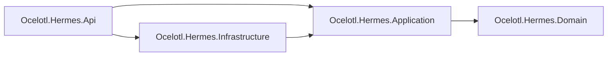
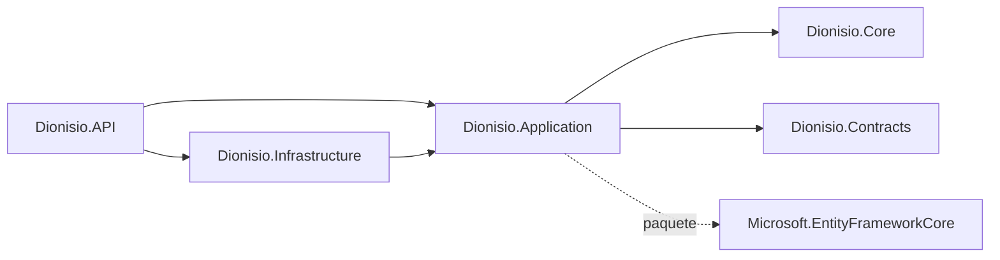

---
proyecto:
  - Ocelotl.Hermes
  - Itzamna.Dionisio
  - ReporteriaAzure
  - Pochteca.Nomisma
proyectos:
  - "[[Ocelotl.Hermes]]"
  - "[[Itzamna.Dionisio]]"
  - "[[ReporteriaAzure]]"
  - "[[Pochteca.Nomisma]]"
tipo: arquitectura
nivel: intermedio
estado: completo
tags:
  - conocimiento
  - arquitectura
  - capas
progreso: pendiente
area: Arquitectura y patrones
contenido: completo
---
# Clean Architecture

> Organizar el código en capas concéntricas donde las dependencias solo apuntan hacia adentro: el negocio no conoce a la base de datos, al framework web ni al robot.

## Qué es y qué problema resuelve
Clean Architecture (Robert C. Martin) separa una aplicación en capas con una sola **regla de dependencias**: el código de una capa interna nunca menciona nada de una capa externa. Resuelve el problema de que la lógica quede "pegada" a detalles (SQL, HTTP, SDK de un proveedor), lo que hace difícil probarla y cambiar esos detalles.

## Cómo funciona por dentro
- **Dominio** (centro): tipos del negocio. No depende de nada.
- **Aplicación**: casos de uso. Depende del dominio y declara *interfaces* (puertos) para lo que necesita de fuera.
- **Infraestructura**: implementa esas interfaces (base de datos, clientes HTTP, SDK).
- **Presentación / API**: recibe peticiones y llama a los casos de uso. Es también la **raíz de composición**: el único lugar que conoce todas las capas para conectar implementaciones con interfaces por [[Inyección de dependencias]].

La clave es la **inversión de dependencias**: Aplicación define `ICajaRepositorio`; Infraestructura lo implementa. En tiempo de ejecución la llamada va "hacia afuera", pero en tiempo de compilación la dependencia apunta "hacia adentro".



## Cuándo usarla y cuándo no
Úsala cuando hay lógica que debe sobrevivir a cambios de tecnología o cuando hay varias integraciones externas que conviene poder sustituir (simuladores, fakes en pruebas). No la uses en un CRUD pequeño o un script: el costo de proyectos e interfaces supera el beneficio.

### Ventajas
- La lógica se prueba sin base de datos ni robot (fakes de las interfaces).
- Cambiar un adaptador (p. ej. Argo real por Argo simulado) no toca los casos de uso.
- El compilador vigila la regla: si `Domain` no referencia a nadie, no puede depender de nadie.

### Desventajas
- Más proyectos, interfaces y mapeos entre capas.
- Riesgo de capas "de paso" que solo reenvían llamadas.
- Si el dominio no tiene reglas, la capa de dominio aporta poco (ver más abajo).

## Alternativas
| Alternativa | En qué se diferencia |
|---|---|
| Arquitectura en N capas clásica | La lógica depende directamente de la capa de datos (sin inversión). |
| [[Arquitectura hexagonal]] | Misma idea de fondo, pero habla de puertos/adaptadores en vez de capas concéntricas. |
| [[Vertical Slice Architecture]] | Organiza por caso de uso en vez de por capa técnica; se puede combinar con Clean (como en Hermes). |
| Onion Architecture | Variante casi equivalente, con énfasis en el modelo de dominio en el centro. |

## Cómo se usó en Ocelotl
[[Ocelotl.Hermes]] tiene cuatro proyectos (ver [[Ocelotl.Hermes - Arquitectura]]):

| Proyecto | Contiene | Referencia a |
|---|---|---|
| `Ocelotl.Hermes.Domain` | Records de `Robots/`, `Inventario/`, `Operaciones/`, `Eventos/` | nadie |
| `Ocelotl.Hermes.Application` | `Abstractions/` (puertos) y `Features/` (slices) | Domain |
| `Ocelotl.Hermes.Infrastructure` | Rowa, Argo, Identity, SQLite + [[Dapper]], outbox | Application |
| `Ocelotl.Hermes.Api` | [[ASP.NET Core Controllers]], Hub de [[SignalR]], seguridad, errores | Application e Infrastructure |

La regla se ve en los `.csproj`. Por ejemplo, `Ocelotl.Hermes/src/Ocelotl.Hermes.Application/Ocelotl.Hermes.Application.csproj` solo referencia al dominio:

```xml
<ProjectReference Include="..\Ocelotl.Hermes.Domain\Ocelotl.Hermes.Domain.csproj" />
```

Y la Api compone todo en `Ocelotl.Hermes/src/Ocelotl.Hermes.Api/Program.cs`:

```csharp
builder.Services.AddApplication();
builder.Services.AddInfrastructure(builder.Configuration);
builder.Services.AddSingleton<IIrisNotifier, SignalRIrisNotifier>();
```

`IIrisNotifier` se registra en la Api (no en Infrastructure) porque su adaptador depende del Hub de SignalR, que vive en la Api.

Decisiones pragmáticas observadas:
- El dominio son `record` sin comportamiento (p. ej. `Egreso` en `Domain/Operaciones/Egreso.cs`); las reglas viven en los slices de Application. Es un dominio "anémico" a propósito: Hermes orquesta integraciones más que modelar reglas complejas (ver [[Arquitectura hexagonal]]).
- Application depende de `Microsoft.Extensions.DependencyInjection.Abstractions`, `Logging.Abstractions` y `Options` (solo abstracciones, no implementaciones).
- Se combina con [[Vertical Slice Architecture]]: dentro de Application no hay "servicios" por capa, sino un archivo por caso de uso.

Lo usan todas las funcionalidades del back: [[Conexión de robots]], [[Ingresos]], [[Dispensar]], [[Trazabilidad por caja]], [[Sincronización con Argo]], [[Sesión y roles]].


## Cómo se usó en Itzamna
[[Itzamna.Dionisio]] tiene cinco proyectos (ver [[Itzamna.Dionisio - Arquitectura]] y `.ai/01_ARCHITECTURE.md`):

| Proyecto | Contiene | Referencia a |
|---|---|---|
| `Itzamna.Dionisio.Core` | Entidades (`Creator`, `Portfolio`, `ContentItem`, `MediaAsset`, `PortfolioSnapshot`…), `Slug`, `MetricFormatter`, `MediaReference` | nadie |
| `Itzamna.Dionisio.Contracts` | DTOs del Studio y `PublicPortfolioDto` | nadie |
| `Itzamna.Dionisio.Application` | `Features/`, mediador, validadores, puertos (`IAppDbContext`, `IFileStorageService`, `IImageProcessor`, `IPublicCacheInvalidator`, `ICurrentUser`, `ITenantContext`), `PortfolioSnapshotBuilder` | Core, Contracts + **EF Core**, FluentValidation |
| `Itzamna.Dionisio.Infrastructure` | `AppDbContext`, configuraciones, migraciones, Local/Azure Blob, ImageSharp, `JatzSeeder` | Application (+ `Microsoft.AspNetCore.App`) |
| `Itzamna.Dionisio.API` | Controllers, JWT, `TenantResolutionMiddleware`, `AppExceptionHandler`, OutputCache, rate limiting | Application, Infrastructure |

La regla de dependencias se cumple en los `.csproj` (Core y Contracts no referencian nada), y la Api es la raíz de composición (`AddApplication()` + `AddInfrastructure(configuration)`).

Diferencias con Hermes y concesiones pragmáticas, dichas con honestidad:
- **Application depende de EF Core**: `IAppDbContext` expone `DbSet<T>` y los handlers usan LINQ de EF (`FirstOrDefaultAsync`, `IgnoreQueryFilters`, `AsNoTracking`). Es una decisión consciente de no esconder el ORM detrás de [[Repository|repositorios]]; la "pureza" se pierde a cambio de menos código (ver [[Entity Framework Core]]).
- **La Api usa una clase de Infrastructure directamente**: `TenantResolutionMiddleware` recibe `AppDbContext` (no la interfaz) porque necesita `IgnoreQueryFilters()` sobre la entidad concreta y vive en la Api.
- **Dominio con comportamiento** (menos anémico que Hermes): `Portfolio.MarkPublished`, `Unpublish`, `ChangeSlug`, `Touch`; `PortfolioItem.SoftDelete`; constructores privados en `PortfolioSnapshot`.
- **Contracts separado de Core**: los DTOs no contaminan el dominio y el contrato público queda en un proyecto aparte (lo consume el front a mano en `packages/contracts` de [[Itzamna.Clio]]).
- **Puertos hacia el framework web**: `IPublicCacheInvalidator` se define en Application y se implementa en la **Api** (con `IOutputCacheStore`), igual que `IIrisNotifier` en Hermes.



> [!note] Pendiente de confirmar
> No encontré por qué `Itzamna.Dionisio.Infrastructure` declara `FrameworkReference Microsoft.AspNetCore.App` (usa `IHostEnvironment` en `LocalFileStorageService`, que existe fuera de ASP.NET Core).


## Cómo se usó en ReporteriaAzure
[[ReporteriaAzure]] usa una versión de tres proyectos, sin Core/Domain porque no hay reglas de dominio: `API` → `Application` ← `Infrastructure`.

- **Application** define el puerto `IAzureDevOpsClient` y sus records (`ConsultaGuardada`, `ResultadoConsulta`, `WorkItem`); no sabe que existe Flurl.
- **Infrastructure** lo implementa con [[Flurl]] y traduce los errores HTTP a excepciones de Application.
- Antes, `AzureOptions` (la configuración de Azure DevOps) vivía en Application aunque solo la usaba Infrastructure; ahora `AzureDevOpsOptions` está junto al cliente que la usa.

Ver [[ReporteriaAzure - Arquitectura]].


## Cómo se usó en Pochteca.Nomisma
[[Pochteca.Nomisma]] usa los 4 proyectos clásicos: `API → Application → Core ← Infrastructure`.
- **Core** tiene entidades, enums, puertos (`IPasarelaPago`, repositorios) y las excepciones con `codigo`.
- **Infrastructure solo referencia Core**, no Application. Por eso lo que comparten las pasarelas y los handlers (excepciones) vive en Core.
- Application no conoce ningún SDK (ni Stripe.net ni el cliente de OpenPay): si cambia el SDK, Application no se entera.
- Ver [[Pochteca.Nomisma - Arquitectura]] y [[Patrón Strategy]].

## Errores comunes y buenas prácticas
- **Filtrar tipos de infraestructura hacia adentro** (p. ej. que un slice reciba un `SQLiteConnection` o un tipo del SDK de Rowa). En Hermes los tipos `CareFusion.*` solo aparecen en `Infrastructure/Robot`.
- **Poner reglas de negocio en los adaptadores.** El README de Hermes lo prohíbe explícitamente: "Las reglas de negocio viven en los slices, nunca en los adaptadores".
- **Crear interfaces para todo.** En Hermes solo hay puertos hacia lo externo; los handlers se piden como clases concretas.
- Dejar que la Api sea la única que conoce todo (raíz de composición) y mantenerla delgada: endpoints de una línea.

## Qué estudiar después
- [[Vertical Slice Architecture]] y [[Arquitectura hexagonal]] (cómo se combinan en Hermes)
- [[Inyección de dependencias]] (la pieza que hace posible la inversión)
- [[Repository]]
- Principio de inversión de dependencias (la "D" de SOLID)

## Documentación oficial
- https://blog.cleancoder.com/uncle-bob/2012/08/13/the-clean-architecture.html
- https://learn.microsoft.com/en-us/dotnet/architecture/modern-web-apps-azure/common-web-application-architectures

## Autoevaluación

Contesta primero en voz alta o en papel; luego despliega la respuesta.

> [!question]- Enuncia la regla de dependencias.
> El código de una capa interna nunca nombra nada de una capa externa. Las dependencias de compilación apuntan hacia el dominio.

> [!question]- ¿Dónde se conectan interfaces con implementaciones y por qué ahí?
> En la raíz de composición (el proyecto API / `Program.cs`), el único que conoce todas las capas. Así Application y Domain siguen sin referenciar Infrastructure.

> [!question]- Caso: Application necesita enviar correos. ¿Qué capa define qué?
> Application define `IEnviadorCorreo` (puerto). Infrastructure implementa `SmtpEnviadorCorreo` o `SendGridEnviador`. API lo registra en DI.

> [!question]- Error común: entidades de dominio con atributos de EF (`[Table]`, `[Key]`). ¿Por qué es problema y cómo se corrige?
> El dominio queda acoplado al ORM. Se corrige con configuración fluida (`IEntityTypeConfiguration<T>`) en Infrastructure.

> [!question]- ¿Cómo haces que el compilador o las pruebas vigilen la regla?
> Referencias de proyecto (Domain sin referencias) y pruebas de arquitectura (p. ej. NetArchTest) que fallen si Application usa un namespace de Infrastructure.

