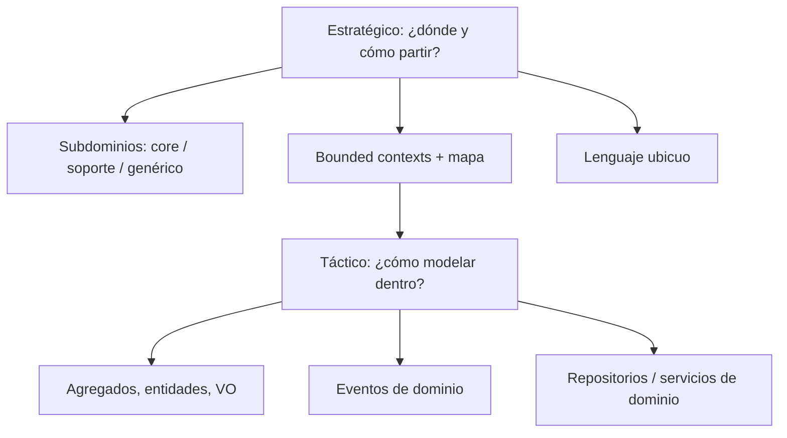

# Domain-Driven Design - conceptos

Parte de: [[09-Arquitectura-Patrones/01 Estilos de arquitectura/_Índice Estilos de arquitectura|Estilos de arquitectura]]

> [!info] Cómo avanzar
> `progreso`: **pendiente** → **viendo** (estudiando) → **visto** (contestaste la autoevaluación sin abrir las respuestas) → **dominado** (hiciste el laboratorio o lo aplicaste de verdad).

## Contenido

### Qué es
*Domain-Driven Design* (DDD), propuesto por Eric Evans en 2003, es un enfoque para construir software complejo **poniendo el modelo del negocio en el centro** y construyéndolo en colaboración estrecha con los expertos del dominio. Se divide en dos partes:

- **Diseño estratégico:** decide **dónde** invertir y **cómo partir** el sistema. Herramientas: subdominios, [[Bounded contexts]], mapa de contextos y lenguaje ubicuo.
- **Diseño táctico:** decide **cómo modelar el código** dentro de un contexto. Herramientas: [[Entidades, value objects y agregados]], [[Eventos de dominio y reacciones|eventos de dominio]], repositorios y servicios de dominio.

Lo estratégico es lo más valioso y lo más ignorado; mucha gente cree que DDD es "poner carpetas `Domain` y `ValueObjects`".

### Cómo funciona
#### Lenguaje ubicuo
Es el vocabulario compartido entre expertos y desarrolladores **dentro de un contexto**, que aparece igual en conversaciones, documentos, pruebas y código. Si la farmacia dice "dispensar" y el código dice `ProcessOrder`, hay una traducción mental que genera errores. Con lenguaje ubicuo, el slice se llama `Dispensar`, el evento `MedicamentoDispensado` y la regla "no se dispensa un lote caducado" aparece con esas palabras en la prueba.

#### Subdominios
El negocio se divide en subdominios, y no todos merecen el mismo esfuerzo:

| Tipo | Qué es | Inversión |
|---|---|---|
| **Core** | Lo que diferencia al negocio y le da ventaja | La mayor: mejores personas, modelo cuidado, DDD táctico si hay complejidad |
| **De soporte** | Necesario y específico, pero no diferencia | Moderada: soluciones simples, CRUD bien hecho |
| **Genérico** | Problema resuelto por igual en todas partes (identidad, correo, facturación electrónica) | Mínima: compra o usa un servicio/librería |



### Ejemplo
En un sistema de farmacia hospitalaria: el **core** es el control de dispensado y trazabilidad de lotes (reglas complejas, regulación, errores costosos). **Soporte**: catálogo de medicamentos y reportes. **Genérico**: autenticación (ahí usas Xolotl.Hecate o un proveedor) y envío de correos.

Para el core vale un agregado con invariantes:

```csharp
public sealed class Dispensacion
{
    private readonly List<LineaDispensada> _lineas = [];
    public int Id { get; }
    public EstadoDispensacion Estado { get; private set; } = EstadoDispensacion.Abierta;

    public Dispensacion(int id) => Id = id;

    // Lenguaje ubicuo: "dispensar un lote", no "AddItem"
    public void DispensarLote(Lote lote, int piezas, DateOnly hoy)
    {
        if (Estado != EstadoDispensacion.Abierta)
            throw new InvalidOperationException("La dispensación ya fue cerrada.");
        if (lote.Caducidad < hoy)
            throw new ReglaDeNegocioException("LOTE_CADUCADO", "No se dispensa un lote caducado.");
        _lineas.Add(new LineaDispensada(lote.Codigo, piezas));
    }
}
```

Para el catálogo (soporte), un slice con Dapper y un `.sql` es suficiente; no necesita agregados.

### Cuándo usarlo y cuándo no
- **DDD estratégico** casi siempre ayuda: aunque sea en una pizarra, distinguir subdominios y contextos evita modelos gigantes.
- **DDD táctico** solo donde hay **reglas de negocio ricas** (invariantes, estados, cálculos). En un CRUD es un problema: agregas agregados, repositorios, value objects y eventos para algo que es "guardar un formulario". El costo es código ceremonial, más archivos por cambio, mapeos innecesarios y un equipo que pierde tiempo defendiendo la pureza del modelo en lugar de entregar. Además ocultas que el sistema es simple, y quien llega cree que es complejo.
- Encaja con las reglas del usuario: vertical slice por caso de uso; dentro del slice del core puedes tener un modelo rico, y en los de soporte, SQL directo.

### Errores comunes
1. **Aplicar DDD táctico en un CRUD** (ver arriba).
2. **Saltarse lo estratégico** y empezar por las carpetas `Entities/ValueObjects`.
3. **Lenguaje ubicuo solo en documentos:** si el código usa otros nombres, no es ubicuo.
4. **Modelo anémico disfrazado:** entidades con propiedades públicas `set` y toda la lógica en servicios. Si vas a hacer DDD táctico, las reglas viven en el agregado.
5. **Tratar todo como core:** invertir lo mismo en el envío de correos que en el corazón del negocio.

### Para profundizar
- [DDD Reference (Eric Evans)](https://www.domainlanguage.com/ddd/reference/)
- [Ubiquitous Language (Martin Fowler)](https://martinfowler.com/bliki/UbiquitousLanguage.html)
- [DDD y CQRS en microservicios (.NET, Microsoft Learn)](https://learn.microsoft.com/en-us/dotnet/architecture/microservices/microservice-ddd-cqrs-patterns/)

## Autoevaluación

Contesta primero en voz alta o en papel; luego despliega la respuesta.

> [!question]- ¿Qué es DDD y qué separa entre diseño estratégico y táctico?
> Un enfoque para modelar software complejo alrededor del dominio del negocio. Estratégico: lenguaje ubicuo, [[Bounded contexts]], mapas de contexto, subdominios. Táctico: [[Entidades, value objects y agregados]], repositorios, servicios de dominio, [[Eventos de dominio y reacciones|eventos de dominio]].

> [!question]- ¿Qué es el lenguaje ubicuo?
> El vocabulario compartido entre negocio y desarrollo, usado tal cual en código, pruebas y conversaciones. Si negocio dice "egreso" el código no dice `Output`.

> [!question]- Subdominio *core*, de soporte y genérico: ¿dónde inviertes más?
> En el *core* (lo que diferencia al negocio): ahí va el mejor modelado. Los genéricos (autenticación, facturación estándar) se compran o se usan librerías.

> [!question]- Error común: aplicar DDD táctico en un CRUD. ¿Por qué es problema?
> Agregados, value objects y eventos en un dominio sin reglas añaden capas sin beneficio. DDD paga cuando hay complejidad de negocio real.

