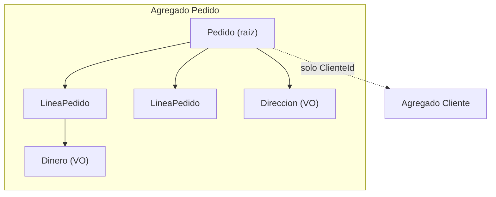

# Entidades, value objects y agregados

Parte de: [[09-Arquitectura-Patrones/01 Estilos de arquitectura/_Índice Estilos de arquitectura|Estilos de arquitectura]]

> [!info] Cómo avanzar
> `progreso`: **pendiente** → **viendo** (estudiando) → **visto** (contestaste la autoevaluación sin abrir las respuestas) → **dominado** (hiciste el laboratorio o lo aplicaste de verdad).

## Contenido

### Qué es
Son los tres bloques básicos del diseño táctico de [[Domain-Driven Design - conceptos|DDD]]:

- **Entidad:** objeto con **identidad propia** que persiste en el tiempo aunque cambien sus atributos. Un `Pedido` sigue siendo el pedido 1042 aunque cambie su dirección de entrega. Dos entidades son iguales si tienen el mismo id.
- **Value object (objeto de valor):** objeto **sin identidad**, definido solo por sus valores, e **inmutable**. `Dinero(150.00, "MXN")`, un `Rfc`, un `RangoFechas`. Dos value objects con los mismos valores son intercambiables. Para "cambiarlo" creas otro.
- **Agregado:** grupo de entidades y value objects que se tratan **como una unidad de consistencia**. Tiene una **raíz** (*aggregate root*), la única entidad accesible desde fuera; todo cambio pasa por ella, y ella protege las **invariantes** (reglas que siempre deben cumplirse).

### Cómo funciona


Reglas prácticas (de Vaughn Vernon):
1. **Protege invariantes dentro del límite:** "el total no puede superar el límite de crédito autorizado para el pedido", "no se agregan líneas a un pedido cerrado".
2. **Diseña agregados pequeños.** Muchas veces la raíz sola, o la raíz con sus líneas.
3. **Referencia otros agregados por id**, no por objeto.
4. **Una transacción modifica un solo agregado.** Si un cambio debe reflejarse en otro agregado, hazlo con un [[Eventos de dominio y reacciones|evento de dominio]] y consistencia eventual.

#### Pedido y Cliente
¿El `Pedido` debe contener el objeto `Cliente` completo? **No.** Cliente es otro agregado con su propio ciclo de vida (cambia su correo, su crédito, su dirección). Si el pedido lo contiene:
- Cargar un pedido arrastra al cliente y quizá sus otros pedidos.
- Guardar el pedido podría modificar al cliente por accidente, y dos usuarios editando cosas distintas chocan.
- La transacción se vuelve grande y el bloqueo en SQL Server también.

El pedido guarda `ClienteId` y, si necesita datos históricos (dirección de entrega o nombre en el momento de la compra), los **copia como value object**. Eso además es correcto en el negocio: si el cliente se muda, el pedido de ayer no debe cambiar de dirección.

#### Por qué agregados pequeños y uno por transacción
- **Concurrencia:** un agregado grande lo editan muchas personas a la vez y aumentan los conflictos de concurrencia optimista (`rowversion`).
- **Rendimiento:** cargas y guardas menos datos.
- **Escalabilidad:** si cada transacción toca un agregado, puedes separarlos en bases o servicios distintos más adelante.
- **Claridad:** el límite dice exactamente qué es consistente al instante y qué es eventual.

### Ejemplo
```csharp
// Value object: record con validación y sin identidad
public sealed record Dinero
{
    public decimal Monto { get; }
    public string Moneda { get; }
    public Dinero(decimal monto, string moneda)
    {
        ArgumentOutOfRangeException.ThrowIfNegative(monto);
        ArgumentException.ThrowIfNullOrWhiteSpace(moneda);
        Monto = decimal.Round(monto, 2);
        Moneda = moneda;
    }
    public Dinero Sumar(Dinero otro) =>
        otro.Moneda == Moneda ? new(Monto + otro.Monto, Moneda)
                              : throw new InvalidOperationException("Monedas distintas.");
}

public sealed record LineaPedido(string Sku, int Cantidad, Dinero PrecioUnitario)
{
    public Dinero Importe => new(PrecioUnitario.Monto * Cantidad, PrecioUnitario.Moneda);
}

// Raíz del agregado: la única puerta de entrada
public sealed class Pedido
{
    private readonly List<LineaPedido> _lineas = [];
    public int Id { get; }
    public int ClienteId { get; }            // referencia por id
    public bool Cerrado { get; private set; }
    public IReadOnlyList<LineaPedido> Lineas => _lineas;

    public Pedido(int id, int clienteId) => (Id, ClienteId) = (id, clienteId);

    public void AgregarLinea(string sku, int cantidad, Dinero precio)
    {
        if (Cerrado) throw new InvalidOperationException("Pedido cerrado.");
        ArgumentOutOfRangeException.ThrowIfNegativeOrZero(cantidad);
        _lineas.Add(new LineaPedido(sku, cantidad, precio));
    }

    public Dinero Total() =>
        _lineas.Select(l => l.Importe).Aggregate(new Dinero(0, "MXN"), (a, b) => a.Sumar(b));

    public void Cerrar() => Cerrado = true;
}
```

Con Dapper, un repositorio del agregado carga `Pedido` y sus líneas con dos consultas (o `QueryMultiple`) desde archivos `.sql` y guarda todo en una transacción. Recuerda la regla del usuario: si el caso de uso es solo leer el pedido para una pantalla, el slice de consulta lee directo un DTO; no necesitas reconstruir el agregado para leer.

### Cuándo usarlo y cuándo no
- **Entidades y VO** valen casi siempre: un `Rfc` o un `Dinero` como VO evita errores de validación repetidos.
- **Agregados** valen cuando hay invariantes reales. En un catálogo CRUD sin reglas, una tabla y un DTO bastan.

### Errores comunes
1. **Agregados gigantes** (Cliente con todos sus pedidos y pagos): conflictos y cargas lentas.
2. **Setters públicos** que permiten saltarse la raíz y romper invariantes.
3. **Value objects mutables:** si cambias el `Dinero` compartido, cambias el de otros. Usa `record` con propiedades de solo lectura.
4. **Modificar dos agregados en la misma transacción** "porque es más fácil": acoplas su escalabilidad para siempre.
5. **Usar tipos primitivos para conceptos de negocio** (*primitive obsession*): `string rfc` en 20 lugares, cada uno validando distinto.

### Para profundizar
- [DDD Aggregate (Martin Fowler)](https://martinfowler.com/bliki/DDD_Aggregate.html)
- [Value Object (Martin Fowler)](https://martinfowler.com/bliki/ValueObject.html)
- [DDD táctico para microservicios (Azure Architecture Center)](https://learn.microsoft.com/en-us/azure/architecture/microservices/model/tactical-ddd)

## Autoevaluación

Contesta primero en voz alta o en papel; luego despliega la respuesta.

> [!question]- Diferencia entre entidad y value object.
> Entidad: tiene identidad que persiste aunque cambien sus atributos (`Cliente` con `Id`). Value object: se define solo por sus valores, es inmutable y dos con los mismos valores son iguales (`Dinero(100, MXN)`). En C# un `record` es buen candidato para VO.

> [!question]- ¿Qué es un agregado y su raíz?
> Un grupo de objetos que se modifica como unidad para proteger invariantes. Solo la raíz se referencia desde fuera; todo cambio pasa por sus métodos (`pedido.AgregarLinea(...)`, no `pedido.Lineas.Add(...)`).

> [!question]- Caso: un `Pedido` y un `Cliente`. ¿El pedido debe contener el objeto cliente completo?
> No: entre agregados se referencia por identidad (`ClienteId`). Así cada agregado se carga, bloquea y guarda por separado.

> [!question]- ¿Por qué conviene que un agregado sea pequeño y que una transacción modifique solo uno?
> Agregados grandes generan contención y cargas pesadas. Si una operación toca varios, la consistencia entre ellos suele ser eventual (eventos de dominio).

