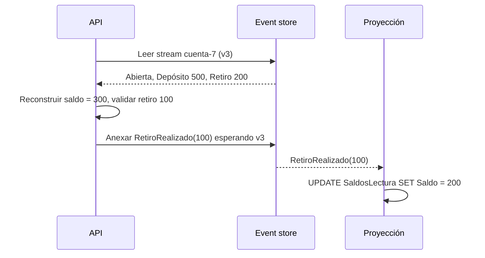

# Event Sourcing

Parte de: [[09-Arquitectura-Patrones/01 Estilos de arquitectura/_Índice Estilos de arquitectura|Estilos de arquitectura]]

> [!info] Cómo avanzar
> `progreso`: **pendiente** → **viendo** (estudiando) → **visto** (contestaste la autoevaluación sin abrir las respuestas) → **dominado** (hiciste el laboratorio o lo aplicaste de verdad).

## Contenido

### Qué es
*Event Sourcing* es un patrón de persistencia en el que **no guardas el estado actual de una entidad, sino la secuencia completa de eventos que la llevaron a ese estado**. El estado se obtiene "reproduciendo" los eventos en orden. Una cuenta no tiene una columna `Saldo`: tiene `CuentaAbierta`, `DepositoRealizado(500)`, `RetiroRealizado(200)`, y el saldo (300) es el resultado de aplicarlos. El registro de eventos es **solo de anexar** (*append-only*): nunca se actualiza ni se borra un evento.

Sirve para tener **auditoría completa por diseño**, poder responder "¿cómo estaba esto el 15 de marzo?", reconstruir vistas nuevas a partir del historial y depurar reproduciendo exactamente lo que pasó.

### Cómo funciona
1. Llega un comando (`Retirar 200`).
2. Cargas los eventos del *stream* de esa cuenta y los aplicas para reconstruir el estado.
3. El agregado valida la regla (¿alcanza el saldo?) y produce nuevos eventos.
4. Los anexas al stream **verificando la versión esperada** (concurrencia optimista: si alguien escribió entre tanto, falla y reintentas).
5. **Proyecciones** escuchan los eventos y construyen modelos de lectura (tablas para pantallas y reportes).



#### Snapshots
Si un stream tiene miles de eventos, reconstruirlo cada vez es lento. Un **snapshot** guarda el estado calculado en la versión N; para cargar, lees el snapshot más reciente y solo aplicas los eventos posteriores. Es una optimización: siempre debes poder borrar los snapshots y recalcularlos desde los eventos.

#### Cambiar la forma de un evento ya guardado
Los eventos guardados son historia: **no se modifican**. Si cambias la clase `DepositoRealizado` (renombras un campo, cambias un tipo), los eventos viejos ya no se deserializan igual y la reconstrucción falla o da un estado incorrecto. Estrategias:
- **Cambios compatibles:** solo agregar campos opcionales con valor por defecto.
- **Versionar el evento:** `DepositoRealizadoV2`, y el código sabe aplicar ambos.
- **Upcasting:** al leer, un traductor convierte V1 en V2 antes de aplicarlo.
- **Copiar y transformar** el stream a uno nuevo (migración costosa, último recurso).

### Ejemplo
```csharp
public abstract record EventoCuenta(Guid CuentaId);
public sealed record CuentaAbierta(Guid CuentaId, string Titular) : EventoCuenta(CuentaId);
public sealed record DepositoRealizado(Guid CuentaId, decimal Monto) : EventoCuenta(CuentaId);
public sealed record RetiroRealizado(Guid CuentaId, decimal Monto) : EventoCuenta(CuentaId);

public sealed class Cuenta
{
    public decimal Saldo { get; private set; }
    public int Version { get; private set; }
    private readonly List<EventoCuenta> _nuevos = [];
    public IReadOnlyList<EventoCuenta> Nuevos => _nuevos;

    public static Cuenta Reconstruir(IEnumerable<EventoCuenta> historia)
    {
        var c = new Cuenta();
        foreach (var e in historia) { c.Aplicar(e); c.Version++; }
        return c;
    }

    public void Retirar(Guid id, decimal monto)
    {
        if (monto > Saldo) throw new ReglaDeNegocioException("SALDO_INSUFICIENTE", "No alcanza el saldo.");
        Registrar(new RetiroRealizado(id, monto));
    }

    private void Registrar(EventoCuenta e) { Aplicar(e); _nuevos.Add(e); }

    private void Aplicar(EventoCuenta e)
    {
        switch (e)
        {
            case DepositoRealizado d: Saldo += d.Monto; break;
            case RetiroRealizado r: Saldo -= r.Monto; break;
        }
    }
}
```

En SQL Server, una tabla `Eventos(StreamId, Version, Tipo, Datos, Fecha)` con clave única `(StreamId, Version)` te da la concurrencia optimista: si dos procesos intentan anexar la versión 4, uno falla por la restricción. También existen bases especializadas (EventStoreDB, Marten sobre Postgres).

### Cuándo usarlo y cuándo no
**¿Obliga a CQRS?** No formalmente, pero en la práctica casi siempre lo usarás: consultar "todos los pedidos de más de $10,000" reproduciendo streams es inviable, así que necesitas proyecciones de lectura separadas, que es la esencia de [[CQRS y mediador|CQRS]]. CQRS, en cambio, no necesita Event Sourcing.

**Úsalo** cuando la auditoría y el historial son requisitos del negocio (contabilidad, inventario regulado, trazabilidad de medicamentos), cuando el negocio piensa naturalmente en eventos, o cuando necesitas reconstruir vistas nuevas sobre el pasado.

**No lo uses** en CRUD, cuando el equipo no lo ha usado nunca y el plazo es corto, cuando necesitas borrar datos personales (derecho de cancelación de datos: borrar de un log inmutable exige técnicas como cifrar por titular y destruir la llave), o cuando una tabla de auditoría con triggers o *temporal tables* de SQL Server resuelve la necesidad de historial.

### Errores comunes
1. **Eventos con forma de CRUD** (`CuentaActualizada` con todos los campos): pierdes la intención y el valor del patrón.
2. **No planear versiones de eventos** desde el día uno.
3. **Usar el event store para consultas** en lugar de proyecciones.
4. **Proyecciones no idempotentes:** al reconstruirlas o recibir duplicados, se duplican importes.
5. **Adoptarlo en todo el sistema** cuando solo un subdominio lo necesita.

### Para profundizar
- [Event Sourcing (Martin Fowler)](https://martinfowler.com/eaaDev/EventSourcing.html)
- [Patrón Event Sourcing (Azure Architecture Center)](https://learn.microsoft.com/en-us/azure/architecture/patterns/event-sourcing)
- [Patrón CQRS (Azure Architecture Center)](https://learn.microsoft.com/en-us/azure/architecture/patterns/cqrs)

## Autoevaluación

Contesta primero en voz alta o en papel; luego despliega la respuesta.

> [!question]- ¿Qué es Event Sourcing?
> Guardar el estado como la secuencia de eventos que lo produjeron (`CuentaAbierta`, `Depósito 100`, `Retiro 30`) en lugar de solo el estado actual. El estado se obtiene reproduciendo los eventos.

> [!question]- ¿Qué es un snapshot y para qué sirve?
> Una foto del estado en el evento N. Al cargar, se parte del snapshot y solo se reproducen los eventos posteriores, para no leer miles de eventos.

> [!question]- ¿Qué pasa si cambias la forma de un evento ya guardado?
> Los eventos son inmutables; no se reescriben. Se versionan (`DepositoV2`) y se usa *upcasting* al leer para convertir los viejos al formato nuevo.

> [!question]- ¿Event Sourcing obliga a CQRS? ¿Cuándo no usarlo?
> En la práctica casi siempre va con CQRS, porque consultar sobre eventos es incómodo y se construyen proyecciones de lectura. No lo uses si no necesitas historial/auditoría completa ni reconstruir estados pasados: añade mucha complejidad.

