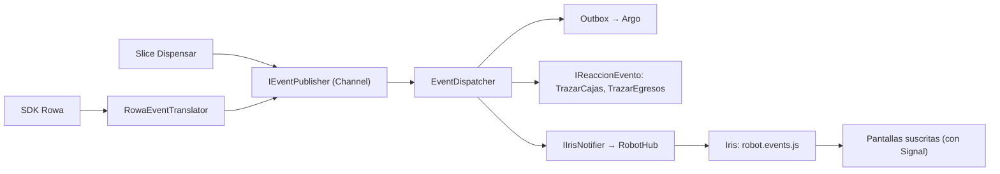

# Eventos de dominio y reacciones

> Representar "algo que pasó" como un objeto inmutable y dejar que varias partes reaccionen a él sin que quien lo publica las conozca.

## Qué es y qué problema resuelve
Un **evento de dominio** es un hecho del negocio en pasado: "una caja quedó almacenada", "terminó una orden de salida". Quien lo produce solo lo publica; uno o varios **suscriptores (reacciones)** deciden qué hacer. Resuelve el acoplamiento: el adaptador del robot no tiene que saber que existe una tabla de trazabilidad, un outbox hacia Argo y una pantalla en Iris.

## Cómo funciona por dentro
- **Evento**: objeto inmutable con datos del hecho y cuándo ocurrió.
- **Publicador**: recibe el evento y lo encola (no hace el trabajo).
- **Repartidor (dispatcher)**: saca eventos de la cola y los entrega a cada destino.
- **Reacción**: código que recibe todos los eventos e ignora los que no le tocan.
- **Aislamiento de fallos**: si una reacción falla, las demás siguen.



## Cuándo usarla y cuándo no
Úsalo cuando un hecho dispara varios efectos independientes, o cuando el productor corre en un hilo que no debe bloquearse (callback de un SDK). Evítalo cuando necesitas el resultado de la reacción para responder (ahí es una llamada directa) o cuando solo hay un efecto y nunca habrá más.

### Ventajas
- Agregar una reacción no toca al productor ni al repartidor.
- El productor no se bloquea (cola en memoria).
- Un fallo aislado no tumba el ciclo.

### Desventajas
- Flujo menos evidente: "ir a la definición" no lleva a quien reacciona.
- Consistencia eventual: la reacción ocurre después.
- Orden y fallos más difíciles de razonar (¿qué pasa si una reacción falla a medias?).

## Alternativas
| Alternativa | En qué se diferencia |
|---|---|
| Llamadas directas | El productor llama a cada efecto; acoplado pero explícito. |
| MediatR `INotification` | Mismo patrón con librería; Hermes lo hace a mano sin MediatR. |
| Event sourcing | Los eventos son la fuente de verdad del estado; aquí solo se notifican. |
| `EventTarget` / `CustomEvent` del navegador | En Iris se usa un `Map` de suscriptores propio en lugar de eventos del DOM. |

## Cómo se usó en Ocelotl
**[[Ocelotl.Hermes]]**
- Eventos: `Ocelotl.Hermes/src/Ocelotl.Hermes.Domain/Eventos/EventosRobot.cs` define `IEventoRobot` (`RobotId`, `OcurridoEn`) y los records `EstadoRobotCambiado`, `PackAlmacenado`, `PackDispensado`, `IngresoTerminado`, `DispensadoTerminado`, `EgresoSolicitado`, `PackEntranteResuelto`. "El nombre del tipo es el nombre del evento que viaja por SignalR".
- Publicador: `IEventPublisher` → `ChannelEventPublisher` ([[System.Threading.Channels]]); `Publicar` nunca bloquea al hilo del SDK.
- Repartidor: `Infrastructure/Eventos/EventDispatcher.cs` ([[BackgroundService]]) entrega cada evento a 1) [[Patrón Outbox]], 2) reacciones, 3) Iris por [[SignalR]]; cada destino en su `try/catch`.
- Reacciones: `IReaccionEvento` (`Application/Abstractions`), implementada por slices de `Features/Trazabilidad`. Ejemplo `Ocelotl.Hermes/src/Ocelotl.Hermes.Application/Features/Trazabilidad/TrazarEgresos.cs`:

```csharp
public sealed class Handler(IEgresoRepositorio egresos) : IReaccionEvento
{
    public async Task AplicarAsync(IEventoRobot evento, CancellationToken ct)
    {
        switch (evento)
        {
            case DispensadoTerminado t:
                await egresos.RegistrarCajasAsync(t.RobotId, t.Orden, t.Cajas, t.OcurridoEn, ct);
                break;
```

`AddApplication()` expone automáticamente como `IReaccionEvento` todo `Handler` que la implemente, y el dispatcher abre **un scope por evento** y pide `GetServices<IReaccionEvento>()` sin conocerlas.

Funcionalidades: [[Eventos en tiempo real]], [[Trazabilidad por caja]], [[Historial de salidas]], [[Sincronización con Argo]], [[Dispensar]], [[Ingresos]].

**[[Ocelotl.Iris]]** — `src/core/robot.events.js` se inicia una vez en `app.js`, escucha todos los eventos de `hermes.signal.js`, guarda un historial de 50 y el último estado de cada robot, muestra avisos globales (p. ej. caja rechazada) y reparte a las pantallas. La suscripción acepta el `Signal` de un [[AbortController]] para quitarse sola (`Ocelotl.Iris/src/core/robot.events.js`):

```js
export function fnSuscribir(Tipo, Fn, { Signal } = {}) {
    if (!Suscriptores.has(Tipo)) Suscriptores.set(Tipo, new Set())
    Suscriptores.get(Tipo).add(Fn)

    const fnQuitar = () => Suscriptores.get(Tipo)?.delete(Fn)
    Signal?.addEventListener('abort', fnQuitar, { once: true })
    return fnQuitar
}
```

Uso en una pantalla (`Ocelotl.Iris/src/features/configuracion/configuracion.events.js`): `RobotEvents.fnSuscribir(RobotEvents.Eventos.EstadoRobotCambiado, ConfiguracionHandler.fnAlCambiarEstadoRobot, { Signal })`. Existe además `TodosLosEventos = '*'`. Excepción deliberada: `dispensar.events.js` se suscribe a `DispensadoTerminado` **sin Signal y fuera de `mount`**, porque una orden puede terminar mientras el operador está en otra pantalla.

Restos observados: en `Infrastructure/Eventos/` siguen `CajaProyeccion.cs` y `EgresoProyeccion.cs`, con la misma lógica que `TrazarCajas`/`TrazarEgresos` ("antes: CajaProyeccion en Infrastructure"), y no están registrados en DI. Pendiente de confirmar si se eliminan.

## Errores comunes y buenas prácticas
- **Hacer trabajo pesado en el hilo del productor** (el SDK): solo encolar.
- **Dejar que una excepción detenga el `BackgroundService`**: detendría todo Hermes. El dispatcher captura incluso fallos al *resolver* las reacciones.
- **Reacciones que dependen del orden entre ellas**: cada una debe ser independiente.
- **Suscripciones que no se quitan** en el front: fugas y handlers pintando pantallas desmontadas. Usar `Signal`.
- Nombrar eventos en pasado y hacerlos inmutables (`record`).
- Hacer las reacciones [[Idempotencia|idempotentes]] (un evento podría reprocesarse).

## Qué estudiar después
- [[Patrón Outbox]]
- [[System.Threading.Channels]] y [[BackgroundService]]
- [[SignalR]] y [[AbortController]]
- [[Inyección de dependencias]] (scopes en servicios de fondo)
- Observer / publish-subscribe

## Documentación oficial
- https://learn.microsoft.com/en-us/dotnet/architecture/microservices/microservice-ddd-cqrs-patterns/domain-events-design-implementation

## Autoevaluación

Contesta primero en voz alta o en papel; luego despliega la respuesta.

> [!question]- ¿Qué distingue a un evento de dominio de un comando?
> El evento es un hecho pasado e inmutable (`CajaAlmacenada`); el comando es una intención que puede rechazarse (`AlmacenarCaja`).

> [!question]- ¿Qué pasa si una reacción falla y el evento solo vivía en memoria?
> Se pierde. Para efectos que salen del proceso usa un [[Patrón Outbox]] persistido y reintentos; las reacciones deben ser idempotentes.

> [!question]- ¿Cuándo una llamada directa es mejor que un evento?
> Cuando necesitas el resultado para responder o solo hay un efecto que nunca crecerá; el evento añade indirección sin beneficio.

