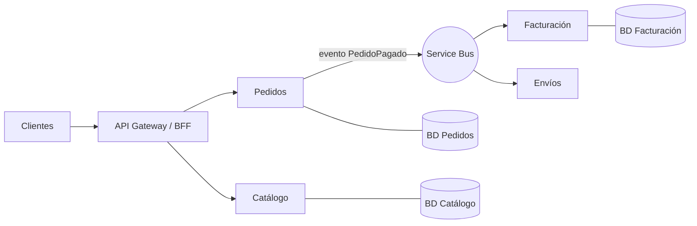

# Microservicios

Parte de: [[09-Arquitectura-Patrones/01 Estilos de arquitectura/_Índice Estilos de arquitectura|Estilos de arquitectura]]

> [!info] Cómo avanzar
> `progreso`: **pendiente** → **viendo** (estudiando) → **visto** (contestaste la autoevaluación sin abrir las respuestas) → **dominado** (hiciste el laboratorio o lo aplicaste de verdad).

## Contenido

### Qué es
Un microservicio es un servicio **pequeño en responsabilidad, desplegable de forma independiente, dueño de sus propios datos y organizado alrededor de una capacidad de negocio** (pagos, catálogo, envíos). Lo que lo define no es el número de líneas sino la **independencia**: un equipo puede cambiarlo, probarlo y desplegarlo sin coordinar con los demás, y ningún otro servicio lee su base de datos directamente. Una arquitectura de microservicios es un sistema compuesto por muchos de ellos que se comunican por red (HTTP/gRPC o mensajería).

### Cómo funciona


Características:
1. **Base de datos por servicio:** cada uno es dueño de su esquema; otros acceden por su API o eventos.
2. **Despliegue independiente:** pipeline propio en Azure DevOps, versión propia.
3. **Comunicación por red:** síncrona (HTTP) cuando se necesita respuesta, asíncrona (eventos) para desacoplar.
4. **Límites por [[Bounded contexts|bounded context]]:** un servicio no mezcla modelos de contextos distintos.
5. **Equipos autónomos:** idealmente un equipo dueño de uno o pocos servicios.

### Costos frente a un monolito
Los microservicios cambian complejidad de código por complejidad operativa:
- **Red:** latencia, timeouts, fallos parciales; necesitas [[Circuit breaker y reintentos]] y [[Bulkhead y throttling]].
- **Consistencia:** se acaban las transacciones ACID entre áreas; aparecen [[Patrón Saga|sagas]], [[Patrón Outbox|outbox]] y [[Consistencia eventual y teorema CAP|consistencia eventual]].
- **Observabilidad:** trazas distribuidas, correlation id, logs centralizados; sin eso no puedes depurar.
- **Infraestructura:** N pipelines, N despliegues, contenedores, descubrimiento de servicios, secretos por servicio.
- **Pruebas:** pruebas de contrato y entornos de integración.
- **Datos para reportes:** ya no hay un `JOIN` entre áreas; necesitas réplicas o un almacén analítico.
- **Organización:** versionado de contratos y coordinación entre equipos.

### Ejemplo
Imagina Itzamna.Dionisio dividido prematuramente en `Pedidos` y `Clientes`. Para mostrar "pedidos con nombre del cliente", Pedidos llama a Clientes por HTTP en cada petición:

```csharp
builder.Services.AddHttpClient<ClientesApi>(c =>
        c.BaseAddress = new Uri(builder.Configuration["Servicios:Clientes"]!))
    .AddStandardResilienceHandler(); // reintentos, timeouts y circuit breaker

public sealed class ClientesApi(HttpClient http)
{
    public Task<ClienteDto?> ObtenerAsync(int id, CancellationToken ct) =>
        http.GetFromJsonAsync<ClienteDto>($"api/clientes/{id}", ct);
}
```

Ahora la disponibilidad de Pedidos depende de Clientes (en serie: multiplica disponibilidades), cada listado hace N llamadas y una caída de Clientes rompe Pedidos. Si además ambos deben desplegarse juntos cuando cambia `ClienteDto`, no ganaste independencia: tienes un monolito distribuido. Como módulos de un [[Monolito modular]], ese mismo caso era una consulta.

### Cuándo SÍ elegirlos
- **Varios equipos** que se estorban en el mismo código y necesitan desplegar a ritmos distintos.
- **Necesidades de escala muy distintas:** el módulo de búsqueda recibe 100 veces más tráfico que el de administración.
- **Aislamiento de fallas o de cumplimiento:** el procesamiento de pagos debe aislarse por PCI, o una parte puede caerse sin tumbar el resto.
- **Tecnologías distintas justificadas** (un servicio de ML en Python).
- **Dominio ya entendido:** los límites están claros porque ya funcionó como monolito modular.

Si nada de esto aplica, un equipo pequeño (como el de un desarrollador que va a senior con varios proyectos) gana más con un monolito modular bien partido.

### Monolito distribuido
Es el error más común: servicios separados físicamente pero **acoplados como si fueran uno**. Lo delatan:
- Hay que desplegar varios servicios a la vez para cualquier cambio.
- Comparten la misma base de datos o leen tablas ajenas.
- Cadenas largas de llamadas síncronas (A → B → C → D) para una sola petición.
- Una librería "Common" con modelos de dominio que todos referencian y versionan juntos.

Tiene los costos de los microservicios y ninguno de sus beneficios.

### Errores comunes
1. **Empezar con microservicios** sin conocer el dominio; los límites quedan mal y moverlos es carísimo.
2. **Partir por capa técnica** (servicio de "datos", servicio de "validación") en vez de por capacidad de negocio.
3. **Base de datos compartida.**
4. **Sin observabilidad** desde el inicio.
5. **Servicios demasiado pequeños** ("nanoservicios") que multiplican la red sin dar autonomía.

### Para profundizar
- [Microservices (Martin Fowler y James Lewis)](https://martinfowler.com/articles/microservices.html)
- [Estilo de microservicios (Azure Architecture Center)](https://learn.microsoft.com/en-us/azure/architecture/guide/architecture-styles/microservices)
- [Patrón de arquitectura de microservicios (microservices.io)](https://microservices.io/patterns/microservices.html)

## Autoevaluación

Contesta primero en voz alta o en papel; luego despliega la respuesta.

> [!question]- ¿Qué es un microservicio y qué lo define más que el tamaño?
> Un servicio que se despliega de forma independiente, es dueño de sus datos y se alinea a una capacidad de negocio (un [[Bounded contexts|bounded context]]). La independencia de despliegue es lo esencial.

> [!question]- ¿Qué costos agregan frente a un monolito?
> Latencia y fallos de red, consistencia eventual, transacciones distribuidas ([[Patrón Saga]]), versionado de contratos, observabilidad distribuida y más infraestructura.

> [!question]- ¿Cuándo SÍ los elegirías?
> Cuando varios equipos necesitan desplegar a ritmos distintos, hay partes con necesidades de escala muy diferentes, o se requiere aislar fallos o tecnologías. Con un equipo chico y un dominio aún inestable, no.

> [!question]- Error común: "monolito distribuido". ¿Qué es?
> Servicios que comparten base o que deben desplegarse juntos porque se llaman en cadena síncrona. Tienes los costos de microservicios sin sus beneficios.

