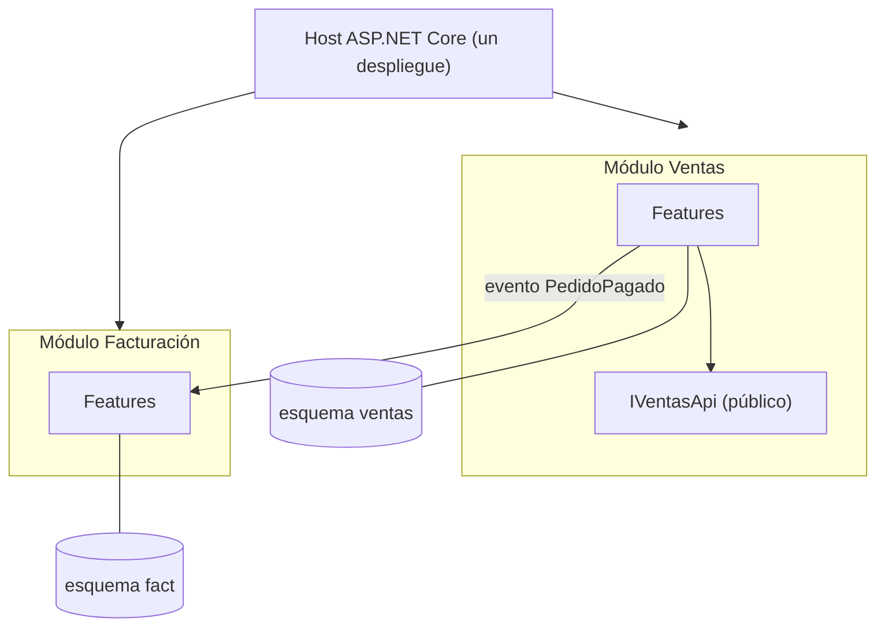

# Monolito modular

Parte de: [[09-Arquitectura-Patrones/01 Estilos de arquitectura/_Índice Estilos de arquitectura|Estilos de arquitectura]]

> [!info] Cómo avanzar
> `progreso`: **pendiente** → **viendo** (estudiando) → **visto** (contestaste la autoevaluación sin abrir las respuestas) → **dominado** (hiciste el laboratorio o lo aplicaste de verdad).

## Contenido

### Qué es
Un monolito modular es una aplicación que **se despliega como una sola unidad** (un proceso, un pipeline), pero **internamente está dividida en módulos con límites estrictos**, normalmente uno por [[Bounded contexts|bounded context]] (Ventas, Facturación, Inventario). Cada módulo tiene su código, su modelo, sus datos y una API pública pequeña; los demás no pueden tocar sus internos. Combina la simplicidad operativa del monolito con buena parte del desacoplamiento de los [[Microservicios]].

### Cómo funciona
1. **Un módulo por área de negocio**, cada uno con sus slices dentro (`Ventas/Features/CrearPedido`).
2. **API pública mínima por módulo:** una interfaz o un conjunto de contratos (`IVentasApi`, eventos publicados). Todo lo demás es `internal`.
3. **Datos separados por módulo:** en SQL Server, un **esquema por módulo** (`ventas.Pedido`, `fact.Factura`) y la regla de que un módulo solo consulta su esquema. Si quieres más aislamiento, un usuario de base por módulo con permisos solo sobre su esquema.
4. **Comunicación entre módulos:**
   - **Síncrona en proceso:** llamar la interfaz pública de otro módulo (una llamada de método, sin red).
   - **Asíncrona con eventos en proceso o outbox:** el módulo publica `PedidoPagado` y Facturación reacciona. Es la forma más desacoplada y prepara una futura separación.
5. **Reglas verificadas automáticamente** con pruebas de arquitectura (ver [[Arquitectura evolutiva]]).



### Por qué suele ser mejor punto de partida
- **Los límites son baratos de mover:** si te equivocaste al partir, mover código entre carpetas o proyectos es un refactor; entre microservicios es una migración de datos y contratos.
- **Sin costos de red:** no hay timeouts, ni sagas obligatorias, ni trazas distribuidas para empezar.
- **Transacciones locales** cuando de verdad las necesitas.
- **Un solo pipeline** en Azure DevOps y un solo despliegue.
- **Camino de salida:** un módulo bien aislado (datos propios, comunicación por eventos) se puede extraer a microservicio cuando aparezca una razón real. Fowler lo resume como *Monolith First*.

### Ejemplo
Estructura de una solución .NET con módulos como proyectos y vertical slices dentro:

```text
src/
  Tienda.Host/                    -> Program.cs, controllers delgados
  Modulos/
    Ventas/
      Tienda.Ventas/              -> Features/CrearPedido/, Features/PagarPedido/
      Tienda.Ventas.Contratos/    -> IVentasApi, eventos públicos (PedidoPagado)
    Facturacion/
      Tienda.Facturacion/         -> Features/EmitirFactura/, Sql/*.sql
      Tienda.Facturacion.Contratos/
```

Regla: `Tienda.Facturacion` puede referenciar `Tienda.Ventas.Contratos`, nunca `Tienda.Ventas`.

```csharp
// Tienda.Ventas.Contratos (público)
public sealed record PedidoPagado(int PedidoId, int ClienteId, decimal Total);
public interface IVentasApi
{
    Task<ResumenPedido?> ObtenerResumenAsync(int pedidoId, CancellationToken ct);
}

// Tienda.Ventas (implementación interna)
internal sealed class VentasApi(IDbConnection db, ISqlArchivos sql) : IVentasApi
{
    public Task<ResumenPedido?> ObtenerResumenAsync(int pedidoId, CancellationToken ct) =>
        db.QuerySingleOrDefaultAsync<ResumenPedido>(
            new CommandDefinition(sql.Leer("Ventas/ResumenPedido.sql"),
                new { pedidoId }, cancellationToken: ct));
}

// Registro del módulo
public static class VentasModulo
{
    public static IServiceCollection AddVentas(this IServiceCollection s) =>
        s.AddScoped<IVentasApi, VentasApi>();
}
```

El archivo `ResumenPedido.sql` solo toca el esquema `ventas`.

### Cuándo usarlo y cuándo no
- **Úsalo** como opción por defecto para productos nuevos con varias áreas de negocio y un equipo de una a pocas células.
- **Considera microservicios** cuando un módulo necesite escalar, desplegarse o fallar de forma independiente, o cuando varios equipos se estorben.
- **No hace falta** si la aplicación es de un solo propósito pequeño: ahí basta un proyecto con slices.

### Errores comunes
1. **Una sola base sin reglas:** el "monolito modular" donde cualquier módulo hace `JOIN` contra tablas de otro. Lo delata: consultas `.sql` que mezclan esquemas, llaves foráneas entre módulos, o que no puedes explicar qué módulo es dueño de una tabla. Solución: esquema por módulo, sin FK cruzadas, acceso a datos ajenos solo por API o evento.
2. **Todo `public`:** sin `internal`, los límites son decorativos.
3. **Proyecto "Shared" que crece** con entidades de dominio de todos.
4. **Llamadas síncronas en cadena** entre módulos que replican el acoplamiento de un monolito clásico.
5. **No verificar las reglas** con pruebas automáticas; se erosionan en meses.

### Para profundizar
- [Monolith First (Martin Fowler)](https://martinfowler.com/bliki/MonolithFirst.html)
- [Bounded Context (Martin Fowler)](https://martinfowler.com/bliki/BoundedContext.html)
- [Arquitecturas comunes de aplicaciones web (.NET, Microsoft Learn)](https://learn.microsoft.com/en-us/dotnet/architecture/modern-web-apps-azure/common-web-application-architectures)

## Autoevaluación

Contesta primero en voz alta o en papel; luego despliega la respuesta.

> [!question]- ¿Qué es un monolito modular?
> Una sola unidad de despliegue dividida en módulos con fronteras claras (por capacidad de negocio), cada uno con su API pública y sus datos propios; los módulos no tocan las tablas ni las clases internas de otros.

> [!question]- ¿Por qué suele ser mejor punto de partida que microservicios?
> Da fronteras y autonomía de código sin el costo de red, despliegues independientes, consistencia distribuida y observabilidad compleja. Si un módulo luego lo necesita, se extrae.

> [!question]- ¿Cómo se comunican dos módulos sin acoplarse?
> Por una interfaz pública (contrato) del módulo o por eventos en proceso; nunca por joins entre esquemas de otro módulo ni referencias a sus clases internas.

> [!question]- Error común: "monolito modular" que comparte una sola base sin reglas. ¿Qué lo delata?
> Consultas que hacen `JOIN` entre tablas de módulos distintos y migraciones que tocan varios módulos a la vez. Solución: esquema por módulo y pruebas de arquitectura.

